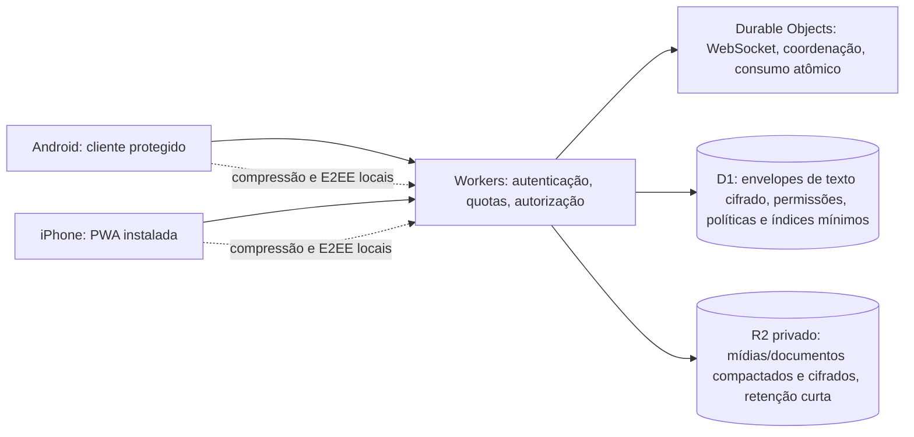
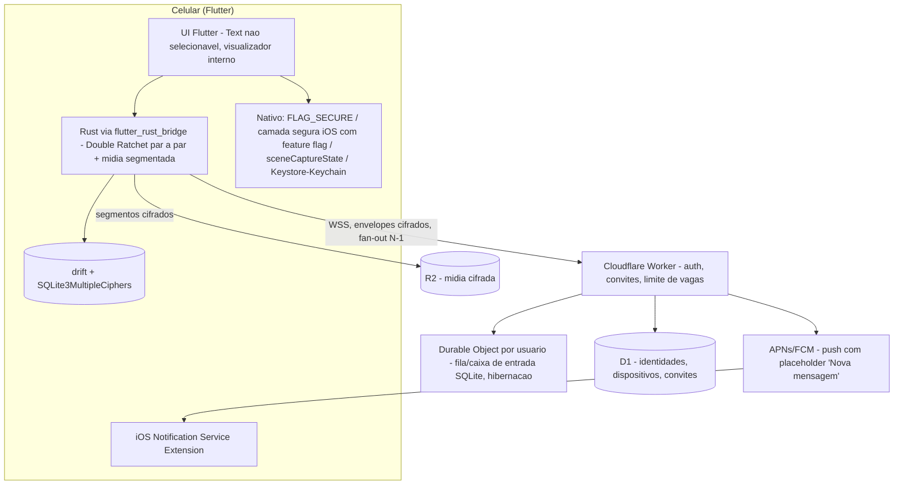
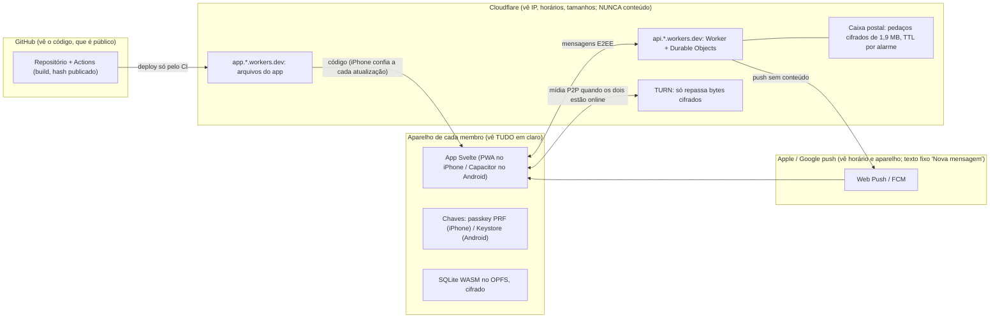
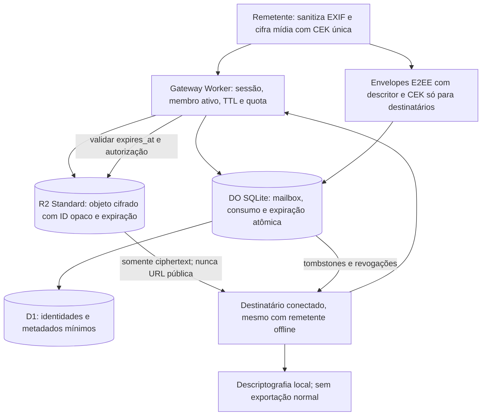

# Mensageiro Privado — Documento Mestre de Produto, Arquitetura e Segurança

> **VERSÃO:** 7.0 — 22/10/2026 (v6 + decisões da rodada de revisão com o proprietário e com o agente Hermes; ver §2.2)  
> **ESTADO:** PLANEJAMENTO / ESPECIFICAÇÃO. Nada foi implementado, hospedado ou testado.  
> **FONTE:** consolidação das decisões do proprietário nas conversas e dos documentos `PROJETO_MENSAGEIRO_PRIVADO_ARQUITETURA_v4.md`, `..._v5.md`, da revisão enviada pelo Claude e das pesquisas técnicas anteriores.  
> **REGRA DE PRECEDÊNCIA:** ESTE DOCUMENTO v7 é a fonte normativa vigente; a §2.2 prevalece sobre qualquer trecho em conflito. Documentos v1–v6, anexos e pareceres do Claude são históricos. Divergências devem ser registradas, nunca resolvidas silenciosamente por um implementador.  
> **ESCOPO:** círculo fechado de até **10 pessoas**, Android e iPhone, convites, conversas privadas e em grupos, mídias, documentos e stories; privacidade acima da conveniência, com objetivo operacional de R$ 0.  
> **EXCLUSÕES IMPORTANTES:** *Não há marca d'água, apelido do destinatário, data ou hora sobre mídias.* **Não ressuscitar esta proposta.** Nome e logo definitivos seguem pendentes.

## Sumário

1. Como trabalhar com este documento
2. Decisões vigentes e revisões expressas
3. Princípios, escopo e ameaças
4. Plataformas e distribuição
5. Identidade, convites e liderança
6. Autenticação, dispositivos e recuperação
7. Criptografia e gestão de chaves
8. Arquitetura Cloudflare A
9. Dados conceituais e minimização
10. Horário de Brasília e políticas de prazo
11. Envio e recebimento de mensagens
12. Exclusão para mim, para todos e por prazo
13. Usuários offline e garantias de expiração
14. Fotos, vídeos e áudios: limites e processamento
15. Visualização única por destinatário
16. Documentos: 20 MB, três globais
17. Editor, composição e controles de envio
18. Interface, grupos e personalização
19. Notificações e privacidade comportamental
20. Segurança de telas e mídias sensíveis
21. Fotos de perfil e fundos sem prazo automático
22. Stories e mídia para audiências escolhidas
23. Atualização de PWA e compatibilidade futura
24. Cotas e objetivo de custo zero
25. Máquinas de estado e fluxos críticos
26. Critérios de aceitação e plano de testes
27. Matriz de decisões ainda pendentes
28. Riscos conhecidos sem solução absoluta
29. Fontes de segurança e referências históricas
30. Prompt de continuidade e regras para outras IAs
31. Histórico de alterações v5 → v6
32. Arquivo histórico de pesquisas e pareceres (não normativo)

---

## 1. Como trabalhar com este documento

Status normativos:

- **[DECIDIDO]**: escolha aprovada pelo proprietário, vinculante para o planejamento.
- **[APROVADO COMO DIREÇÃO]**: recomendação técnica aprovada em princípio; implementação, bibliotecas e compatibilidade dependem de teste.
- **[PENDENTE]**: decisão, pesquisa ou prova de conceito não concluída.
- **[LIMITE]**: restrição real de sistemas, serviços ou modelo de ameaça.
- **[FORA DO MVP]**: ideia não exigida na primeira versão.
- **[HISTÓRICO]**: informação de versões anteriores que não altera o comportamento vigente.

Antes de programar: revisar o documento, transformar pendências P0 em decisões verificadas e atualizar um ADR (Architecture Decision Record) numerado, registrando motivo, alternativas, consequência, reversibilidade e testes. Não considerar uma decisão de produto equivalente a um componente já funcional.

### 1.1 Regra fundamental

**Privacidade > segurança operacional > conveniência/novos recursos**, com segurança criptográfica inegociável. Não introduzir rastreadores, analytics de terceiros, publicidade, SDKs de coleta ou dependências que enviem conteúdo ou metadados desnecessários. Evitar qualquer mecanismo para fiscalizar comportamentos dos membros.

**Não prometer anonimato absoluto, impedimento absoluto de print ou destruição retroativa de cópias já expostas.** O produto deve ser muito protetivo sem apresentar falsas garantias.

## 2. Decisões vigentes e revisões expressas

| ID v6 | Decisão vigente | Estado |
|---|---|---|
| V6-001 | Até **10 identidades humanas** ativas, sem cadastro público; acesso por convite descartável | [DECIDIDO] |
| V6-002 | **Uma conta ativa em um aparelho por vez**; revogar dispositivo anterior ao migrar | [DECIDIDO] |
| V6-003 | Sem exigência de telefone, e-mail, Google ou Apple ID como identidade de usuário | [DECIDIDO] |
| V6-004 | iPhone: **PWA instalada na Tela de Início**; Android: cliente protegido, empacotamento nativo como direção a validar | [DECIDIDO/PENDENTE no Android] |
| V6-005 | Não distribuir pela App Store nem pelo Google Play como produto convencional | [DECIDIDO] |
| V6-006 | **Arquitetura A**: Cloudflare Workers + Durable Objects + D1 + R2 Standard | [DECIDIDO como arquitetura-alvo] |
| V6-007 | D1 mantém envelopes de texto cifrados e metadados estritamente necessários; R2 guarda mídias e documentos **somente cifrados e temporários** | [DECIDIDO] |
| V6-008 | **E2EE obrigatória**; servidor/admin não possuem chaves de leitura do conteúdo | [DECIDIDO] |
| V6-009 | Prazo obrigatório para mensagens e mídias temporárias: **12 horas a 15 dias**, sem opção “Nunca”; padrão inicial **5 dias** | [DECIDIDO] |
| V6-010 | A líder define prazos **separados** de texto e mídia no grupo; mudanças só para envios futuros | [DECIDIDO] |
| V6-011 | Horário **sempre exibido em Brasília (`America/Sao_Paulo`)**; instante técnico armazenado em UTC | [DECIDIDO] |
| V6-012 | Conteúdo protegido exige **autorização online para abrir**; app falha fechado ao perder referência segura de prazo | [DECIDIDO] |
| V6-013 | Apagar **para mim** afeta só a pessoa; outros mantêm acesso até expiração ou exclusão para todos | [DECIDIDO] |
| V6-014 | Apagar **para todos** revoga acessos imediatamente no servidor e inicia limpeza local/remota, sem esperar TTL | [DECIDIDO] |
| V6-015 | **Visualização única por destinatário**; remetente não reabre; pessoas ainda pendentes mantêm o direito até abrir ou expirar | [DECIDIDO] |
| V6-016 | **Sem marca d'água**, sobreposição de apelido/ID do visualizador, data ou hora em mídia. Proposta anterior REVOGADA | [DECIDIDO] |
| V6-017 | Visualização única: **tocar para abrir a mídia inteira**, manter até fechar (X/voltar), ocultar ao perder foco/sair da tela; uma abertura autorizada | [DECIDIDO — atualizado por D6 do plano de 25/10/2026] |
| V6-018 | Vídeo no máximo **5 minutos**; áudio no máximo **1 hora**; fotos compactadas antes do envio | [DECIDIDO] |
| V6-019 | Documento genérico: até **20 MB por arquivo**, **três documentos ativos por remetente no app INTEIRO** | [DECIDIDO] |
| V6-020 | Quarto documento enviado **com sucesso** revoga o documento ativo mais antigo do remetente, em qualquer conversa, para todos | [DECIDIDO] |
| V6-021 | Notificações de mensagens: texto **exatamente `novas mensagens`**; sem remetente, grupo, contagem, prévia ou tipo de mídia no payload exibido | [DECIDIDO] |
| V6-022 | Sem online, visto por último, digitando ou recibos de leitura/entrega visíveis; mensagens apresentam apenas horário | [DECIDIDO] |
| V6-023 | Líder que sai é substituída pelo **integrante ativo mais antigo** (ordem verificável) | [DECIDIDO] |
| V6-024 | Foto de perfil, foto de grupo e fundo compartilhado não seguem TTL de mensagens; substituir ou apagar revoga anterior e remove cópias gerenciadas | [DECIDIDO] |
| V6-025 | Editor interno de fotos/vídeos, legenda cifrada, mensagens de áudio via microfone, anexos via clipe, botão `+`, emojis e menu `⋮` | [DECIDIDO] |
| V6-026 | Sem exportação, encaminhamento ou opção de salvar mídia recebida pelas funções normais do aplicativo | [DECIDIDO] |
| V6-027 | Novas versões devem preservar identidade, chaves compatíveis, políticas de expiração e integridade do banco local | [APROVADO COMO DIREÇÃO] |
| V6-028 | Recuperação de participação após perda do aparelho por **verificação de duas pessoas autorizadas**, sem restaurar histórico perdido | [APROVADO COMO DIREÇÃO] |
| V6-029 | Custo-alvo R$ 0; **análise detalhada de excedentes do R2 adiada para testes**, sem afirmar gasto zero garantido | [DECIDIDO] |
| V6-030 | **Nome, logo e identidade visual definitiva** ficam para depois; **paleta azul escuro do protótipo** continua como referência provisória | [DECIDIDO] |
| V6-031 | Chamada de voz/vídeo em tempo real está fora do MVP; gravação/envio de áudios integra o MVP | [DECIDIDO] |
| V6-032 | Visualização sensível sem marcações de vigilância; captura de tela continua sujeita aos limites reais dos sistemas | [DECIDIDO/LIMITE] |

### 2.2 Decisões da v7 (prevalecem sobre o restante em caso de conflito)

Origem: decisões explícitas do proprietário em 22/10/2026 e pontos negociados com o agente Hermes (revisão cruzada), aceitos pelo proprietário. O Hermes deixou de participar antes de concluir a revisão da defesa contra troca de código da PWA; esse ponto segue com a proposta do Claude (V7-017) e continua aberto para revisão.

| ID v7 | Decisão | Estado |
|---|---|---|
| V7-001 | **Código-fonte fechado.** Segurança vem da criptografia auditada, não do sigilo do código. Integridade verificável pelos membros via hash publicado de cada versão (V7-017) | [DECIDIDO] |
| V7-002 | Biblioteca-alvo: **vodozemac** (Apache-2.0) em WASM, Double Ratchet par a par com **fan-out por destinatário**, inclusive em grupos. **Não usar Megolm/sessão de grupo compartilhada**: fan-out favorece revogação e visto único. Condição: PoC aprovando bindings WASM e Android, vetores de teste e manutenção. libsignal (AGPL) só com parecer jurídico | [APROVADO COMO DIREÇÃO] |
| V7-003 | **Versão e algoritmo explícitos** em todo formato criptográfico desde o primeiro envelope, com **plano de migração pós-quântica** registrado | [DECIDIDO] |
| V7-004 | **Conversa 1:1:** quem iniciou é o **líder**; define apenas políticas **futuras** (prazos de texto e mídia); nunca estende TTL já aceito | [DECIDIDO] |
| V7-005 | **Ceder liderança** (1:1 e grupo): evento assinado e irreversível; quem cede perde o posto | [DECIDIDO] |
| V7-006 | **Busca por apelido** para iniciar conversa (ex.: "Lua"), só entre membros do círculo. A lista cifrada de membros fica **no aparelho** e a busca é **local, por prefixo**; o servidor nunca recebe o termo digitado. Apelido **único no círculo**, comparação normalizada (sem acento, minúsculas), resolve para `user_id`; **nunca** é identificador criptográfico; troca de apelido é evento assinado | [DECIDIDO] |
| V7-007 | **Apagar conversa** = só para quem apagou; o outro lado mantém tudo até o prazo, salvo "apagar para todos" | [DECIDIDO] |
| V7-008 | **Desfazer vínculo:** encerra a room, revoga pendências, descarta estado e chaves (sem reuso). Para o outro lado, a conversa antiga fica **somente leitura até vencer**. Nova conversa = **novo identificador**, e quem a inicia é o líder | [DECIDIDO] |
| V7-009 | **Editar mensagem** permitido enquanto ela existir. Evento assinado e versionado pelo autor; mostra **"*editado"** embaixo; preserva o `expires_at` original; a versão anterior é substituída e sua chave destruída no aparelho, **sem histórico visível de versões** (não se promete apagamento forense) | [DECIDIDO] — encerra P-20 quanto à edição |
| V7-010 | **Apagar para todos é exclusivo do autor**, em 1:1 e em grupo. A líder controla prazos futuros, membros, foto, fundo e pode encerrar o grupo, mas **nunca apaga conteúdo alheio** | [DECIDIDO] |
| V7-011 | **Gate online criptográfico** (P-24): segredo aleatório de liberação por mensagem e por destinatário, retido pelo servidor (nunca a CEK completa), entregue só dentro do prazo e destruído no vencimento. Protocolo **separado e versionado**, transportado pelo ratchet sem se misturar a ele. Não chamar de revogação contra cliente hostil: não impede cliente alterado de guardar o conteúdo após uma abertura válida. Continua **P0**, exigindo especificação formal, análise de falhas e concorrência e revisão criptográfica independente antes de virar código | [APROVADO COMO DIREÇÃO] |
| V7-012 | **Recuperação após perda do aparelho:** autorizam a administradora do círculo **e** um **guardião** escolhido antes pela pessoa; espera obrigatória de **24 h** com aviso a todos os membros e ao aparelho antigo, que pode cancelar se estiver online; a administradora pode **congelar** a conta na hora, mas nunca liberar antes das 24 h; ao final, aparelho novo, chaves novas, aviso aos contatos e histórico perdido | [APROVADO COMO DIREÇÃO] — detalha V6-028 e P-11 |
| V7-013 | **Uma instância ativa por aparelho:** trava local (Web Locks API); uma segunda aba ou janela mostra "o app já está aberto" | [DECIDIDO] |
| V7-014 | **Ordem do modelo de ameaça:** (1) servidor ou conta de hospedagem comprometidos, (2) celular roubado ou apreendido, (3) membro malicioso, (4) metadados. Quando segurança e disponibilidade colidem, o app **falha fechado** | [DECIDIDO] |
| V7-015 | **Troca de aparelho só por QR:** o aparelho novo mostra o QR e o antigo escaneia e confirma. **Nunca existe link** capaz de adicionar ou trocar aparelho (lição dos ataques a contas do Signal em 2025) | [DECIDIDO] |
| V7-016 | **Mídia recebida:** formatos restritos (JPEG/WebP para foto, MP4 H.264 para vídeo, Opus para áudio), sempre **recodificados no envio**; nada é decodificado antes do toque do destinatário; sem prévia de link (lição dos ataques zero-click por imagem de 2025) | [APROVADO COMO DIREÇÃO] |
| V7-017 | **Defesa da cadeia de atualização (P-03):** service worker fixa a versão e só atualiza com aceite, mostrando o código curto da versão; builds reproduzíveis; releases assinadas; hash publicado **fora da Cloudflare** (ex.: GitHub); CSP rígida e Trusted Types onde suportado; deploy **só pelo CI** com token curto via OIDC; **chave física** nas contas Cloudflare, GitHub e do domínio; branch protegida; logs imutáveis de deploy; política **anti-downgrade**. Projeto com **um** desenvolvedor humano: revisão por IA **não** conta como segunda aprovação | [APROVADO COMO DIREÇÃO] |
| V7-018 | **Metadados:** push só com "novas mensagens"; envelopes **preenchidos até tamanhos fixos** para não revelar o tamanho real; Worker sem log de IP; nenhum diretório de membros no servidor além do mínimo para roteamento | [APROVADO COMO DIREÇÃO] |
| V7-019 | **Desbloqueio:** passkey com extensão PRF liberando a chave do banco local + PIN do app com limite de tentativas; a biometria precisa **liberar uma chave**, nunca ser só um "sim/não" | [APROVADO COMO DIREÇÃO] — pendente de PoC (P-02) |
| V7-020 | **Android:** conta gratuita de **distribuição limitada** do Google (até 20 aparelhos registrados por QR); APK assinado com Capacitor e `FLAG_SECURE` em todas as telas | [APROVADO COMO DIREÇÃO] — pendente de PoC (P-06) |
| V7-021 | Reações, respostas e edições trafegam **dentro do envelope autenticado**; busca local só sobre conteúdo ainda válido, **sem índice de texto completo persistente** | [DECIDIDO] — ADR de formato pendente |
| V7-022 | Critérios de aceite passam a incluir testes de **cliente adulterado, PWA comprometida, servidor malicioso, corrida de abertura de visto único e migração durante revogação** | [DECIDIDO] |

**Referências de outros apps (resultado da revisão):** trazer do Signal o QR/número de segurança e a verificação explícita de troca de chave; do WhatsApp, notificação sem conteúdo e bloqueio local; do Telegram (chats secretos), o timer e a ausência de encaminhar; do Threema, identidade sem telefone; do SimpleX, a minimização de identificadores; do Wire, identidade por dispositivo e revogação. **Não trazer:** recibos e presença, telefone, backup em nuvem por padrão, E2EE opcional, protocolo próprio, Megolm, legal hold, telemetria, e redes onion como requisito do MVP (fica como P2, ver P-18). Instagram serve só de referência de UX de mídia efêmera.

**[LIMITE] novo:** a revisão criptográfica independente exigida por V7-011 e V7-002 normalmente custa dinheiro e colide com o pilar R$ 0. Decisão do proprietário pendente.

### 2.1 Decisões expressamente REVOGADAS

- Qualquer proposta de colocar **nome/apelido, identificador de pessoa, data, hora, texto de rastreamento ou marca d'água** sobre mídia de visualização única ou confidencial. O usuário revogou essas ideias por conflitarem com a política de privacidade.
- Opções antigas de **4 horas, 30 dias e “Nunca”** para mensagens/mídias temporárias. Vigem exclusivamente **12 horas a 15 dias**.
- Armazenamento de mídia **somente P2P** como requisito rígido. A caixa temporária cifrada R2 está aprovada para disponibilidade com o remetente offline.
- Exibição de plataforma/“nível de proteção” do contato na interface, recebimento de confirmações de leitura/entrega ou identificação de presença.
- Fotos/áudios em grupo apagados globalmente após a **primeira** pessoa abrir. A visualização única é individual; exclusão global só após todos os destinatários elegíveis consumirem ou após expiração.
- Uso de mensagens contendo identificação do remetente nas notificações.

---

## 3. Princípios, escopo e ameaças

Objetivo: conversas 1:1 e em grupo, mensagens de texto, áudio gravado, fotos, vídeos, documentos, status/stories, gerenciamento de grupos, perfis e fundos, sem exigência de dados civis para ingressar. Comunicação apenas entre dez identidades aprovadas.

Propriedades de segurança pretendidas:

1. **Conteúdo E2EE:** backend recebe somente envelopes e blobs cifrados; mensagens nunca legíveis no servidor.
2. **Autenticidade e anti-replay:** envelopes vinculados a identidade, conversa, política, versão e sequência.
3. **Forward secrecy / recuperação pós-comprometimento**, quando oferecidas pela construção criptográfica efetivamente selecionada.
4. **Minimização de metadados:** nada de telemetria, preview remoto de links, sincronização de agenda ou exposição do grafo social sem necessidade.
5. **Chaves e retenção:** chaves específicas por mídia, prazos obrigatórios e exclusões verificadas antes de apresentar conteúdo.
6. **Danos limitados:** um dispositivo perdido pode ser revogado; falha no servidor não deve entregar conteúdo legível a um atacante externo.

Ameaças: convites vazados, servidor malicioso/invadido, conta administrativa comprometida, membro legítimo malicioso, celular roubado, malware/root/jailbreak, navegador/PWA comprometido, provedor de nuvem, teclados terceiros, miniaturas, logs, crash dumps, backups, notificações e vazamento por API de arquivo.

**Limites:** destinatário que teve acesso ao plaintext pode copiá-lo por meio de client modificado, dispositivo comprometido ou foto externa. O programa não pode garantir que nunca haja divulgação de imagem íntima, principalmente no iPhone PWA. Tor e DuckDuckGo são referências a camadas distintas de privacidade, não garantias transferíveis automaticamente a um mensageiro.

---

## 4. Plataformas e distribuição

### iPhone

- **[DECIDIDO]** PWA instalável pela Tela de Início; Safari isolado do app instalado conforme comportamento de armazenamento da plataforma.
- Ao abrir URL fora da experiência instalada, orientar o usuário a abrir pelo ícone, sem duplicar login/identidade em armazenamento separado.
- Notificações via Web Push apenas quando suportado, com solicitação de permissão na interação apropriada.
- Não há API web que bloqueie de forma confiável screenshot comum. PWA não herda proteções nativas de um app Swift.
- Service workers não são tarefas residentes: sem garantia de execução ao expirar uma mensagem com PWA fechada.
- Armazenamento do navegador pode ser eliminado pelo SO ou pelo usuário. Persistência e migração precisam de testes reais.

### Android

- **[APROVADO COMO DIREÇÃO]** compartilhar a maior parte da interface web e empacotar com componente nativo (ex.: Capacitor), permitindo `FLAG_SECURE` em **todas** as telas do app e tratamento nativo do armazenamento quando necessário.
- APK assinado, atualizações verificáveis e distribuição privada compatível com exigências atuais do Android no Brasil. Canal exato pendente de validação.
- Testar todas as janelas: tela de chats, busca, grupos, contatos, perfis, configurações, visualizadores e apps recentes.

### Requisito de privacidade visual

Proteções devem cobrir **todo o aplicativo**, inclusive lista de grupos, foto de perfil, tela de convites e visualização de arquivos, e não só o chat aberto. A UI **não revela** se outro membro usa Android ou iPhone.

---

## 5. Identidade, convites e liderança

- Tela inicial, sem conta local: **“Tenho um convite”** e **“Já uso em outro celular”**. Não há cadastro público.
- Frase provisória aprovada para abertura: **“O único lugar verdadeiramente seguro para o pacto.”** Tratar como texto de marca sujeito a revisão editorial, sem usá-la como promessa jurídica de inviolabilidade.
- Link de instalação e token de ingresso são conceitos diferentes. Convite de uso único, expiração curta, alta entropia, consumido atomicamente e vinculado a vaga/autorização.
- Limite global de 10 identidades ativas, validação atômica contra cadastros concorrentes e reutilização de convite.
- Apelido pode ser alterado, sempre com **aviso autenticado de mudança de nome** aos contatos/grupos pertinentes, por exemplo: “Fantasma alterou seu nome para Eclipse”. Mudança não altera `user_id` ou identidade criptográfica.
- Nome/recado/foto de perfil devem ser compartilhados E2EE conforme viabilidade; perfil não deve ser indexado/publicado para fora do círculo.
- Verificação de contatos por QR/fingerprint. Trocas de chaves e migrações geram aviso de segurança sem revelar telefone/e-mail.
- Administradora do círculo gerencia convites e revogações; administradora/líder de cada grupo define seus prazos, foto, fundo e permissões, sem possuir chaves de conversas das quais não participa.
- Quando a líder sai, assume o **membro ainda ativo com data de ingresso mais antiga** no grupo. Resolver empates por sequência autenticada determinística. Eventos de sucessão devem ser validados pelo servidor e pelo protocolo de grupos; não confiar apenas em nome ou hora local.
- Caso a líder saia simultaneamente a expulsões ou perda de rede, resolver consistência e recuperação de estado antes de permitir comandos privilegiados.
- Em conversas individuais, políticas devem ser estáveis e não unilateralmente extensíveis; definir mecanismo exato de eleição/autorização na matriz de pendências.

---

## 6. Autenticação, dispositivos e recuperação

- Credencial de sessão baseada em prova criptográfica de posse da identidade/dispositivo, com desafios, tokens curtos e revogação.
- Proteção local: biometria **e** PIN próprio, não tratar “Face ID ou senha do sistema” como dois fatores independentes. **Viabilidade exata em PWA/passkeys PRF segue pendente de prova de conceito.**
- O sistema permite **somente um dispositivo autorizado por identidade**. A troca revoga sessões do antigo no servidor; se o antigo estiver offline, não se promete apagar nele dados na hora.
- **Migração com aparelho antigo:** novo exibe QR → antigo confirma com biometria/PIN → canal autenticado de transferência → usuário opta por **levar conversas** ou **começar do zero** → nova credencial → revogação antiga e atualização de chaves/fingerprints. Transferência do histórico não requer exportar chaves de hardware não exportáveis.
- **Perda do aparelho:** pedir ajuda à líder e confirmação por duas pessoas autorizadas, por canal independente, para autorizar um novo dispositivo. História criptográfica antiga não é recuperada por administrador.
- Mudança de membros e dispositivo obriga rotação apropriada de chaves de futuras comunicações.
- Definir tolerância a biometria ausente, passkey PRF indisponível, esquecimento de PIN e perda do armazenamento web. Não criar backdoor de recuperação.

---

## 7. Criptografia e gestão de chaves

**[DECIDIDO]** E2EE obrigatória para conteúdo, anexos, legenda, perfis privados, títulos/fundos quando tecnicamente viável. Proibido desenvolver um protocolo próprio ou combinar primitivas improvisadamente.

**[APROVADO COMO DIREÇÃO]** comparar implementação auditável de Double Ratchet com fan-out por destinatário, adequada a grupos de até 10, versus implementações maduras de MLS. Uma mesma implementação de sessão poderia transportar mensagens 1:1, eventos de grupos e distribuição de envelopes de chaves das mídias. A escolha exata, biblioteca, licença (AGPL/GPL/Apache/MIT), ponte WASM/Android e postura de atualização pós-quântica permanece **[PENDENTE]**.

Material criptográfico conceitual:

- Chave de identidade/assinatura e credencial do dispositivo.
- Prekeys/sessões/ratchet e suas versões.
- Chaves simétricas **aleatórias por mídia** (CEK), com nonce seguro e autenticação AEAD, incluindo segmento final verificado quando houver streaming.
- Envelopes de chave individuais para destinatários. O servidor pode deter ciphertext do envelope, nunca sua chave legível.
- Chave de cifragem local do banco distinta do PIN curto; usar derivação apropriada e proteção robusta do dispositivo/navegador.
- Versões explícitas de formato/algoritmos para evoluir sem downgrade.

Verificação de identidade por QR/fingerprint; nenhuma troca silenciosa de chave pública pelo servidor. Segredos não devem ser registrados em log, analytics, service worker caches, URL ou backup acessível ao provedor. Cuidados com XSS, CSP, Trusted Types se suportado e dependências web passam a ser **fronteiras criptográficas** na PWA.

**PENDÊNCIA CRÍTICA SOBRE ABERTURA ONLINE:** a exigência de internet para abrir mensagens de texto não fica criptograficamente assegurada apenas por uma verificação de interface ou backend se o destinatário já recebeu ciphertext **e** um estado de chave capaz de decifrá-lo localmente. Projetar e revisar um mecanismo de liberação autorizada de chaves/segredos por acesso, sem o servidor ver plaintext nem conseguir substituir identidades. Até isso ser validado, considerar a exigência como política de cliente honesto, não garantia contra cliente alterado.

**Crypto-erasure com honestidade:** destruir CEKs e envelopes utilizáveis reduz drasticamente recuperabilidade do ciphertext sob nosso controle, **desde que não existam cópias da chave**. Não afirmar “jamais recuperável” contra dados já extraídos/descriptografados, snapshots, aparelhos comprometidos ou backups fora do controle da aplicação.

---

## 8. Arquitetura Cloudflare A

**[DECIDIDO]** Cloudflare como arquitetura-alvo para disponibilidade quando o remetente estiver offline. Ainda não implantada nem validada.



- **D1:** envelopes de mensagens não entregues ou ainda existentes dentro da política de prazo, autorizações, índices opacos, estado de expiração/exclusão e referências. Evitar plaintext ou thumbnail legível. Limites de BLOB/linhas e Time Travel impõem atenção à retenção de versões do banco.
- **R2 privado:** fotos, vídeos, áudios, documentos e exceções persistentes de perfil/grupo, **sempre cifrados**. Mídias temporárias expiram; objetos de identidade visual persistem até substituição, exclusão de grupo/conta ou política específica.
- **Durable Objects:** sessão tempo real, bloqueios atômicos de “abrir uma vez”, fila/coordenação, reserva de quota, liderança e reconciliação de concorrência. Não escolher Durable Object SQLite como depósito principal de vídeos.
- **Workers:** autenticação, limitação de tráfego, autorização de upload e leitura, bloqueio preciso de expiração, exclusões prioritárias e operações administrativas.
- **Push:** somente sinal opaco/genericamente identificável, conteúdo exibido `novas mensagens`, sem remetente ou prévia.
- **Domínio/origem de PWA:** estável desde o ingresso inicial, com HTTPS e manifesto, estratégia de continuidade se precisar migrar de origem.

**Disponibilidade offline:** remetente conclui upload e pode desconectar. Destinatário autorizado, estando online, acessa o ciphertext no R2 e sua autorização/envelope E2EE. O serviço **não vê o conteúdo**.

**Não expor bucket público nem URL R2 reutilizável para “ver uma vez”**; acesso mediado por autorização de curta duração e controle de consumo. Se futuramente forem usadas URLs pré-assinadas, avaliá-las como credenciais bearer e testar rigorosamente concorrência e reutilização.

**Sem transcodificação no servidor**: a Cloudflare não recebe mídia legível, portanto toda normalização/compressão precisa acontecer no cliente.

---

## 9. Dados conceituais e minimização

Entidades lógicas do servidor, **não tabelas SQL aprovadas**:

| Entidade | Informação mínima | Privacidade |
|---|---|---|
| `identities` | `id`, estado, chave pública, timestamps essenciais | Sem nome real, telefone ou e-mail |
| `devices` | vínculo com identidade, chave pública de sessão, revogação | 1 ativo por identidade |
| `invites` | hash de token, escopo, vaga reservada, expiração, consumo | Token de convite nunca em claro no banco |
| `rooms` / `memberships` | IDs opacos, membros, papéis, sequência de ingresso | Nomes e descrições cifrados quando possível |
| `retention_policies` | versão, emissor autorizado, prazo, vigência, assinatura | Exige autenticidade |
| `message_envelopes` | destinatário, room opaco, ciphertext, expiração, estado | Não conter texto legível |
| `local_delete_marks` | tombstone individual protegido, escopo por identidade | Não afetar os outros membros |
| `global_tombstones` | revogação para todos, versão/ordem e horizonte mínimo | Executar antes de histórico pendente |
| `attachments` | ID opaco R2, tipo codificado, tamanho cifrado, expiração | Sem nome original/EXIF/miniatura em claro |
| `media_rights` | IDs do destinatário, pendente/consumido/revogado | **Não expor recibos de visualização no app** |
| `document_slots` | até 3 documentos ativos por autor no app inteiro | Transição atômica no 4º upload |
| `sessions` | identidade, dispositivo, validade e revogação | Tokens não registrados em claro |
| `security_events` | mínima trilha de ingressos/revogações | Prazo e autorização restritos |

**Dados locais:** banco cifrado e estado do ratchet, chaves, rascunhos temporários, arquivos cifrados acessíveis, marcações de exclusão individual e índices de pesquisa **somente de conteúdos válidos**. Evitar indexação permanente do texto legível.

O servidor poderá observar metadados necessários a roteamento (IP, tamanho, destinatários de fila, tempos técnicos). Não vender isso como “anonimato equivalente a Tor”. Minimizá-los; eventual roteamento Tor/relay de ocultação de IP permanece pendente.

---

## 10. Horário de Brasília e políticas de prazo

- Todo horário **mostrado** ao usuário é formatado em `America/Sao_Paulo` (horário de Brasília).
- Todo instante técnico é UTC e obtido/ancorado no servidor. Nunca usar a mudança manual do relógio do usuário para estender acesso.
- TTL = duração absoluta de **12 horas a 15 dias**, sem “Nunca”. Padrão inicial **5 dias**. Um “dia” equivale a 24 horas, não à chegada da próxima meia-noite.
- Expiração de cada mensagem = timestamp de aceite autenticado do servidor + TTL válido para aquela classe e grupo/conversa. Pode haver atraso de rede; não confiar na data declarada pelo remetente.
- Líder controla **prazos separados** para mensagem e mídia no grupo; mudanças são eventos autenticados com revisão monotônica, válidos apenas para envios seguintes. Nenhum membro pode estender TTL já definido.
- **Exceções deliberadas:** foto de perfil, foto de grupo e fundo compartilhado não expiram automaticamente, mas serão substituídos/apagados e removidos da conta quando aplicável; **não** são conversas/mídias temporárias comuns.
- Stories devem expirar por política própria dentro da filosofia de retenção; preset, visualizadores e eventuais relações com o TTL geral ainda pendentes.
- “Ao ver” não oferece retenção infinita: visto único é consumido individualmente e **também** possui prazo absoluto máximo definido.

### 10.1 Exemplo

Uma mensagem aceita às **10:00 de Brasília** com TTL de **12h** expira às **22:00 de Brasília**. A pessoa que alterar manualmente o relógio não ganha mais tempo, porque novas autorizações exigem confirmação segura do servidor.

---

## 11. Envio e recebimento de mensagens

1. Verificar sessão, identidade, versão do app e autorização na conversa.
2. Obter política vigente assinada; compor mensagem, responder/reagir/anexar quando aplicável.
3. Cliente cifra payload e metadados sensíveis no protocolo selecionado.
4. Worker valida, carimba instante de aceite, gera prazo autoritativo, persiste envelope cifrado e agenda/notifica destinatários sem divulgar conteúdo.
5. Cliente receptor estando online consulta primeiro expirações, revogações, políticas e tombstones; só depois autoriza a leitura e descriptografa.
6. UI mostra o conteúdo e apenas o horário de envio/aceite em Brasília. Não emitir presença, digitação, visto/entregue.
7. Falha de envio, duplicata/reenvio, latência, desconexão e retry devem preservar idempotência e ratchet. Nenhum reenvio cria mensagem com prazo “novo” indevidamente.

Texto armazenado no D1 é **somente ciphertext**, não histórico de plaintext. Mensagens de grupos podem exigir envelopes por destinatário, proporcional aos até nove receptores. A escolha do protocolo ainda será tecnicamente validada.

### 11.1 Rascunhos

Salvar rascunhos apenas no armazenamento local cifrado, sem sincronizar conteúdo de digitação. Expiração/limpeza do rascunho e bloqueio de notificações devem respeitar privacidade.

---

## 12. Exclusão para mim, para todos e por prazo

| Ação | Autoridade | Repercussão |
|---|---|---|
| **Apagar para mim** | Próprio usuário | Oculta/destrói dados sob seu controle e mantém tombstone individual. Outros participantes **continuam vendo** até seus prazos ou até exclusão para todos. Dados necessários às outras pessoas **não são apagados do D1/R2** por esta ação. |
| **Apagar para todos** | Autor ou outra autoridade expressamente definida | Revoga novas autorizações para **todos imediatamente**, envia tombstone autenticado, solicita exclusão local e inicia purga D1/R2, sem aguardar o prazo original. |
| **Expirar por TTL** | Política assinada/servidor | Revoga acesso no horário exato, limpa dados locais quando o app puder executar e elimina objetos/registros no backend. |
| **Apagar grupo** | Líder/autorizados | Encerra escrita, revoga os objetos do grupo, invalida futuros acessos e promove rekey onde pertinente. |

**Apagar para mim não encurta o prazo dos outros membros.** O servidor deve manter os envelopes/objetos que ainda tenham destinatários autorizados e não expirados, mesmo que o remetente tenha apagado localmente.

**Apagar para todos não é apenas esconder uma bolha.** A operação deve dar prioridade à invalidação da leitura, impedir novas entregas, remover envelopes cifrados e limpar o R2. Dispositivos offline recebem tombstones ao voltar, **antes** de qualquer renderização. Não afirmar que o código removeu instantaneamente bytes num aparelho desligado.

**D1 Time Travel / snapshots:** exclusão lógica em banco e R2 não equivale a eliminação física instantânea em todo estado histórico do provedor. Proteger conteúdo criptograficamente e minimizar chaves/retentores; escolher estratégia que não dependa de certeza forense sobre serviço de terceiros.

A interface poderá mostrar brevemente **“Esta mensagem expirou.”**, mas esse aviso não deve revelar conteúdo e poderá ser removido ao completar a sincronização, conforme padrão de UX.

---

## 13. Usuários offline e garantias de expiração

**[DECIDIDO como comportamento de produto]** Modo de segurança máxima: o destinatário pode ter envelopes cifrados localmente, mas **precisa de autorização online válida para abrir** mensagens e mídias protegidas. Não manter um modo normal que reexiba conteúdo antigo só porque a PWA estava offline. **[PENDENTE de desenho criptográfico]** A proteção contra cliente alterado requer não entregar antecipadamente chaves reutilizáveis que permitam decifrar o conteúdo offline.

- Se a internet cair ao tentar abrir conteúdo, falhar fechado (bloquear) em vez de assumir a validade do cache.
- Relógio do aparelho não é autoridade; usar tempo do servidor e verificações de versão/estado de autorização.
- `performance.now()` pode auxiliar no andamento da sessão, **mas não prova tempo decorrido em reinícios/longos períodos suspensos**.
- Se a PWA estiver fechada, nenhum código é garantido a executar no instante exato de expiração. Na retomada, o primeiro ato é validar autorização e vencimentos e ocultar antes de renderizar.
- A limpeza de dados locais pode ficar pendente até a próxima execução; não chamar isso de exclusão física instantânea no aparelho offline.
- O serviço expira o direito de acesso independentemente de o usuário estar online. A limpeza do D1/R2 ocorre por rotina + exclusão explícita; **filtro de autorização e TTL no acesso são a garantia de não entrega pelo servidor**, não o job de limpeza.
- Clientes alterados ou maliciosos podem preservar plaintext/chaves já obtidos. Não criar promessa de revogação universal retroativa.

**Consequência aceita:** quando totalmente offline, o usuário poderá ver lista/estrutura local mínima e tela de bloqueio, mas não abrir conteúdo confidencial que exija nova autorização. Este custo de conveniência foi aprovado.

---

## 14. Fotos, vídeos e áudios: limites e processamento

| Classe | Regra aprovada | Detalhe técnico |
|---|---|---|
| Foto | Qualquer resolução original selecionável, **compactação antes do envio** | Limite final operacional de bytes/memória pode ser imposto após testes sem inventar ausência de limites físicos |
| Vídeo | **Máximo 5 minutos** | Meta de conversão local 4K → até 1080p/30 fps, bitrate adaptativo e codec compatível; testar Safari/PWA real |
| Áudio | **Máximo 1 hora** | Microfone no chat; codificar/comprimir localmente em segmentos, com limites de memória e cancelamento |
| Legenda | Texto enviado junto de foto/vídeo | Criptografado; segue mesmo prazo/permissões do objeto associado |
| Thumbnail | Pequena e cifrada | Nunca em push, logs, campos legíveis do D1 ou URLs públicas |

**Fluxo:** capturar/escolher → editar/recortar/anotar → remover EXIF/GPS e outros metadados desnecessários → redimensionar/transcodificar **no aparelho** → confirmar limite de bytes → cifrar com CEK aleatória → upload de ciphertext ao R2 → distribuir envelopes E2EE e descritor de mídia.

- Não transcodificar na Cloudflare: E2EE impede o servidor de ver arquivo original.
- Evitar conversão inútil de vídeo já eficiente; preservar legibilidade de texto em fotos.
- Se a PWA no iPhone não conseguir transcodificar um 4K localmente com segurança, **não enviar original acima da cota/limite operacional**. Exibir erro simples, sem fallback de mídia legível a serviço de terceiros.
- Segmentar vídeo e áudio com autenticação por bloco e detecção de truncamento; não depender da extensão do arquivo para validação.
- Proteger arquivos importados de codecs maliciosos/arquivos excessivos. Processamento com limites de CPU/RAM e abortos seguros.
- O arquivo original escolhido na galeria **pode continuar existindo fora do app**, pertencendo ao próprio remetente. Nosso aplicativo não o elimina silenciosamente.

### 14.1 Microfone

Gravar pressionando o ícone, deslizar para cancelar, permitir travar gravação e reproduzir/descartar antes de enviar. Limite **1h**. Velocidades de reprodução 1×, 1,5× e 2× como recurso de UX aprovado em princípio. Nada de transcrição automática na nuvem.

---

## 15. Visualização única por destinatário

**Regra central aprovada:** quem enviou **não pode reabrir** o próprio visto único dentro do chat. Para cada destinatário elegível existe um direito de abertura independente. Um membro que já consumiu **perde seu acesso**; um membro que não viu continua podendo abrir enquanto não expirar. Quando todos os direitos elegíveis estiverem consumidos/revogados, o objeto R2 é eliminado, mesmo antes do TTL. Se TTL vencer primeiro, expira para todos.

**Interface aprovada (D6, 25/10/2026):** mídia em tamanho grande quase tela inteira, **tocar para abrir**, mantida até fechar por X/voltar e ocultada ao perder foco, sair da tela ou encerrar a sessão. Soltar o dedo não encerra a abertura. O primeiro pedido de abertura consome a autorização de uso único; falha de rede pode perder a visualização, sem repetição automática. A transição de interface não altera o consumo atômico no servidor nem cria recibos ao remetente.

**PROIBIDO NESTE PRODUTO:** marca d’água, sobreposição ou carimbo contendo apelido do destinatário, identificador, nome, data, hora ou texto de rastreabilidade. Essas técnicas foram recusadas pelo proprietário. Não adicionar nem como “proteção opcional padrão” sem nova autorização explícita.

Máquina de estados, **por destinatário**:

```
pending → reserved/opening → consumed
      ↘ revoked
      ↘ expired
```

Regras:

1. Remetente seleciona audiência no envio; lista de destinatários é **congelada** para o objeto. Integrante adicionado mais tarde não recebe acesso retroativo.
2. Servidor guarda **um único blob cifrado** no R2 e uma autorização por destinatário (não N blobs). Envelopes de chaves são cifrados para cada receptor.
3. O primeiro pedido de abertura é validado e consumido **atomicamente**, protegendo concorrência, duplo toque, retries e duas abas. Se a conexão falhar durante a abertura, a visualização pode ser perdida, como opção de segurança conservadora.
4. A chave utilizável não deve ser entregue antecipadamente a destinatários de “ver uma vez”. Uma vez entregue ao cliente autorizado, é impossível provar que não foi guardada por cliente malicioso.
5. Destinatário que consumiu não poderá reabrir no app, independentemente do estado dos demais.
6. Remetente não obtém botão para reabrir; prévia enquanto está editando/antes de enviar não equivale ao direito posterior.
7. Participante removido perde direito pendente e deixa de bloquear exclusão global; mudança de grupo envolve revogação e chave futura adequada.
8. Quando não sobra destinatário elegível pendente, revogar leitura R2 e eliminar ciphertext; quando o prazo absoluto vence, fazer o mesmo mesmo que haja pendências.
9. **Sem recibos de visualização no aplicativo.** Estado interno do servidor só serve à autorização/limpeza, não à vigilância de membros.
10. Não incluir preview legível na conversa, notificações ou busca; mídia aparece como item protegido até abertura.

**Limite real:** um destinatário autorizado ainda pode capturar conteúdo por cliente modificado, sistema comprometido ou câmera externa; iPhone PWA não consegue impedir screenshots comuns.

---

## 16. Documentos: 20 MB, três globais

**[DECIDIDO]** Cada pessoa pode manter **três documentos/arquivos genéricos ativos no aplicativo inteiro**. Não são três por grupo ou por conversa. O limite por arquivo é **20 MB**. Fotos, vídeos e áudios tratados como mídia não contam nessas três vagas.

- Registrar quota por **identidade/remetente**, global a todos os chats.
- Antes de enviar, validar tamanho, formato, presença de conteúdo ativo perigoso e possibilidade de visualização segura. Proibir execução automática de scripts/macros; não abrir em terceiros pelo fluxo normal.
- Upload cifrado concluído não deve criar mais de três direitos ativos por remetente. Se já existem três, o **quarto envio bem-sucedido** provoca revogação para todos do **documento ativo mais antigo** daquela pessoa, inclusive em outra conversa.
- Falha/cancelamento do quarto upload deixa os documentos antigos intactos.
- Fazer publicação do quarto e revogação do primeiro como transição lógica **atômica**, com idempotência e remoção física assíncrona segura; nunca apagar um arquivo antes de confirmar o novo.
- O documento revogado desaparece do app de todos, inclusive após reconexão, e seus envelopes/chaves controlados são invalidados. O servidor apaga objeto cifrado e referências, respeitando limitações reais de cópias previamente recebidas.
- **Apagar para mim** não diminui necessariamente a contagem global do documento se ele continuar ativo para outros. A quota mede documentos globalmente ativos, não apenas o que está visível no aparelho do autor.
- Prazo normal de 12h–15d também incide nos documentos ativos, salvo decisão futura explícita contrária. Expirar libera vaga.

**Casos críticos de teste:** quarto upload simultâneo em duas conversas, retries e queda de energia após upload antes da publicação, documento mais antigo já expirado, exclusão para todos e alteração de dispositivo durante a operação.

---

## 17. Editor, composição e controles de envio

Barra planejada:

```
[ + ] [ clipe ] [ Mensagem...                             ] [ emoji ] [ microfone ] [ enviar ]
```

- **`+`**: câmera/captura interna, seleção de foto, abertura de editor com cortar, girar, riscar/desenhar, escrever sobre foto, escolher cor, legenda abaixo e decidir visto único. Recurso de edição similar em vídeos quando compatível.
- **Clipe:** escolher foto, vídeo, documento ou outro arquivo permitido; tudo processado/compactado/validado localmente.
- **Emoji:** seletor de emojis sem bibliotecas externas rastreadoras.
- **Microfone:** gravar voz, cancelar/travar, até 1h.
- **Enviar:** só após validações; estado local otimista para desempenho, sem indicar “entregue” ao outro usuário.
- **Fotos/vídeos:** edição local; opções de visto único e legenda criptografada. A interface evita reexpor miniaturas sensíveis durante upload.
- **Responder, reagir, editar antes de enviar, copiar rascunho local, pesquisar mensagens ainda válidas** e organização de conversas; sem copiar/exportar o texto recebido como função normal.
- Mensagens de texto podem ter emojis. Prévia de URL externa automática, GIFs online e packs de stickers de terceiros **não** são padrão, pela exposição de IP e metadados.

**[PENDENTE]** Detalhar se “editar mensagem já enviada” fará parte do MVP; não presumir. Se entrar, alterações também devem ser assinadas, versionadas e não prorrogar o TTL original.

---

## 18. Interface, grupos e personalização

Telas-base já aprovadas como referência de produto:

1. Entrada por convite / migração, sem “criar conta”.
2. Bloqueio biométrico + PIN e proteção de conteúdo ao sair do app.
3. Lista de conversas e grupos, busca local de conteúdo válido, aba Status/Stories e Ajustes.
4. Chat 1:1 e de grupo; horário em Brasília em cada mensagem, sem status de presença/entrega.
5. Visualizador de foto/vídeo e modo visto único sem qualquer overlay identificador.
6. Gestão do grupo pela líder (participantes, prazos de texto/mídia, foto, fundo, apagar/encerrar).
7. Ajustes de perfil: foto, apelido, recado, senha, notificações, verificação QR, trocar celular.
8. Menu da conversa `⋮`: silenciar, buscar, fixar/arquivar, ver participantes, verificar identidade, apagar para mim, sair; menu da líder inclui políticas e personalização.
9. Seletor de emoji, câmera/editor e visualizador interno de anexo.

**Silenciar:** opções recomendadas aprovadas em princípio: 1 hora, 8 horas, 24 horas, 7 dias ou até reativar; **não altera TTL**, criptografia nem permissões.

**Funcionalidades comuns de UX aprovadas como direção:** rascunhos locais cifrados, respostas, reações, fixar/arquivar, busca local apenas no conteúdo vigente, cancelamento e retomada de upload, reprodução 1×/1,5×/2×, menções `@apelido`, bloqueio de membro e descrição/permissões do grupo. Afinar prioridades do MVP sem cortar proteções.

**Não incluir:** mostrar plataforma dos membros, online, digitando, “visto”, “entregue”, visto por último, contagem de visualizações individuais ou painéis de monitoramento comportamental.

### Paleta visual provisória do protótipo v4/v5

| Token | Valor |
|---|---|
| Fundo | `#0B1220` |
| Barras | `#0E1728` |
| Cartões | `#131D31` |
| Bolha recebida | `#172338` |
| Bolha enviada | `#1D3A63` |
| Texto | `#E8EEF8` |
| Secundário | `#93A1B8` |
| Destaque | `#6CB4FF` |
| Destrutivo | `#FF7A7A` |

**Nome, logo e ícones definitivos: [PENDENTE].** Fontes e ícones distribuídos localmente, sem Google Fonts/CDNs em tempo de execução. O nome visual pode mudar; a identidade técnica da PWA (origem, `manifest.id`) deve permanecer estável e versionada.

---

## 19. Notificações e privacidade comportamental

**Notificação de mensagem: texto visível EXATAMENTE:**

> novas mensagens

- Não revelar nome, apelido, grupo, contagem, texto, tipo de anexo, arquivo, miniatura ou hora de envio no corpo/payload exibido.
- Push é sinal para sincronização E2EE, não contém conteúdo em claro.
- Notificações em grupos silenciados devem ser suprimidas conforme configuração local/autorizada; recebimento e expiração funcionam normalmente.
- O SO ainda pode exibir ícone/nome do aplicativo e horário da notificação; não prometer esconder essas informações controladas pela plataforma.
- Proteger lista de conversas, badges, ícones, avatares, tela de bloqueio e snapshots: evitar metadados que contradigam a privacidade das notificações.
- Apple/Google/provedor de push podem observar metadados operacionais de envio; não incluir dados desnecessários em payload.

**Privacidade comportamental:** nenhum aviso de digitação, visualização, entrega ou última atividade. A líder não pode acessar dashboards de quem visualizou mídia, salvo estados técnicos mínimos indispensáveis a consumo interno de visto único.

---

## 20. Segurança de telas e mídias sensíveis

- **Android nativo/empacotado:** `FLAG_SECURE` em todo o conteúdo do aplicativo e proteção das telas recentes, inclusive lista de grupos, perfis, fotos, visualizadores e menu de configurações. Testar janelas modais e SDKs de terceiros.
- **iPhone PWA:** não existe bloqueio generalizado confiável de screenshots no navegador. Segurar para ver e ocultar ao perder foco reduzem exposição acidental, **não previnem print feito durante a visualização**.
- Sem botões de download/encaminhamento/exportação de conversa, sem compartilhamento para apps de terceiros nem clipboard de mensagens recebidas como função de produto.
- Evitar snapshots, miniaturas visíveis ao trocar de app, logs, nomes originais, EXIF, cache em claro, `localStorage` para segredos, prévias de mídia em notificações e backups legíveis.
- Editor/visualizadores de documento devem evitar renderização insegura e execução de conteúdo ativo.
- Medidas de acessibilidade precisam de revisão própria; não bloquear cegamente recursos assistivos que o usuário realmente utiliza.
- Nenhum requisito de carimbar conteúdo com identidade, data, hora ou “informação para identificar vazamentos”. A política explícita é **não sobrepor esses dados**.

**Advertência sem alarmismo:** mesmo implementando tudo corretamente, não é possível garantir que um destinatário legítimo nunca faça captura e compartilhe material íntimo. Não prometer segurança “absoluta” ou “nível Tor” sem definir e comprovar o modelo de ameaça.

---

## 21. Fotos de perfil e fundos sem prazo automático

Exceções aprovadas à retenção obrigatória de 12h–15d:

- Foto de perfil: controlada pela pessoa, disponível apenas a participantes autorizados, sem expiração automática enquanto atual.
- Foto de grupo: controlada pela líder, sem expiração enquanto atual.
- Fundo de conversa do grupo: única imagem compartilhada que todos os participantes autorizados veem; controlada pela líder, sem expiração enquanto atual.

Todos compactados, sanitizados, cifrados ponta a ponta onde possível e armazenados no R2 privado. Ao substituir, excluir conta/grupo ou revogar acesso, emitir atualização autenticada e impedir novos downloads da versão antiga, remover objetos e limpar caches/CEKs controláveis quando os clientes voltarem a funcionar.

**Não prometer exclusão instantânea de cópias antigas em celulares desligados ou conteúdo já capturado.** Não permitir que fotos antigas sobrevivam como “histórico de fundo” acessível a usuários por recurso normal do produto.

---

## 22. Stories e mídia para audiências escolhidas

- Stories/status existem no escopo e recebem E2EE, compactação, seleção de audiência entre pessoas autorizadas e prazo de expiração.
- Padrão de 24h é **candidato**; não foi estabelecido como nova regra definitiva em substituição a 12h–15d. Definir se líder controla prazos ou se stories têm TTL próprio.
- Histórico de quem visualizou stories e contagens de audiência não são padrão, pois violariam o objetivo de minimizar rastreamento comportamental. Questão de respostas/reações permanece em refinamento de UX.
- Excluir story antes do vencimento revoga acessos e inicia limpeza; audiência não deve ser ampliada depois de enviada sem operação explícita segura.
- Foto/vídeo dentro de status também deve obedecer limites de 5 min e compactação.

---

## 23. Atualização de PWA e compatibilidade futura

**Problema estrutural:** código JS/WASM entregue pela hospedagem possui acesso a operações do próprio cliente. Uma origem invadida ou atualização maliciosa pode comprometer E2EE. CSP, SRI, hashes e service worker reduzem risco, mas **não criam, por si só, uma raiz de confiança independente do servidor**.

### 23.1 Arquitetura de atualização aprovada como direção

1. Versionar interface, manifesto PWA, worker, API, banco, ratchet, protocolo de envelope, algoritmo de mídia, TTL e política de grupos.
2. Publicar builds reproduzíveis quando viável, com manifesto de release assinado e prova de proveniência; verificar confiança com âncora independente para não depender apenas do código servido pela mesma origem.
3. Preparar nova versão de assets **integralmente** antes de ativá-la; não misturar módulos criptográficos de duas versões numa sessão ativa.
4. Preservar sessões e banco: migrar transacionalmente, criar pontos de recuperação controlados e proteger chaves contra corrupção. Não fazer rollback que reintroduza formato vulnerável.
5. Suportar negociação de versões/protocolos entre clientes dentro de janela definida; rejeitar downgrade inseguro.
6. Em emergência, servidor pode bloquear versões inseguras de realizar operações novas, sem prometer apagamento de dados em dispositivo offline.
7. Testar Safari/PWA instalada em iOS real para perda de dados, atualização do service worker, reinstalação, “Tela de Início”, passkeys e rotas off-line.

### 23.2 Armazenamento local de PWA

- Banco criptografado local: SQLite/WASM/OPFS/IndexedDB conforme viabilidade do iOS testado; nenhuma escolha de pacote presumida final.
- Testar persistência real, quotas, comportamento após atualização do iOS e limpeza de dados pelo usuário/OS.
- Não derivar chave de banco exclusivamente de PIN curto; avaliar passkeys/WebAuthn PRF e suas limitações de suporte e semântica de fallback.
- Isolar versão da base de identidade/ratchet de versão da UI; migração parcial não deve permitir reabertura de conteúdo vencido ou troca silenciosa de chave.
- A origem HTTPS, `manifest.id` e identidade técnica devem estar definidas antes de convidar pessoas de verdade, mesmo que **nome e logo sejam escolhidos depois**.

### 23.3 Proteção de cadeia de suprimentos

Dependências travadas e verificadas, auditoria de vulnerabilidades, builds sem bibliotecas de telemetria, deploy com autenticação forte, políticas CSP, proteção contra XSS, revisões humanas e testes de replay/downgrade. Verificar se bibliotecas criptográficas em WASM podem manter/limpar segredos no ciclo de vida do browser e não presumir que RAM/GC são apagados com garantia.

---

## 24. Cotas e objetivo de custo zero

**Arquitetura A aprovada**; a avaliação financeira definitiva de R2, custos de ativação e possíveis excedentes **foi conscientemente adiada até testes**. Não abrir essa discussão de forma repetitiva sem motivo; manter o risco documentado de maneira objetiva.

- Objetivo: operação sem desembolso, dentro de franquias gratuitas quando possível, **sem promessa matemática de cobrança zero**.
- Cotas internas, reservas atômicas, estimativa de bytes comprimidos e limite de operações protegem o serviço; quando atingir limite interno, negar novo upload de forma segura.
- R2 adequado para blobs, D1 para mensagens/índices, Durable Objects para coordenação; não trocar prematuramente de provedor para tentar somar free tiers.
- Retenção curta (12h–15d; padrão 5d) reduz ocupação média mas não evita picos nem cargas concentradas.
- Testar limites reais de upload, streaming de 5 minutos, áudio de 1 hora e documentos de até 20 MB. Limitar processamento no dispositivo.
- O R2 é serviço com faturamento por consumo: uso acima da franquia pode gerar cobrança. O controle pelo código **não substitui** limite imposto pelo provedor. **Decisão de risco financeiro: pendente de testes futuros.**

Não inventar números de uso garantidos nem afirmar que 10 mil fotos/500 vídeos cabem em todos os cenários. Compressão, duração, bitrate e retenção mudam esses resultados.

---

## 25. Máquinas de estado e fluxos críticos

### 25.1 Envelopes de mensagem

`draft(local) → queued/encrypted → accepted(expires_at) → accessible → expired | deleted_for_all`

`deleted_for_me` é **projeção individual** paralela, não novo estado global. `expired` ou `deleted_for_all` nunca voltam a `accessible`.

### 25.2 Documento global

`uploading → uploaded_not_published → active → expired | evicted_on_fourth | deleted_for_all`

Falha de upload não muda as três vagas. Publicação do quarto é condicionada à revogação lógica atômica do mais antigo, com limpeza assíncrona e idempotência.

### 25.3 Mídia de visto único

`prepared → encrypted_uploaded → pending_for_each_recipient → opening/consumed_per_recipient → all_consumed_or_expired → purged`

Remoção de destinatário converte direito pendente em revogado; não concede novo direito a integrante posterior. Não há comprovante de visualização para o remetente.

### 25.4 Grupo

`created → active → leader_changed → active | closed/deleted`; sequência autenticada de liderança, membership e políticas de retenção.

### 25.5 Troca de aparelho

`old_active → authenticated_pairing → new_pending → atomically_new_active → old_revoked → rekey/warnings`; em perda, substituir pareamento por quórum de verificação e histórico vazio.

### 25.6 Falha e reconciliação

1. Validar versão/identidade/autorização.
2. Obter tempo confiável e política vigente.
3. Aplicar revogações, exclusões globais, tombstones individuais e expiração.
4. Destruir chaves/snapshots locais sob controle do cliente.
5. Autorizar acesso ao que ainda está vigente.
6. Só então renderizar as mensagens.

NUNCA renderizar primeiro e “corrigir depois”. Reprocessamento offline não pode ressuscitar mensagem expirada.

---

## 26. Critérios de aceitação e plano de testes

Nenhuma caixa abaixo implica testes realizados. São **portões futuros de aprovação**.

### A. Identidade e recuperação

- [ ] Convite usado ou vencido não abre conta; 11º usuário não entra em corrida de cadastro.
- [ ] Uma identidade não mantém duas sessões ativas.
- [ ] Troca por QR preserva ou não o histórico conforme escolha do usuário; atualiza identidade/ratchet com notificação.
- [ ] Perda do telefone exige procedimento com dois autorizados e não recupera segredos antigos indevidamente.
- [ ] Alterar apelido informa a mudança sem revelar email/telefone e sem trocar fingerprint silenciosamente.

### B. Criptografia e vazamentos

- [ ] Servidor/administrador não lê texto, foto, vídeo, áudio, documento, legenda ou miniatura.
- [ ] Auditoria ou revisão independente da implementação selecionada, licenças e uso da biblioteca.
- [ ] Nenhum segredo em logs, push, URLs, `localStorage`, backups legíveis e cache de service worker.
- [ ] Testes de servidor que substitui chave, replay, mensagens fora de ordem, rotação de grupo e downgrade.

### C. Expiração e exclusão

- [ ] TTL de **12h a 15d**, sem “Nunca”; Brasília na UI, UTC na persistência.
- [ ] Mensagem apagada **para mim** desaparece só para aquele usuário; demais participantes mantêm acesso até seu vencimento.
- [ ] Mensagem apagada **para todos** deixa de ser entregue no servidor, some da UI e não reaparece após sincronização.
- [ ] Aparelho offline não exibe conteúdo sem autorização válida ao retornar.
- [ ] PWA fechada não mostra nem flashes de conteúdo expirado na próxima abertura.
- [ ] D1/R2 limpam objetos vencidos; versionamento e Time Travel documentados.
- [ ] Fotos de perfil/grupo/fundo permanecem até troca/exclusão; versões antigas deixam de ser oferecidas.

### D. Visto único

- [ ] Autor não reabre visto único enviado; destinatário só consegue abertura autorizada uma vez.
- [ ] Depois de uma pessoa abrir, outras pendentes ainda conseguem abrir até vencer.
- [ ] Ao consumir todos direitos elegíveis, objeto é eliminado; expirou antes, elimina independentemente de abertura.
- [ ] Dois pedidos simultâneos do mesmo destinatário não liberam duas aberturas.
- [ ] Um membro removido não impede a limpeza global.
- [ ] **Sem marca d’água, nome, data, hora ou identificação sobreposta nas mídias.**

### E. Documentos e processamento

- [ ] 20 MB por documento; três documentos globais por pessoa.
- [ ] Quarto upload falho mantém os três anteriores; quarto concluído revoga apenas o ativo mais antigo da pessoa, mesmo em outra conversa.
- [ ] Arquivos perigosos não são executados; visualizador não faz exportação normal.
- [ ] Vídeos até 5min, áudio até 1h, fotos compactadas; conversão local 4K→1080p quando suportada e comportamento seguro ao falhar.
- [ ] EXIF/GPS e previews legíveis não vão para o servidor.

### F. Plataformas, UI e manutenção

- [ ] Android bloqueia capturas padrão em todas as telas e oculta conteúdo nos recentes conforme suporte.
- [ ] iPhone PWA informa limitação real de print ao especificar segurança; sem alegar bloqueio que inexiste.
- [ ] Notificação exibida tem apenas `novas mensagens`, sem nomes, grupo, miniaturas, tipos ou contagens.
- [ ] Sem online/visto/entrega/digitando; grupos, buscas e telas de perfil protegidos conforme plataforma.
- [ ] PWA atualiza sem perder chaves e sem misturar estados criptográficos de versões diferentes.
- [ ] Banco migra transacionalmente, com comportamento correto quando Safari fecha no meio da operação.
- [ ] Testes de bateria, memória, vídeo importado e armazenamento esgotado no iPhone real.

---

## 27. Matriz de decisões ainda pendentes

| ID | Prioridade | Questão realmente pendente | Direção atual / critério de decisão |
|---|---|---|---|
| P-01 | **P0** | Biblioteca/protocolo E2EE, licença, WASM e interoperabilidade Android | Direção: vodozemac + fan-out (V7-002, V7-003); falta a PoC |
| P-02 | **P0** | Biometria + PIN, derivação de segredo e persistência no **iPhone PWA** | PoC WebAuthn/passkey PRF com dispositivos reais e perda de armazenamento |
| P-03 | **P0** | Atualização autenticada da PWA e âncora confiável de código | Controles definidos em V7-017; falta PoC do service worker com versão fixada |
| P-04 | **P0** | Banco local PWA: SQLite WASM/IndexedDB/OPFS, backup de migração sem vazamento | Testes de quota, reinícios e iOS; não prometer retenção local absoluta |
| P-05 | **P0** | Fluxo técnico de liberação de CEK em visto único e autenticidade temporal | Servidor sem acesso à CEK, direito por destinatário e consumo atômico comprovado |
| P-24 | **P0** | Abertura online de TEXTO: evitar decriptação offline por clientes alterados | Direção aprovada em V7-011 (gate online criptográfico); falta especificação formal e revisão independente |
| P-06 | **P0** | Android empacotado, canal de distribuição e proteção global de tela | Prova em APK assinado real; regras brasileiras verificadas na implementação |
| P-07 | **P0** | Endereço/origem HTTPS e `manifest.id` antes do onboarding real | Identidade técnica imutável/migrável; **não** exige escolher marca visível agora |
| P-08 | **P1** | Duração da sessão de visualização única por toque (D6, 25/10/2026) | Definir após ensaio UX e segurança; sem marca d’água |
| P-09 | **P1** | Política de stories: TTL próprio, padrão, audiência, reações | Privacidade alta sem relatório de visualizadores |
| P-10 | ~~P1~~ | Líder/admin em chat 1:1 e poderes de alterar prazo | **RESOLVIDO na v7** (V7-004, V7-005) |
| P-11 | **P1** | Exceções para aparelhos sem biometria, PIN esquecido e recuperação de conta | Recuperação detalhada em V7-012; falta definir aparelho sem biometria e PIN esquecido |
| P-12 | **P1** | Formatos permitidos de documentos e restrição de renderização | Lista positiva de tipos seguros e não execução de macros/scripts |
| P-13 | **P1** | Limites de bytes finais para imagens e vídeos e bitrate específico | Medir conversão local na PWA iPhone/Android, custos/latência/RAM |
| P-14 | **P1** | Estratégia de cotas e ativação R2 sem cobrança surpresa | **Adiado deliberadamente aos testes**, sem excluir risco financeiro |
| P-15 | **P1** | Política de retenção de tombstones, logs técnicos e objetos órfãos | Mínimo necessário para impedir ressurgimento e prevenir vazamentos |
| P-16 | **P1** | Tratamento de relatórios de abuso/segurança sem enfraquecer E2EE | Denúncia explicitamente voluntária, sem servidor inspecionar mensagens |
| P-17 | **P1** | Limites de versões antigas e rollout de atualizações críticas | Compatibilidade definida; bloquear versões inseguras com migração segura |
| P-18 | **P2** | Roteamento de IP/metadata (Tor/relay/sem P2P direto) | Não prometer anonimato; comparar latência e suporte PWA/iPhone |
| P-19 | **P2** | Identidade visual definitiva, nome, logotipo e pacote de ícones | **Adiado pelo proprietário**; preservar paleta atual provisória |
| P-20 | **P2** | Chamadas e recursos extras | Edição **resolvida na v7** (V7-009); chamadas seguem fora do MVP |
| P-21 | **P2** | Grau de retenção do histórico de apelidos | Aviso obrigatório, mas histórico longo pode contrariar minimização |
| P-22 | **P2** | Comportamento exato de bloqueio de membro e menções em grupos | Sem métricas de atividade/presença |
| P-23 | **P2** | Migração da origem de hospedagem/fallback se free tier mudar | Não perder identidade técnica ou permitir código não autenticado |

**Não são mais pendências:** código fechado; líder do 1:1 é quem iniciou; ceder liderança; busca local por apelido; apagar conversa e desfazer vínculo; edição com "*editado"; apagar para todos só pelo autor; uma instância por aparelho; troca de aparelho só por QR; limite 10 pessoas; Android+iPhone; iPhone PWA; prazo 12h–15d; Brasília; R2 para mídia cifrada; remetente poder ficar offline; máximo 5min vídeo/1h áudio; três documentos globais de 20MB; excluir para mim/todos; visto único por destinatário; retirada de marcas d’água; notificações `novas mensagens`; liderança ao membro mais antigo; adiar nome/logo; arquitetura A; custo detalhado do R2 reservado a testes.

---

## 28. Riscos conhecidos sem solução absoluta

1. **Captura no iPhone PWA:** não há bloqueio confiável de screenshot. A proteção Android `FLAG_SECURE` não é equivalente no iPhone.
2. **Destinatário malicioso:** uma vez descriptografado, texto/mídia pode ser extraído; app não impede câmera externa.
3. **PWA e código remoto:** origem maliciosa ou XSS pode atacar material local e comportamento criptográfico.
4. **Dispositivo offline:** não executa limpeza física até reativação, embora servidor revogue acessos e cliente legítimo valide antes de exibir.
5. **Cópias anteriores de CEKs/plaintext:** crypto-shred não apaga material já copiado para fora do domínio de controle.
6. **D1 Time Travel/R2 e persistência de fornecedor:** apagar registros e objetos não equivale a destruir instantaneamente todas as réplicas/backups internos.
7. **Dados locais no navegador:** persistência não é garantida após limpeza ou problemas de armazenamento.
8. **Metadados:** E2EE não esconde por si só IP, horários de conexão, volume nem destinatários envolvidos em roteamento.
9. **Custo operacional:** R2 tem faturamento por uso além da franquia; revisão financeira está adiada por decisão consciente, não resolvida.
10. **Mídia de visualização única:** não é possível provar criptograficamente que a tela realmente foi vista, então consumo no começo da abertura pode desperdiçar uma visualização em falha de conexão.
11. **Disponibilidade do provedor:** interrupções da Cloudflare impedem validação online exigida pelo modo máximo; o app falha fechado em vez de liberar caches.
12. **Apps e bibliotecas de terceiros:** componentes de codec, emoji, fontes, edição de documentos e analytics podem introduzir vazamentos e devem passar por triagem.

---

## 29. Fontes de segurança e referências históricas

Essas referências servem à **pesquisa e validação de futuras implementações**, não afirmam que o software foi auditado ou executado. Confirmar versões, valores e regras no momento dos testes.

### Documentação primária por tema

- Android `FLAG_SECURE`: <https://developer.android.com/security/fraud-prevention/activities>
- Android verificação/distribuição: <https://developer.android.com/developer-verification/guides>
- Apple screenshot (notificação posterior): <https://developer.apple.com/documentation/uikit/uiapplication/userdidtakescreenshotnotification>
- Apple Developer Forums sobre limites do bloqueio: <https://developer.apple.com/forums/thread/824922>
- Apple Web Push: <https://developer.apple.com/documentation/usernotifications/sending-web-push-notifications-in-web-apps-and-browsers>
- WebKit sobre limites e armazenamento: <https://webkit.org/blog/14403/updates-to-storage-policy/>
- MDN: Service Worker API: <https://developer.mozilla.org/en-US/docs/Web/API/Service_Worker_API>
- MDN: `StorageManager.persist()`: <https://developer.mozilla.org/en-US/docs/Web/API/StorageManager/persist>
- MDN: Web App Manifest `id`: <https://developer.mozilla.org/en-US/docs/Web/Progressive_web_apps/Manifest/Reference/id>
- Signal Double Ratchet: <https://signal.org/docs/specifications/doubleratchet/>
- IETF RFC 9420 (MLS): <https://www.rfc-editor.org/rfc/rfc9420>
- Cloudflare Workers: <https://developers.cloudflare.com/workers/platform/pricing/>
- Cloudflare Durable Objects: <https://developers.cloudflare.com/durable-objects/>
- Cloudflare D1 (limites): <https://developers.cloudflare.com/d1/platform/limits/>
- Cloudflare R2 (preços): <https://developers.cloudflare.com/r2/pricing/>
- Cloudflare R2 lifecycle: <https://developers.cloudflare.com/r2/buckets/object-lifecycles/>
- Cloudflare D1 Time Travel: <https://developers.cloudflare.com/d1/platform/time-travel/>
- Cloudflare Cron Triggers: <https://developers.cloudflare.com/workers/configuration/cron-triggers/>
- Cloudflare Durable Object Alarms: <https://developers.cloudflare.com/durable-objects/api/alarms/>
- OWASP MASVS: <https://mas.owasp.org/MASVS/>
- OWASP File Upload Cheat Sheet: <https://cheatsheetseries.owasp.org/cheatsheets/File_Upload_Cheat_Sheet.html>
- SimpleX: <https://simplex.chat/>; <https://github.com/simplex-chat/simplex-chat>
- Tor Project: <https://support.torproject.org/>

### Pesquisa e linhagem documental

- **v1:** visão inicial Android/iPhone com E2EE, convites e controles de captura.
- **Claude, “Arquitetura mensageiro privado seguro.md”:** revisão de viabilidade, SimpleX, protocolos, licenças, distribuição e screenshots; opiniões e valores devem ser revalidados.
- **v3:** histórico da pesquisa aprofundada, mídias local-first, TTL, segurança, distribuição fora das lojas e limites da nuvem.
- **v4:** decisão da PWA no iPhone, layout azul escuro, 10 telas de protótipo, identidade local, visto único ao segurar e privacidade comportamental. **Sua antiga proposta de marca d’água é inválida pela v6.**
- **v5:** adoção de mailbox cifrada na Cloudflare, atualização robusta da PWA e versionamento, decisões financeiras provisórias. **Seus prazos antigos são inválidos pela v6.**
- **v6:** este documento único, que incorpora as aprovações posteriores (D1/R2, TTL 12h–15d, anexos 20MB/3 globais, exclusões, notificações e remoção de marcas d’água).

**A íntegra das pesquisas/pedidos originais permanece nos arquivos de referência da conversa. Este documento é a especificação vigente, não a transcrição das pesquisas.**

---

## 30. Prompt de continuidade e regras para outras IAs

> Estou planejando o **Mensageiro Privado** para até **10 pessoas**. O arquivo `PROJETO_MENSAGEIRO_PRIVADO_ARQUITETURA_v7.md` é a **única especificação normativa atual**; leia a §2.2 primeiro. Leia-o antes de sugerir arquitetura ou escrever código. As versões v1–v6 e pareceres do Claude e do Hermes são fontes históricas; prevalece a v7 em toda divergência. O projeto está **APENAS EM PLANEJAMENTO**: não implemente, não crie repo, não instale ferramentas, não provisione Cloudflare ou distribua app sem autorização explícita.
>
> Privacidade acima da conveniência. iPhone em PWA instalada; Android protegido e empacotamento nativo em validação. Uma identidade ativa por aparelho; entrada por convite sem telefone/e-mail; E2EE; grupos, stories, mensagens, fotos, vídeos, áudio e documentos. D1 contém somente mensagens cifradas/metadata mínima; R2 contém mídia/documentos cifrados e temporários; DO/Workers coordenam autorizações. Todo horário mostrado é **Brasília**; UTC técnico. Prazos obrigatórios **12 horas a 15 dias**, padrão 5 dias, sem “Nunca”. **Visualização única por destinatário**, por toque para abrir (D6, 25/10/2026): remetente não reabre; os outros ainda podem abrir até o vencimento; objeto eliminado quando todos os direitos acabam. **Não usar marca d’água nem sobrepor nome, apelido, ID, data, hora ou identificação da pessoa nas mídias.** Foto/vídeo/áudio compactados antes da cifra; vídeo até 5min; áudio até 1h. Documentos até 20 MB, **3 ativos por pessoa no aplicativo inteiro**, quarto upload bem-sucedido revoga o mais antigo para todos. “Apagar para mim” não apaga dos outros nem encurta TTL no D1; “apagar para todos” revoga imediatamente e inicia purga global. Mensagens protegidas exigem autorização online para abrir; ao retornar do offline aplicar exclusões/TTL antes de exibir. Notificações com texto **exatamente `novas mensagens`**, sem remetente/grupo/contagem. Sem visto/online/digitando/entregue. Líder que sai é substituída pelo membro ativo mais antigo. Foto de perfil/grupo/fundo persistentes até substituição ou exclusão, sem versões antigas acessíveis. Nome e logo ficam para depois. Arquitetura Cloudflare A aprovada; detalhamento de gasto zero no R2 adiado até testes.
>
> Nunca prometer bloqueio de screenshots na PWA do iPhone, eliminação forense absoluta, ausência total de metadados ou impossibilidade de vazamento por destinatário legítimo. Diferencie [DECIDIDO], [APROVADO COMO DIREÇÃO], [PENDENTE] e [LIMITE]. Ao propor mudanças, apresentar ADR, impacto no modelo de ameaças, compatibilidade futura, testes e migração. **Não reintroduzir marcas d’água, rastreamento de visualizadores ou prazos antigos.**

---

## 31. Histórico de alterações

### v6 → v7

| Área | Mudança |
|---|---|
| Código | Fechado (V7-001); vodozemac + fan-out como direção (V7-002); versão e migração pós-quântica (V7-003) |
| Conversa 1:1 | Líder é quem iniciou; ceder liderança; apagar conversa; desfazer vínculo (V7-004 a V7-008) |
| Busca | Por apelido, local e por prefixo, apelido único no círculo (V7-006) |
| Edição | Permitida com "*editado", sem mudar o prazo (V7-009) |
| Exclusão | Apagar para todos só pelo autor; líder não apaga conteúdo alheio (V7-010) |
| Segurança | Gate online criptográfico (V7-011), recuperação com guardião e 24 h (V7-012), uma instância (V7-013), ordem de ameaças (V7-014), troca só por QR (V7-015), mídia restrita (V7-016), cadeia de atualização (V7-017), metadados (V7-018), desbloqueio (V7-019) |
| Distribuição | Android por distribuição limitada gratuita (V7-020) |

### v5 → v6

| Área | Mudança |
|---|---|
| Prazo | Versões antigas 4h–30d revogadas; **12h–15d**, padrão 5d, sem “Nunca” |
| Horário | Brasília para todas as exibições, UTC para instantes internos |
| Armazenamento | Arquitetura **A** consolidada: D1 para texto cifrado e metadados, R2 para mídia cifrada, DO/Workers para coordenação |
| Offline | Autorizar online antes de exibir; não restaurar itens vencidos; falta de execução não significa deleção física instantânea |
| Mídia | Compactação obrigatória antes de cifrar; vídeo máx. 5min; áudio máx. 1h; imagem otimizada |
| Visto único | Estado **por destinatário**; remetente sem reabertura; exclusão quando todos consumiram ou TTL venceu |
| Sobreposição em fotos | **Removida integralmente** a proposta de marca d'água, nome/ID, data ou hora sobre mídia |
| Documentos | Máx. 20 MB; **três ativos por pessoa globalmente**; quarto concluído revoga mais antigo em qualquer grupo |
| Apagar para mim | Outros continuam vendo até TTL/exclusão para todos; nada de apagar D1 prematuramente |
| Apagar para todos | Revogação imediata e início de purga; tombstones para clientes offline |
| Notificações | Texto fixo exato **`novas mensagens`** sem metadados |
| UI | Microfone, clipe, botão +, edição de fotos/vídeos, emojis, silenciar, menu ⋮, foto/fundo de grupo |
| Perfil e grupo | Foto/fundo persistem até substituição/exclusão; retirar objeto antigo e chaves controláveis |
| Segurança | Proteger todas as telas no Android, limites honestos do iPhone PWA; sem falsas promessas para mídia íntima |
| Governança | Sucessão ao membro ativo mais antigo; nome/logo definitivos adiados |
| Operação | Custo zero permanece objetivo; avaliação detalhada de R2 reservada para testes |

**FIM DAS SEÇÕES NORMATIVAS DO DOCUMENTO MESTRE v7.0.**


---

## 32. Arquivo histórico de pesquisas e pareceres (NÃO NORMATIVO)

Este apêndice preserva as pesquisas de segurança, as análises do Claude e os estudos técnicos da v5 integralmente como **fontes históricas**. É importante não perder argumentos ou evidências, mas o conteúdo abaixo **não atualiza e não revoga** as decisões das seções 1–31 deste documento.

**Conflitos históricos já resolvidos:** propostas de marca d’água com identidade, data/hora ou monitoramento de viewers estão **REVOGADAS**; prazos 4h–30d e “Nunca” estão **REVOGADOS**; P2P obrigatório sem R2 está **REVOGADO**; iPhone será PWA; três documentos globais por pessoa; visualização única é independente por destinatário. Toda menção divergente abaixo é apenas uma citação antiga, NÃO orientação vigente.

### 32.1 Pesquisa aprofundada e parecer do Claude preservados da v5

### 42. APÊNDICE A — PESQUISA APROFUNDADA, REFERÊNCIA DE SEGURANÇA

> **Função do apêndice:** concentrar a pesquisa concluída sobre mídia privada máxima, com sua estrutura e conclusões, para que a equipe possa consultar e confrontar decisões. É uma **consolidação editorial integral dos temas e resultados disponíveis** da pesquisa de 22/10/2026, não um novo teste prático nem reprodução certificada de cada resultado externo. Consulte as URLs do §41 para fontes oficiais e a transcrição do Claude no Apêndice B para opiniões que exigem validação.

#### A.1 Resumo e recomendação da pesquisa

Fotos, vídeos e áudios são tratados como o conteúdo mais sensível. Recomendação **local-first/no-cloud-at-rest**: conteúdo nasce no telefone, é cifrado antes de sair, trafega cifrado e deve ficar apenas nos aparelhos dos participantes, salvo quando autorizada uma mailbox efêmera para entrega offline.

Um relay pode **encaminhar ciphertext temporariamente sem armazená-lo permanentemente**. Isso é diferente de salvar uma foto por dias no object storage. A pesquisa usa Briar (P2P/local e Mailbox), SimpleX (SMP/XFTP temporário), Tor (redução de metadados de IP) e Signal (mídia única) como referências independentes, sem atribuir a nenhum todos os requisitos do projeto.

#### A.2 Comparação de modelos de mídia

| Modo | Persistência externa | Segurança de conteúdo | Offline | Julgamento da pesquisa |
|---|---|---|---|---|
| Aparelho a aparelho | Nenhuma | E2EE, local | Não | Excelente quando ambos online, IP pode vazar |
| Relay em RAM | Nenhuma persistente | E2EE, menor exposição de IP dos peers | Não | Melhor base de modo máximo |
| Mailbox do grupo | Ciphertext temporário | E2EE, governança local | Sim, até TTL | Melhor compromisso com disponibilidade |
| Relay cifrado com TTL | Ciphertext externo curto | E2EE | Sim | Fallback sob concessão explícita |
| Object storage terceiro | Ciphertext externo | E2EE | Sim | Última opção; não é padrão |

**Conclusão:** 'sem nuvem' não é 'sem rede' e não significa anonimato. P2P direto pode mostrar IP entre membros; relays/Tor o escondem dos peers ao custo de latência, necessidade de infra e banda. RFC 8826/8828 e RFC 8656 são as referências de transporte. Onion services escondem localização do serviço quando corretamente implantados, mas não substituem E2EE do app.

#### A.3 Separação controle/mídia

- Plano de controle: convite, identidade, grupos, políticas, revogações, aviso genérico, fila de envelopes e tombstones.
- Plano de mídia: origem -> remoção de metadados -> chave própria -> cifragem -> transporte de ciphertext -> autenticação do destinatário -> reprodução privada.
- Backend não guarda CEK legível. Chaves são transmitidas dentro dos envelopes E2EE entre membros autorizados.
- Fotos e áudios compartilham os mesmos requisitos de não exportar, expirar e limpar buffers.

#### A.4 Expiração pelo líder

Política assinada e versionada, com número de revisão, grupo, tipo de mídia, TTL, regras de visualização única, tempo absoluto, abertura offline, watermark, cache e validade. A política não pode ser falsificada pelo servidor com mero campo editável. O app verifica assinatura/época e rejeita versões antigas.

Quatro casos: TTL absoluto desde o envio; TTL após primeira abertura com teto absoluto; view-once com uma abertura registrada por destinatário; stories com retenção curta definida pelo líder. 'Modo confidencial extremo' exige autorização online e não permite abrir offline.

**Atenção criptográfica:** se o destinatário já obteve CEK e ciphertext, não existe mecanismo de recuperá-los remotamente de cliente hostil. Um sistema de autorização online pode reduzir aberturas normais; não desfaz uma cópia vazada. Para não dar ao backend chaves legíveis, o segredo no instante da abertura deve vir de dispositivo/custodiante E2EE autorizado, ou ser derivado por um protocolo que impeça liberação prematura, sujeito a revisão.

#### A.5 Eliminação de chave e lixo temporário

Ordem lógica: revogar acesso, destruir CEK e envelopes no app conforme, encerrar player, remover thumbnails, previews, waveforms, frames e caches, remover blobs cifrados locais e no relay/mailbox, manter tombstone mínimo por prazo apropriado. NIST SP 800-88r2 respalda crypto erase conforme condições técnicas. Delete de sistema de arquivos não equivale a apagamento forense perfeito em flash.

#### A.6 Segurança local Android

Usar sandbox privado + cifragem própria, Android Keystore para proteger chaves de embrulho quando possível, bloquear compartilhamento via FileProvider/galeria, configurar e testar backup/deslocamento de dados entre aparelhos. Android 12+ exige examinar regras específicas de backup e device-to-device; não depender cegamente de apenas um atributo do manifesto.

#### A.7 Segurança local iPhone

Keychain com classe ThisDeviceOnly apropriada, acesso quando aparelho desbloqueado, file protection forte, exclusão explícita de backup, tela neutra em switcher, bloqueio automático. Proteção contra screenshot comum não tem API pública universal; sceneCaptureState pode reagir à gravação/espelhamento, com janela de corrida. Parar reprodução de áudio durante captura detectada.

#### A.8 Câmera privada e metadados

Preferir captura interna CameraX/AVFoundation sem arquivo claro na galeria e criptografia logo após aquisição. Ao importar arquivo existente, o original pode persistir no iCloud Photos/Google Photos e não será apagado pelo mensageiro. Remover GPS, EXIF, XMP, identificação de aparelho, nomes originais, horários de captura não necessários e outros identificadores de arquivo.

#### A.9 Captação e DRM

Não confiar em FairPlay ou Widevine como base do E2EE: são sistemas de DRM/licenças para mídia premium, com modelos de chaves e fornecedores específicos, complexidade operacional e possíveis custos/limites de elegibilidade. Estudar apenas se houver caso muito específico. Marca d'água do destinatário ajuda na responsabilização, mas pode ser editada/cortada e não impede foto de outro telefone.

#### A.10 Regras de segurança derivadas

- Não persistir mídia em nuvem de terceiros por padrão.
- Não oferecer exportação, download, encaminhar ou abrir em app externo.
- Não mostrar thumbnails legíveis fora da sessão confidencial.
- Relay nunca tem chaves privadas de usuários ou CEK em claro.
- Separar anonimato de rede de sigilo do conteúdo.
- Recusar abertura extrema offline e sem autenticação válida.
- Dar ao líder TTL autenticado, mas não poderes de leitura nem promessa de apagamento absoluto.
- Tratar push/APNs/FCM, logs, backups e imagens no multitarefa como superfícies de vazamento.
- Testar perda/roubo de aparelho, rotação de chave, revogação e eventos fora de ordem.
- Não criar protocolo criptográfico proprietário.

#### A.11 Questões adicionadas pela revisão de engenharia

A revisão do Claude foi útil por chamar atenção à multiplicação de stacks (Flutter, Kotlin, Swift, Rust, TypeScript), risco de integração de bibliotecas, diferença entre licença livre/permissiva, possível simplificação para fan-out em grupos pequenos, limitação do iPhone e distribuição. As conclusões de custo fixo de agência e todas as versões exatas de pacotes apresentadas por terceiros são **alegações contextualizadas**, não requisitos ou fatos arquiteturais. Neste projeto a exigência de R$ 0 impede aceitar de imediato a sugestão de VPS pago ou assinatura Ad Hoc.

#### A.12 Fontes originais da pesquisa

- https://briarproject.org/ e https://www.briarproject.org/mailbox/
- https://simplex.chat/docs/xftp-server.html
- https://www.rfc-editor.org/rfc/rfc8826.html
- https://www.rfc-editor.org/rfc/rfc8828.html
- https://www.rfc-editor.org/rfc/rfc8656.html
- https://community.torproject.org/onion-services/overview/
- https://support.signal.org/hc/en-us/articles/360038443071-View-Once-Media
- https://www.nist.gov/news-events/news/2025/09/guidelines-media-sanitization-nist-publishes-sp-800-88r2
- https://developer.android.com/training/data-storage
- https://developer.apple.com/documentation/security/ksecattraccessiblewhenunlockedthisdeviceonly
- https://mas.owasp.org/MASVS/
- https://developer.android.com/reference/kotlin/androidx/camera/core/ImageCapture
- https://developer.apple.com/documentation/avfoundation/avcapturephoto
- https://developers.google.com/widevine/drm/overview
- https://developer.apple.com/streaming/fps/

**Observação editorial:** este apêndice cobre integralmente o conteúdo temático do relatório de pesquisa de mídia exposto na conversa. O projeto não recebeu um arquivo original verificável contendo todas as etapas e citações brutas da execução; portanto, NÃO declarar isto uma transcrição literal dos registros internos da pesquisa nem uma auditoria independente. O relatório apresentado pela pesquisa permanece a fonte completa de consulta; este Markdown fornece um campo de referência durável e utilizável para decisões futuras.

---

### 43. APÊNDICE B — PARECER ORIGINAL DO CLAUDE (ARQUIVO FORNECIDO PELO USUÁRIO)

> **Arquivo-fonte:** `Arquitetura mensageiro privado seguro.md` (anexo do usuário, preservado abaixo **integralmente** como documento de referência).
> **Natureza:** análise de terceiro. Seus números de mercado, inferências de licenças, rankings de segurança, comportamento de apps e propostas de arquitetura **não são decisões do projeto automaticamente**. Qualquer recomendação que conflitasse com as decisões posteriores (10 membros, no-cloud-at-rest, custo R$ 0, sem lojas) foi marcada como proposta histórica, não norma vigente.

## Projeto acerta os limites, mas subestima o esforço

**Veredito curto:** o documento é melhor que a maioria dos planos de mensageiro "ultra privado" que circulam por aí. Ele não promete o impossível, separa o que foi decidido do que ainda é hipótese e tem um modelo de ameaças honesto (§1.2, §13, §16, §25). O ponto fraco não está na segurança. Está na **viabilidade**: o plano pede para construir, a partir do zero, criptografia ponta a ponta, dois apps nativos (com Flutter + Kotlin + Swift), um backend em tempo real e um protocolo de grupo. Uma agência profissional cobra entre **US$ 60 e 110 mil e 14 a 20 semanas** só por um mensageiro com Signal Protocol, sem contar auditoria ([RaftLabs](https://www.raftlabs.com/blog/cost-to-build-app-like-whatsapp)). Sobre o pedido central, a resposta é direta: **não existe como garantir que uma conversa "nunca saia do app"**. No Android dá para bloquear print de verdade. No iPhone, a Apple confirmou em 2026 que **não há API pública para impedir screenshots** ([Apple Developer Forums](https://developer.apple.com/forums/thread/824922)). Os bancos usam um truque não documentado, e qualquer pessoa pode fotografar a tela com outro celular. O documento já diz isso no §1.2 e no §25, e deve continuar dizendo. A minha recomendação é dividir o projeto em fases: usar já o SimpleX com servidores próprios (zero código, cripto auditada), e só depois construir o app próprio, com escopo reduzido e decisões mais simples do que as atuais D-018 e D-020.

### O documento é forte onde a maioria falha e fraco onde a maioria tropeça

O que está bom e deve ficar como está: a separação entre nome visível e identidade criptográfica (§4.1); a regra de que admin não tem chave de conteúdo (§3.1, D-016); a ordem "aplicar revogações e tombstones antes de renderizar" na sincronização offline (§10.2); o consumo atômico no servidor para visualização única (§11.4); a tabela de ataques por plataforma (§13.3); e o fato de o §7.4 tratar a troca maliciosa de chave pública pelo servidor como requisito de segurança, não como enfeite. Tudo isso mostra maturidade.

O problema é a soma das partes. Na prática, o §8.1 descreve **cinco linguagens e ambientes**: Dart (Flutter), Kotlin, Swift, uma linguagem para o módulo criptográfico (Rust, se você usar as bibliotecas boas) e TypeScript/JavaScript nos Workers. Para quem ainda está aprendendo a programar, cada uma dessas camadas é um projeto por si só. E a camada mais perigosa de errar é justamente a de criptografia. Equipes profissionais erraram ali: a ETH Zurich achou **7 vulnerabilidades** nos protocolos próprios do Threema ([The Register](https://www.theregister.com/2023/01/11/swiss_army_threema_bugs/)), pesquisadores acharam **5 no Matrix, 2 críticas**, que deixavam um servidor malicioso se passar por usuários ([The Register](https://www.theregister.com/2022/09/28/matrix_encryption_flaws/)), e o MTProto do Telegram também teve falhas ([PortSwigger](https://portswigger.net/daily-swig/multiple-encryption-flaws-uncovered-in-telegram-messaging-protocol)). O §7.2 acerta ao proibir "criptografia caseira". Só que **juntar corretamente bibliotecas auditadas** (persistir o estado do ratchet antes de enviar, serializar chamadas, não resetar sessão a cada erro) também é onde os bugs acontecem. O próprio wrapper Dart da libsignal avisa isso ([pub.dev libsignal](https://pub.dev/documentation/libsignal)).

#### Inconsistências que precisam ser corrigidas

| Onde | Problema | Correção sugerida |
|---|---|---|
| D-002, §1, §3.2, RF-004, §11.5, §21, §27 | Agora você fala em **10 a 15 pessoas**, e o documento inteiro diz 10 ("entre os dez", "10ª vaga") | Revisar a D-002 com um número fixo (ex.: 15) e deixá-lo configurável no servidor. Isso também afeta os limites de distribuição (ver adiante) |
| D-020 | Pede **dois protocolos** (ratchet no 1:1 e MLS nos grupos). Para ≤15 pessoas, isso dobra a complexidade sem ganho real | Usar um único protocolo (ver seção de criptografia) |
| §7.2 | Cita a família Signal sem mencionar que a libsignal é **AGPL-3.0** | Criar um ADR de licença: app aberto ou fechado |
| §13.2 | Diz "não basear segurança em hacks de `secureTextEntry`", mas o objetivo 8 (§1.1) e o seu pedido querem o bloqueio "como os bancos fazem" | Reescrever: usar como camada de melhor esforço, nunca como garantia (detalhes na próxima seção) |
| §16.3 vs §17 | Play Integrity exige que o app tenha sido **instalado pela Play Store**; o §17 ainda considera "distribuição privada" | Amarrar uma decisão à outra |
| §17 Android | Não menciona a **verificação de desenvolvedor obrigatória no Brasil desde 30/09/2026** | Incluir |
| §17 iOS | Não cita **Ad Hoc**, justamente o caminho que a Apple indica para "família e amigos" | Incluir |
| RF-023 e D-008 | Áudio está como "planejado", mas o seu pedido inclui não permitir baixar áudios | Tratar áudio com as mesmas regras de mídia do §11 e incluir pausa durante gravação de tela |
| D-019 | Cloudflare está como [PROPOSTO] e o §23 diz para "não declarar que será gratuito" | A escolha é boa e o plano gratuito sobra para 15 pessoas; pode virar [DECIDIDO] após a prova de conceito |

### Como os bancos bloqueiam print no iPhone (e por que isso não é garantia)

**Não existe API oficial para bloquear screenshot no iOS.** Em abril de 2026 o suporte técnico da Apple (DTS) escreveu literalmente "There are no public APIs for preventing screenshots" ([Apple Developer Forums 824922](https://developer.apple.com/forums/thread/824922)), e repetiu em julho de 2026 ([thread 838583](https://developer.apple.com/forums/thread/838583)). Nenhuma WWDC até 2026 mudou isso. O que os bancos fazem é explorar um efeito colateral.

#### O truque do campo de senha, explicado sem código

Quando você digita uma senha num iPhone, o campo de texto com `isSecureTextEntry = true` (a propriedade que transforma o texto em bolinhas) é desenhado numa camada interna especial que o sistema **exclui de prints e gravações**, para a senha não vazar. O truque é criar um desses campos invisíveis e "pendurar" a tela inteira do app dentro dessa camada interna. Como o iOS exclui aquela camada da captura, o print sai preto ou mostra o que estiver por trás ([Medium](https://medium.com/@thakurneeshu280/screenshot-prevention-in-ios-advanced-techniques-inspired-by-banking-authenticator-apps-0d1900c2a1bb); [HackerNoon](https://hackernoon.com/lang/cs/i-hid-a-watermark-in-screenshots-and-ios-thought-it-was-a-password)). Existem até SDKs comerciais que vendem isso, como o ScreenShieldKit ([ScreenShieldKit](https://screenshieldkit.com/)).

Os riscos são concretos. Primeiro, a Apple diz que esse comportamento "may change in any system update without notice" e que usá-lo assim está "outside its intended purpose and is not recommended" ([thread 824922](https://developer.apple.com/forums/thread/824922); [thread 838583](https://developer.apple.com/forums/thread/838583)). Segundo, há o risco de revisão: a **Guideline 2.5.1** exige usar APIs "para o propósito pretendido". Não encontrei nenhum caso público de rejeição, e bancos, WhatsApp e Telegram aparentemente usam a técnica, mas a Apple diz que "não consegue prever" a decisão da revisão. Terceiro, há bugs reais: um desenvolvedor relatou app travando ao voltar de tela protegida, tela preta em transições e vazamento de memória ([thread 838583](https://developer.apple.com/forums/thread/838583)). Outro descobriu que vários campos seguros escondidos num chat fizeram **o teclado tratar a caixa de mensagem como campo de senha**, com autocorreção travada e a barra "Senha Forte" aparecendo ([HackerNoon](https://hackernoon.com/lang/cs/i-hid-a-watermark-in-screenshots-and-ios-thought-it-was-a-password)). Para um app de conversa, esse último ponto é o mais grave.

#### O que a Apple oferece oficialmente: só detecção

Todas as APIs oficiais **avisam depois ou reagem**, nenhuma impede. A `userDidTakeScreenshotNotification` dispara **depois** que o print já foi salvo: serve para avisar o remetente, não para apagar o print ([thread 824922](https://developer.apple.com/forums/thread/824922)). O `sceneCaptureState` (iOS 17+), que substitui o antigo `UIScreen.isCaptured`, informa quando a tela está sendo **gravada, espelhada (AirPlay) ou controlada remotamente**, sem diferenciar entre essas situações ([Apple docs](https://developer.apple.com/documentation/uikit/uitraitcollection/scenecapturestate.md)). Com ele dá para esconder o conteúdo durante a gravação, mas existe uma janela de corrida: o que estava na tela no instante em que a gravação começou pode já ter sido gravado. Ele também só funciona em apps com ciclo de vida baseado em cenas (`UISceneDelegate`) ([thread 762744](https://developer.apple.com/forums/thread/762744)). A própria Apple publicou em 2026 um guia que recomenda exatamente esse padrão: detectar, ocultar, mostrar um aviso neutro e desativar ações de risco ([Apple docs](https://developer.apple.com/documentation/swiftui/protecting-sensitive-content-when-screen-sharing.md)). O FairPlay, citado no §13.2, deixa preto apenas vídeo protegido por DRM e **continua capturando o áudio** ([Apple docs isCaptured](https://developer.apple.com/documentation/uikit/uiscreen/iscaptured.md)). Ele também exige um servidor de chaves da Apple, o que conflita com E2EE. O documento está certo em descartá-lo.

Um detalhe que falta no documento: como a gravação de tela captura áudio, o player de mensagens de voz deve **pausar quando `sceneCaptureState` indicar captura**. O mesmo vale para o áudio de vídeos.

#### Flutter, WhatsApp e Telegram

No Flutter, os pacotes `screen_protector` (v1.5.3, jul/2026) e `no_screenshot` (v2.0.1) usam `FLAG_SECURE` no Android, que é um bloqueio real. No iOS combinam o truque do campo seguro, a detecção e a capa no seletor de apps ([pub.dev screen_protector](https://pub.dev/packages/screen_protector); [pub.dev no_screenshot](https://pub.dev/packages/no_screenshot)). O `no_screenshot` avisa que, se você tiver um scene delegate próprio, ele precisa herdar de `FlutterSceneDelegate`. O `flutter_windowmanager` só funciona no Android e está parado desde 2021 ([pub.dev](https://pub.dev/packages/flutter_windowmanager)). As versões 1.4.4 a 1.4.13 do `screen_protector` podiam travar em alguns aparelhos, então fixe a versão e teste.

Os grandes apps batem no mesmo limite. O Telegram, em chats secretos no iPhone, gera **print preto e avisa o outro lado**; no Android, bloqueia ([AirDroid, jul/2026](https://www.airdroid.com/app-tips/does-telegram-notify-screenshot/)). O WhatsApp, na visualização única, mostrava no iPhone uma tela "Screenshot Blocked" no lugar da mídia (fonte de 2022, comportamento atual não reverificado) ([Lowyat](https://lowyat.net/2022/290698/whatsapp-view-once-screenshot-blocking)). O Signal, no iOS, apenas esconde a prévia no seletor de apps e admite que isso "does not prevent someone else from taking a screenshot on their device" ([Signal Support](https://support.signal.org/hc/en-us/articles/360043469312-Screen-Security)). O comportamento do WhatsApp e do Telegram é compatível com o mesmo truque dos bancos.

#### Recomendação para o §13.2

Use uma defesa em camadas e **nunca prometa bloqueio no iPhone**. (1) Truque do campo seguro como **camada de melhor esforço**, isolada num módulo Swift próprio e ligada por uma **feature flag remota** (um interruptor no servidor que desliga o recurso sem precisar publicar versão nova), para você conseguir desligar no dia em que um iOS novo quebrar o app. Aplique primeiro no visualizador de mídia e de visualização única, onde não há teclado, e só estenda para a tela de conversa depois de testar o problema do teclado. (2) `sceneCaptureState` para ocultar conteúdo e pausar áudio durante gravação ou espelhamento. (3) `userDidTakeScreenshotNotification` para avisar o remetente ("Fulano tirou print"), com texto que deixe claro que o print **não foi bloqueado**. (4) Capa no seletor de apps. (5) **Marca d'água com o apelido do destinatário** sobre mídia sensível: é a única coisa que desestimula a foto com outro celular, porque deixa a origem do vazamento identificável. (6) Testar em todo beta do iOS. A frase atual do §13.2 vira: "o truque de `secureTextEntry` pode ser usado como camada adicional desligável remotamente; nenhuma promessa ao usuário depende dele".

#### Copiar e colar: dá para fechar quase tudo dentro do app

No Flutter, renderize mensagens com `Text` comum (nunca `SelectableText` ou `SelectionArea`) e use `enableInteractiveSelection: false` onde houver campo de texto, o que esconde o menu de copiar e desativa os atalhos ([Flutter API](https://api.flutter.dev/flutter/material/TextField/enableInteractiveSelection.html)). Se algum dia permitir copiar, grave na área de transferência por código nativo com `localOnly` (não vai para Mac ou iPad via Handoff) e `expirationDate` ([Apple docs](https://developer.apple.com/documentation/uikit/uipasteboard/optionskey.md); [OWASP MASTG-TEST-0280](https://mas.owasp.org/MASTG/tests/ios/MASVS-PLATFORM/MASTG-TEST-0280/)). O `Clipboard.setData` padrão do Flutter não faz isso. Duas saídas continuam abertas e precisam constar no §25: leitores de tela de acessibilidade leem o texto, e bloqueá-los prejudica quem precisa deles (o §13.3 já trata disso); e qualquer print ou foto pode ter o texto extraído depois por OCR ([Classmethod](https://dev.classmethod.jp/en/articles/ios27-confidential-info-auto-hide-shortcut/)). Também vale incluir na prova de conceito o bloqueio de **teclados de terceiros** no campo de mensagem, já que um teclado instalado pode registrar o que é digitado. Confirme as APIs de cada plataforma antes de fixar o requisito.

### Construir do zero só depois de usar o SimpleX com servidores próprios

Nenhum app pronto atende 100% do pedido, mas um chega muito perto. O **SimpleX Chat** não atribui **nenhum identificador** ao usuário, nem número aleatório. Contatos entram só por link ou QR. O app tem mensagens temporárias, senha de acesso, bloqueio de print no Android ligado por padrão, e passou por duas auditorias da Trail of Bits (2022 e 2024) ([GitHub simplex-chat](https://github.com/simplex-chat/simplex-chat); [SimpleX docs](https://simplex.chat/docs/guide/app-settings.html)). Os servidores de mensagem (SMP) e de arquivos (XFTP) podem ser instalados num VPS com **senha para criar filas e enviar arquivos**, e os servidores públicos podem ser removidos do app ([SimpleX docs: SMP](https://simplex.chat/docs/server.html); [XFTP](https://simplex.chat/docs/xftp-server.html)). O perfil não sincroniza entre aparelhos ([SimpleX FAQ](https://simplex.chat/faq/)), o que já entrega a D-003 de graça. A Privacy Guides recomenda o app ([Privacy Guides](https://www.privacyguides.org/en/real-time-communication/)).

O que falta, e é exatamente o que diferencia o seu projeto: **não há visualização única nem stories**, não há política de "não baixar mídia", a documentação não promete bloqueio de print no iOS e arquivos ficam no XFTP por **48 horas** ([XFTP docs](https://simplex.chat/docs/xftp-server.html)). A licença é **AGPL-3.0**, e nome e logo são marca separada.

Comparando as outras opções: o Signal tem visualização única e stories, mas **exige telefone**, e auto-hospedar o servidor foi descrito como "almost impossible" ([SoftwareMill](https://softwaremill.com/can-you-self-host-the-signal-server/)). O Matrix/Element X aceita cadastro só por token de convite ([Synapse docs](https://element-hq.github.io/synapse/latest/usage/administration/admin_api/registration_tokens.html)), mas expõe mais metadados no servidor e não tem visualização única confirmada. O Session não permite rede privada. O Delta Chat não tem forward secrecy ([Delta Chat FAQ](https://delta.chat/en/help)).

**Plano em fases.** Fase 1: SimpleX oficial com SMP e XFTP privados protegidos por senha, já, para o grupo. Custa um VPS e resolve o problema real enquanto você aprende. Fase 2, se as lacunas incomodarem: duas rotas. (a) **Fork do SimpleX**, adicionando visualização única, stories e bloqueio de download sem mexer na cripto auditada. Exige publicar o código (AGPL), trocar nome e logo, e lidar com um núcleo em Haskell, que é uma barreira forte para iniciante (a stack exata dos apps não foi confirmada nesta pesquisa). (b) **App próprio** conforme o documento, com as simplificações abaixo. A rota (b) é mais didática e dá controle total. A (a) é mais segura se você não tiver dinheiro para auditoria. O documento deveria registrar essa escolha num ADR, em vez de assumir implicitamente o "do zero".

### Escolher a biblioteca de cripto começa pela licença, não pelo protocolo

**Armadilha de licença.** A libsignal é AGPL-3.0, e o README diz "Use outside of Signal is unsupported", com APIs que mudam sem aviso ([GitHub libsignal](https://github.com/signalapp/libsignal)). Publicar um app fechado com ela na loja exige liberar o código-fonte sob AGPL, e não achei evidência de licença comercial. O Wire core-crypto é GPL-3.0, com o mesmo problema ([GitHub core-crypto](https://github.com/wireapp/core-crypto/)). Se o app for **open source**, a libsignal vira uma opção excelente, inclusive com proteção pós-quântica (PQXDH e, desde out/2025, SPQR) ([Signal blog](https://signal.org/blog/spqr/)). Se for **fechado**, sobram as permissivas:

| Biblioteca | Licença | O que faz | Situação |
|---|---|---|---|
| **vodozemac** (Matrix) | Apache-2.0 | Olm (Double Ratchet par a par) e Megolm (sender keys em grupo) | Auditada pela Least Authority em 2022, 8 de 10 problemas corrigidos na hora; sem binding oficial para Flutter ([Matrix.org](https://matrix.org/blog/2022/05/16/independent-public-audit-of-vodozemac-a-native-rust-reference-implementation-of-matrix-end-to-end-encryption/)) |
| **OpenMLS** | MIT | MLS (RFC 9420) | Sem auditoria pública própria; falha HIGH em 2026 e uma de forward secrecy em 2025 ([GitLab advisories](https://advisories.gitlab.com/pkg/cargo/openmls/)); wrapper Flutter `openmls` de terceiro ([pub.dev](https://pub.dev/documentation/openmls/latest/)) |
| **mls-rs** (AWS) | Apache-2.0/MIT | MLS | Wrapper UniFFI 0.1.0 de ago/2026, sem auditoria encontrada ([docs.rs](https://docs.rs/mls-rs-uniffi)) |

**Para ≤15 pessoas, MLS é exagero.** O MLS foi feito para escalar com eficiência em grupos grandes ([RFC 9420](https://rfc-editor.org/rfc/rfc9420.html)) e exige um servidor que ordene os "commits" de cada grupo. Num grupo de 15, criptografar cada mensagem de texto **14 vezes**, uma por destinatário, usando sessões Double Ratchet par a par (o chamado *fan-out*), custa praticamente nada a um celular moderno e dá o modelo de segurança mais simples e forte. Mídia é cifrada uma vez só e apenas a chave dela é enviada 14 vezes. Sender keys (Megolm) reduzem o custo para quem envia, mas recuperam pior depois de um comprometimento. **Minha recomendação para a D-020:** um único protocolo, Double Ratchet par a par (Olm via vodozemac, ou libsignal se o app for AGPL), para 1:1, grupos, stories e eventos. O MLS fica registrado como evolução futura. De quebra, stories e visualização única ficam simples: são só uma chave de mídia enviada à audiência escolhida.

**Ponte Flutter–Rust.** O `flutter_rust_bridge` v2 é Flutter Favorite e é o que os dois wrappers E2EE encontrados usam ([flutter_rust_bridge](https://cjycode.com/flutter_rust_bridge/)). Isso confirma a D-018 no essencial (Flutter + nativo), mas acrescenta uma camada Rust e a compilação cruzada para Android NDK e iOS. Cabe registrar no §8.1 que o "módulo criptográfico" será Rust via FRB, e que as camadas Kotlin e Swift ficam restritas a captura de tela, Keystore/Keychain, biometria e push.

**Banco local (§8.1).** Desde o drift 2.32.0, a recomendação é **drift + SQLite3MultipleCiphers** via build hooks do pacote `sqlite3`, com `PRAGMA key` no setup. O `sqlcipher_flutter_libs` deixou de ser necessário ([Drift docs](https://drift.simonbinder.eu/platforms/encryption)). Não misture com `sqlite3_flutter_libs`: há relatos de crash por conflito de símbolos ([commit tane](https://git.comunes.org/comunes/tane/commit/c4b80ab4a9ab246bf2ffab16793b298fab5c65ce?files=apps)). A chave do banco deve ser aleatória e guardada no Keystore/Keychain, nunca derivada só do PIN.

**Mídia segmentada (§11.2).** Uma chave aleatória por arquivo. O arquivo é dividido em segmentos de 64 KiB a 1 MiB, cada um cifrado com AES-256-GCM ou XChaCha20-Poly1305 e um nonce derivado de (prefixo ‖ índice do segmento ‖ flag de último segmento). Isso impede reordenar ou truncar segmentos e permite pular trechos no vídeo com requisições HTTP Range. O `secretstream` da libsodium é mais simples, mas sequencial: para pular um trecho é preciso decifrar desde o início ([libsodium](https://doc.libsodium.org/secret-key_cryptography/secretstream)). O Signal usa MAC incremental por segmento com o mesmo objetivo ([commit Signal-Desktop](https://git.uninsane.org/colin/Signal-Desktop/commit/b51a0e0298e03d0d656d24294392f5ef1740a3bc)). Nunca reutilize o par (chave, nonce) no GCM.

#### Arquitetura recomendada (fase 2, app próprio)



### Distribuir para 15 pessoas é um problema à parte, e a loja pública é o pior caminho

**iPhone.** A própria Apple escreve nas diretrizes que, para um app de "family and friends", "the App Store isn't the best way" e sugere **Ad Hoc** ([App Review Guidelines](https://developer.apple.com/app-store/review/guidelines/)). Todas as opções exigem o Developer Program (US$ 99/ano) ([Apple](https://developer.apple.com/support/enrollment/)). No **Ad Hoc** não há revisão e o limite é de **100 iPhones por ano**, mas você precisa coletar o UDID (identificador do aparelho) de cada pessoa, e desativar um aparelho **não libera a vaga** ([Apple Devices](https://developer.apple.com/help/account/devices/devices-overview)). Com um dispositivo por pessoa (D-003) e trocas de celular (§6), isso dura bem. No **TestFlight**, a primeira build externa passa por revisão e cada build vale **90 dias**, então é preciso republicar a cada trimestre ([App Store Connect Help](https://developer.apple.com/help/app-store-connect/test-a-beta-version/testflight-overview/)). O **Unlisted** exige revisão completa e aprovação discricionária, e os exemplos da Apple são organizacionais, não grupos de amigos ([Apple Unlisted](https://developer.apple.com/support/unlisted-app-distribution)). As lojas alternativas liberadas no Brasil com o iOS 26.5 dependem de marketplace autorizado mais notarização e não simplificam nada para 15 pessoas ([Apple Newsroom](https://www.apple.com/newsroom/2026/06/apple-announces-changes-to-ios-in-brazil/)).

Se passar por revisão (TestFlight ou Unlisted), entra a **Guideline 1.2**: filtro de conteúdo, denúncia com resposta rápida, bloqueio de usuários e contato publicado. Ela também **proíbe apps de "random or anonymous chat"** ([App Review Guidelines](https://developer.apple.com/app-store/review/guidelines/)). O "sem se identificar" do seu pedido precisa ser explicado ao revisor como "sem telefone/e-mail, mas só por convite", e o §15 já tem o desenho certo: denúncia voluntária, bloqueio local e contato de suporte. Some-se a isso a declaração de exportação de criptografia: E2EE própria não é a criptografia isenta do sistema, então provavelmente é `ITSAppUsesNonExemptEncryption = YES`, possivelmente com relatório anual de autoclassificação nos EUA. Isso precisa de confirmação ([Apple](https://developer.apple.com/documentation/security/complying-with-encryption-export-regulations)).

**Android.** Desde **30/09/2026 o Brasil é um dos quatro primeiros países com verificação de desenvolvedor obrigatória**: até APK instalado por fora da loja em aparelho certificado precisa vir de desenvolvedor verificado, exceto pela conta de **distribuição limitada** (gratuita, sem verificação de identidade, até **20 aparelhos**) ou pelo "fluxo avançado" para usuários técnicos ([Android Developers](https://developer.android.com/developer-verification/guides)). Com 15 pessoas e trocas de celular, 20 vagas ficam apertadas. O caminho mais tranquilo é o **teste interno da Play** (US$ 25 uma vez, até 100 testadores, sem a exigência de 12 testadores por 14 dias) ([Play Console Help](https://support.google.com/googleplay/android-developer/answer/9845334?hl=en); [requisitos](https://support.google.com/googleplay/android-developer/answer/14151465?hl=en-GB)). Ele também resolve o §16.3: o **Play Integrity verifica se o app foi instalado pela Play** ([Play Integrity](https://developer.android.com/google/play/integrity/overview)), então só funciona nesse cenário.

**Push (§8.2).** Apple e Google sempre veem os metadados: qual app recebeu notificação e quando ([The Hacker News](https://thehackernews.com/2023/12/governments-may-spy-on-you-by.html)). No iOS, use um push de alerta com `mutable-content: 1` e o texto genérico "Nova mensagem". A **Notification Service Extension** tem cerca de 30 segundos para buscar e decifrar, e se falhar, o texto genérico fica ([Apple docs](https://developer.apple.com/documentation/usernotifications/modifying-content-in-newly-delivered-notifications.md)). Não dependa de push silencioso: a Apple limita a "two or three per hour" ([Apple docs](https://developer.apple.com/documentation/usernotifications/pushing-background-updates-to-your-app.md)). No Android, mande uma mensagem de dados FCM vazia ou opaca e gere a notificação localmente, como faz o Threema ([Threema FAQ](https://threema.com/en/faq/privacy-push)).

**Backend (D-019).** A Cloudflare cabe com folga no plano gratuito: 100 mil requisições por dia em Workers e em Durable Objects, SQLite de até 5 GB, R2 com 10 GB e saída de dados grátis. Com a API de hibernação, conexões WebSocket ociosas não pagam duração, e mensagens recebidas contam na proporção 20:1 ([Cloudflare pricing](https://developers.cloudflare.com/workers/platform/pricing/); [R2](https://developers.cloudflare.com/r2/pricing/)). Mesmo 500 mensagens por pessoa por dia dão algo como 375 requisições cobráveis. Evite o KV para filas: o limite de 1.000 escritas por dia é o gargalo do plano gratuito. O Supabase pausa projetos após uma semana sem uso ([Supabase](https://supabase.com/pricing)), o que é ruim para um grupo pequeno e quieto. **LGPD (§14.3):** a lei não se aplica a tratamento por pessoa física "para fins exclusivamente particulares e não econômicos" ([Lei 13.709, art. 4º, I](https://www.planalto.gov.br/ccivil_03/_ato2015-2018/2018/lei/l13709.htm)). Isso provavelmente cobre um grupo de amigos sem fins comerciais, mas não é garantido. Mantenha aviso de privacidade e exclusão de conta mesmo assim. Confirme com um advogado.

### O que mudar no documento e em que ordem trabalhar

| ADR / seção | Mudança |
|---|---|
| **D-002** (revisar) | Limite de **15** identidades, configurável no servidor; atualizar §1, §3.2, RF-004, §11.5, §21, §27 |
| **D-018** (refinar) | Flutter (UI) + **Rust via flutter_rust_bridge** (cripto, mídia) + Kotlin/Swift só para captura, chaves, biometria e push |
| **D-019** (confirmar após PoC) | Workers + **Durable Object por usuário** com SQLite como fila + D1 + R2; sem KV para filas; hibernação obrigatória |
| **D-020** (substituir) | **Double Ratchet par a par com fan-out** para 1:1, grupos e stories; MLS fora do MVP |
| **D-024** (novo) | **Licença do app**: aberto (AGPL, permite libsignal) ou fechado (vodozemac/Apache) |
| **D-025** (novo) | **Fase 1 = SimpleX com SMP/XFTP privados**; fase 2 = fork do SimpleX ou app próprio, com critério de decisão |
| **D-026** (novo) | **Política de captura no iOS**: camada segura com feature flag + `sceneCaptureState` + aviso de print + marca d'água; reescrever §13.2 |
| **D-027** (novo) | **Distribuição**: iOS Ad Hoc (ou TestFlight), Android teste interno da Play; Play Integrity só nesse caso; reescrever §17 e §16.3 |
| **D-028** (novo) | **Push**: NSE com placeholder no iOS, FCM data opaco no Android, sem push silencioso como transporte |
| **D-029** (novo) | **Banco local**: drift + SQLite3MultipleCiphers, chave aleatória no Keystore/Keychain |
| **D-030** (novo) | **Formato de mídia**: AEAD segmentado com nonce por índice e flag final; aplica a foto, vídeo e **áudio** (RF-023) |
| §11 / RF-023 | Áudio com as mesmas regras de mídia; **pausar reprodução durante captura** |
| §15 | Mapear cada item da Guideline 1.2 para uma função do app; explicar "sem identificação ≠ chat anônimo" |
| §19 / RF-022 | `Text` não selecionável, `enableInteractiveSelection: false`, área de transferência com `localOnly`; avaliar bloqueio de teclados de terceiros |
| §25 | Acrescentar: acessibilidade e OCR de prints como canais aceitos; risco de quebra da camada segura do iOS a cada versão |

**Roteiro sugerido.** *Semanas 1–2:* subir SMP e XFTP do SimpleX num VPS com senha, configurar os apps do grupo só com esses servidores e usar de verdade. Você vai descobrir quais lacunas (visualização única, stories) realmente importam. *Paralelamente:* fechar a Etapa A (§22) com os ADRs acima, começando pela D-024 (licença) e pela D-025 (fases), porque elas mudam todo o resto. *Etapa B, cinco provas de conceito pequenas e isoladas, nesta ordem:* (1) um app Flutter de uma tela com `screen_protector`/`no_screenshot` mais o seu próprio módulo Swift, testando print, gravação, teclado e transições num iPhone real; (2) duas instâncias trocando mensagens com vodozemac via flutter_rust_bridge, incluindo persistência do estado e reinício do app; (3) Worker + Durable Object com WebSocket hibernável e fila offline; (4) cifrar, enviar ao R2 e tocar um vídeo segmentado com avanço; (5) push com placeholder decifrado pela NSE. *Ponto de decisão:* se as cinco funcionarem, siga a Etapa C do documento com escopo de 1:1 e grupo por fan-out. Se travar na (2), é sinal para seguir pelo fork do SimpleX. Antes de qualquer uso sério, reserve verba para uma revisão de segurança externa, que o §21 já exige (OWASP MASVS).

### Conclusão

O documento já fez a parte mais difícil intelectualmente: admitir que privacidade absoluta não existe e desenhar em torno disso. O que muda com esta revisão é o centro de gravidade do risco. Ele deixa de ser "qual protocolo é mais seguro" e passa a ser "quanto código eu consigo manter correto sozinho". Para 15 pessoas, a resposta favorece **menos peças**: um protocolo em vez de dois, um app pronto antes de um app próprio, Ad Hoc e teste interno em vez de loja pública. No iPhone, o bloqueio de print "como os bancos fazem" vale como recurso extra desligável, não como alicerce.

A implicação prática mais útil: as funções que tornam o seu app diferente (visualização única, stories, sem download, marca d'água) **ficam todas no cliente** e não exigem inventar cripto. Elas podem ser construídas por cima de uma base auditada. Isso torna realista começar pequeno, aprender programando as provas de conceito e só assumir a cripto e os dois apps nativos quando houver evidência de que você consegue sustentá-los.


---

### 44. APÊNDICE C — RELATÓRIO "REVISÃO V3 MENSAGEIRO CUSTO ZERO" (22/10/2026, ÍNTEGRA)

> Referência, não decisão. As decisões D-0xx citadas aqui são **propostas do relatório** com numeração própria; só valem as registradas em §0.1.2. Onde este apêndice conflita com §0.1, vale §0.1 (por exemplo: recibos de leitura recíprocos e rótulos de plataforma foram descartados por D-044 e D-045).

#### A v3 é sólida, mas ainda deixa rastros

**Resposta curta: não, a v3 ainda não é "segurança máxima".** Nenhum documento de arquitetura chega a esse ponto sozinho. O que existe é um desenho que fecha os caminhos de ataque conhecidos e que depois passa por testes em aparelhos reais. Como planejamento, a v3 é honesta e madura. Ela não promete bloquear print no iPhone (§1.2, §34), não promete apagamento forense absoluto (§32.4) e separa bem servidor de controle e mídia (§31). Faltam cinco coisas antes de dizer que ela está fechada. **(1)** Uma especificação concreta de apagamento: o §32.4 diz "eliminar CEK", mas não diz onde a chave fica, como o SQLite, os caches do Flutter, as notificações e os backups deixam cópias, nem em que ordem apagar. **(2)** Defesa contra mídia maliciosa. Esse foi o principal vetor de spyware em 2024–2026 e não aparece no documento. **(3)** Biometria ligada a uma chave de hardware, e não um simples "sim/não". **(4)** Bloqueio, e não só aviso, quando a chave de um contato verificado muda. **(5)** Regras de cadeia de suprimentos, ou seja, as dependências de código de terceiros. Os três pilares também **colidem de frente no iPhone**. Um app iOS nativo a R$ 0 só existe por sideload, a instalação por fora da loja com Apple ID gratuito: o app para de abrir a cada 7 dias se não for reassinado, cada aparelho comporta no máximo 3 apps desse tipo e **não há notificação push**. As saídas gratuitas são a PWA (um site instalado na tela inicial), que tem proteções mais fracas, ou pagar US$ 99/ano à Apple. Essa escolha é sua, e as opções estão comparadas abaixo. Este relatório revisa a v3 seção por seção, propõe as decisões D-041 a D-061 e se apoia no parecer anterior, já incluído como Apêndice B da própria v3, sem repeti-lo.

---

##### Os três pilares não cabem juntos no iPhone e a v3 ainda subestima isso

###### As cinco lacunas que impedem chamar a v3 de "máxima"

| # | Lacuna | Onde deveria estar | Gravidade |
|---|---|---|---|
| 1 | Apagamento sem especificação: falta a hierarquia de chaves e faltam regras para SQLite (freelist/WAL), cache de imagem do Flutter, arquivos temporários de player, notificações e Keychain | §32.4, §33, D-027 | Crítica: é o seu requisito "apagar 100%" |
| 2 | Nada sobre mídia maliciosa (exploits "zero-click" em decodificadores de imagem) | §11, §31.3 | Crítica |
| 3 | Biometria não exige ligação criptográfica com chave de hardware; PIN sem derivação especificada | §5.2, §5.3, D-014 | Alta |
| 4 | Mudança de chave só "alerta" (RF-008, §7.4); não bloqueia o envio | §7.4, RF-008 | Alta |
| 5 | Cadeia de suprimentos vaga ("auditoria de dependências", §8.3) | §8.3, §19 | Alta |

###### iPhone: a v3 omite o detalhe que mais pesa

O §17 e o §36.1 já dizem que o Personal Team (Apple ID gratuito) permite 3 aparelhos e perfis de 7 dias. Falta dizer **o que mais dói para um mensageiro: um app assinado com Apple ID gratuito não pode usar push.** O suporte técnico da Apple confirma que a capability Push Notifications é suportada no programa pago e no Enterprise, "but not Apple Developer (that is, free provisioning, aka a Personal Team)" ([Apple Developer Forums 768748](https://developer.apple.com/forums/thread/768748)). Sem push, o app só recebe mensagens quando está aberto. Outros limites do sideload: o AltStore lembra que só cabem **3 apps sideloaded ativos por aparelho**, que eles **param de abrir depois de 7 dias** ([AltStore FAQ](https://faq.altstore.io/altstore-classic/your-altstore)) e que um Apple ID gratuito registra **no máximo 10 App IDs**. Cada extensão, como a Notification Service Extension, consome mais um ([AltStore App IDs](https://faq.altstore.io/altstore-classic/app-ids)). O SideStore reassina sem computador, mas exige Modo de Desenvolvedor, uma VPN local e um "pairing file" que pode se perder numa atualização do iOS ([fr0stb1rd](https://fr0stb1rd.is-a.dev/posts/ios-26-unlimited-sideload-sidestore-livecontainer/)). O marketplace alternativo brasileiro (iOS 26.5+) também não é gratuito. A notarização é pedida no App Store Connect e os marketplaces só recebem apps "from other Apple Developer Program members" ([Apple, Changes to iOS in Brazil](https://developer.apple.com/support/app-distribution-in-brazil)).

**Sua decisão (proposta D-041).** Nenhuma opção satisfaz os três pilares ao mesmo tempo no iPhone:

| Opção iPhone | Custo | Push | Bloqueio de print | Armazenamento local | Operação para 10 leigos | Pilar sacrificado |
|---|---|---|---|---|---|---|
| **A. PWA na tela inicial** | R$ 0 | Sim: Web Push no iOS 16.4+, sem conta Apple ([WebKit](https://webkit.org/blog/13878/web-push-for-web-apps-on-ios-and-ipados/)) | Nenhum: não há equivalente web ao `FLAG_SECURE` | IndexedDB sem cifra própria; o WebKit pode despejar dados de origem não persistente ([WebKit Storage Policy](https://webkit.org/?p=14403)) | Fácil: abrir link e "Adicionar à Tela de Início" | Segurança (parcial) |
| **B. Nativo por sideload grátis** | R$ 0 | **Não** | Mesmas APIs do nativo pago | Keychain/Data Protection completos | Ruim: reassinar a cada 7 dias, 3 apps, Modo Desenvolvedor | Conveniência (grave) |
| **C. Nativo Ad Hoc pago** | US$ 99/ano | Sim (APNs) | Mesmas do nativo (§34) | Completo | Bom | Custo zero |
| **D. iPhone usa app pronto (ex.: SimpleX da App Store)** | R$ 0 | Sim | O que o app oferecer | O que o app oferecer | Bom | Funções próprias (view-once, stories, TTL do líder) |

A opção B é tecnicamente "R$ 0", mas na prática não funciona como mensageiro: sem push e com o app parando de abrir toda semana, ninguém vai ver mensagem chegando. A PWA é a única via gratuita que entrega mensagens no iPhone, mas com proteção menor. Não há bloqueio de print. A chave local precisa ser protegida por PIN e WebCrypto, sem Secure Enclave. Um despejo de armazenamento apaga o histórico. Um ponto a favor: web apps da tela inicial "have their own counter of days of use" e não sofrem a limpeza de 7 dias do Safari ([OSnews citando WebKit](https://www.osnews.com/?p=131566)), e `navigator.storage.persist()` aumenta a chance de os dados serem preservados ([WebKit](https://webkit.org/?p=14403)). Se escolher A, registre na D-038 que **o iPhone opera em um "nível de proteção inferior"** e mostre isso na interface para os outros membros. Assim, quem manda uma mídia sensível sabe que o destinatário está numa PWA.

###### "R$ 0" com ou sem cartão cadastrado? Decida antes (proposta D-042)

Vários "planos gratuitos" pedem cartão, mesmo sem cobrar. A v3 (§36.2) cita o free tier do R2, mas não cita esse requisito:

| Serviço | Grátis? | Exige cartão/pagamento? |
|---|---|---|
| Cloudflare Workers / Durable Objects (SQLite) / D1 | Sim: 100 mil req/dia, 5 GB SQLite; ao estourar, **falha em vez de cobrar** ([DO pricing](https://developers.cloudflare.com/durable-objects/platform/pricing/); [Workers limits](https://developers.cloudflare.com/workers/platform/limits/)) | Não confirmado em fonte primária; aparentemente não |
| Cloudflare R2 | 10 GB-mês | **Provavelmente sim**: exige "R2 subscription" via checkout ([Cloudflare R2](https://developers.cloudflare.com/r2/get-started/)); guia de 2026 diz que pede método de pagamento ([tech-insider](https://tech-insider.org/au/how-to-set-up-cloudflare-r2-2026/)) |
| Oracle Always Free | Sim | **Sim**: "credit/debit card information for account setup", e contas ociosas por 30 dias podem ser suspensas ([Oracle FAQ](https://www.oracle.com/cloud/free/faq/)) |
| Android, distribuição limitada | Sim, até **20 aparelhos**, sem documento ([Android](https://developer.android.com/developer-verification/guides/limited-distribution)) | Exige "payments profile" com nome e endereço; não está claro se pede cartão |
| Cloudflare Realtime TURN | 1.000 GB/mês ([Cloudflare Realtime](https://developers.cloudflare.com/realtime/sfu/platform/pricing/)) | Não informado |
| Metered Open Relay TURN | 20 GB/mês, com cadastro ([Metered](https://www.metered.ca/tools/openrelay/)) | Não informado |
| Domínio + TLS | Subdomínios `*.workers.dev` / `*.pages.dev` com TLS | Não; domínio próprio custa |

A distinção importa: com cartão cadastrado, um erro de configuração ou um upgrade acidental vira cobrança. No plano Workers Free, estourar o limite só para o serviço até 00:00 UTC, então o risco de cobrança é zero. Recomendo escrever na D-029 que "R$ 0" significa **"nenhuma cobrança possível"**, e marcar R2 e Oracle como fora do escopo até você aceitar cadastrar cartão.

---

##### O que a v3 já acerta e deve ficar como está

O núcleo está certo. A v3 reconhece que apagar é "best effort" no aparelho de outra pessoa (§1.2, D-039). Ela trata **cada mídia com chave aleatória própria** (CEK, §31.2) e mantém o backend sem chave de conteúdo (§7.3, invariante). A ordem "aplicar tombstones antes de renderizar" (§10.2, §32.3 item 5) está correta. O consumo atômico de view-once fica no servidor (§11.4, §32.5). O TTL absoluto é preferido, com teto quando a contagem começa na abertura (§32.3 itens 1–2). D-039 diz que o TTL não é retroativo, o que coincide com o Signal (detalhes adiante). O §33 já pede `isExcludedFromBackup`, Keychain `ThisDeviceOnly` e avisa que `allowBackup=false` sozinho não basta. A Ordem de proteção do §29 coloca o anti-print abaixo da criptografia. E o §36.3 apresenta três rotas sem fingir que alguma resolve tudo. O que segue são acréscimos e correções, não uma reescrita.

---

##### Contradições internas que confundem quem for implementar

| Onde | Problema | Correção |
|---|---|---|
| §8 (diagrama), §8.2, §14.3, §21 | O diagrama ainda mostra **R2 com blobs de mídia** e APNs como padrão; o §14.3 fala em "retenção de objetos R2". Isso contradiz D-025, D-019 e o §31 | Marcar o §8 como "SUBSTITUÍDO pelo §31"; trocar R2 por "mailbox/relay conforme D-033"; APNs só se a opção C da D-041 for escolhida |
| §11.3 vs D-026 / §1.1 item 15 | §11.3 diz "Temporária: prazo definido pelo **emissor**"; D-026 diz que o **líder** define o TTL obrigatório | Regra: o líder define o teto e o padrão; o emissor pode escolher prazo **menor**, nunca maior (ver seção do TTL) |
| §32.1 vs seu pedido | §32.1 deixa 1:1 "por regra fixa ou pelos participantes"; você quer que o "líder da conversa" possa mudar | Definir "líder" em 1:1 (ver opções adiante) |
| D-022 | Stories são do autor, não de um grupo; "TTL do líder" para stories é ambíguo | Admin do círculo define o teto global de stories; o autor escolhe até esse teto |
| Apêndice B (§43) vs §2 | O parecer anterior propõe "D-024 (novo) Licença", "D-025 Fase 1 SimpleX"… até D-030, **colidindo** com D-024–D-030 já usados na v3 para outras coisas; também fala em 15 pessoas | Prefixar os IDs do Apêndice B como "B-D-024…" ou removê-los; nota explícita de que 15 foi descartado (D-024) |
| §2 (D-0xx) vs §40 (ADR-01…12) | Duas numerações paralelas para decisões | Unificar: converter ADR-01…12 em D-0xx ou referenciar cruzado (ADR-02 = D-036) |
| §17/§36.1 iPhone | Não dizem que o sideload grátis **não tem push** nem citam o limite de 10 App IDs | Acrescentar (fontes acima) |
| §16.3 | Play Integrity sem Play Store; App Attest num app sem programa pago | Marcar ambos como "não aplicável na rota R$ 0" até prova em contrário |
| §19 "Desempenho" | Quatro linhas genéricas, incompatíveis com o objetivo "melhor que WhatsApp" | Substituir pela D-060 |

---

##### "Apagar 100%" funciona destruindo a chave, não bagunçando o arquivo

###### Por que sobrescrever ou "embaralhar" o arquivo falha no celular

A sugestão do GPT de "bagunçar a criptografia" tem duas leituras, e só uma funciona. **Sobrescrever o arquivo cifrado com lixo não funciona** em memória flash, que é o tipo de armazenamento de todo celular. O controlador do flash (a FTL, camada de tradução) não grava por cima: ele escreve o dado novo em outro lugar e deixa a versão antiga para trás, longe do alcance do app. Wei et al. (UCSD, FAST 2011) testaram vários métodos de sobrescrita de arquivo em SSDs e **todos falharam, deixando de 4% a 75% do conteúdo**. Um disco ainda guardava cerca de 1 GB depois de 20 passagens completas ([Wei et al., FAST 2011](https://static.usenix.org/event/fast11/tech/full_papers/Wei.pdf)). Reardon, Basin e Capkun mostram que as ferramentas de sobrescrita "silently fail" quando erram onde o dado está fisicamente. A técnica que funciona é a **exclusão baseada em criptografia**: cada objeto ganha uma chave pequena própria, e apagar a chave torna o dado irrecuperável para qualquer atacante com poder computacional limitado ([Reardon et al., SoK 2013](https://www.ieee-security.org/TC/SP2013/papers/4977a301.pdf)). A **NIST SP 800-88 Rev. 2** (setembro de 2025) reconhece esse "cryptographic erase" como técnica de sanitização ([NIST CSRC](https://csrc.nist.gov/pubs/sp/800/88/r2/final)), e a v3 já a cita no §32.4.

A leitura correta da sugestão, portanto, é **crypto-shredding**: cada mídia é cifrada com uma chave aleatória de 256 bits (a CEK que a v3 já prevê). Apagar = destruir todas as cópias dessa chave. O arquivo cifrado que sobrar no flash vira ruído. O ponto que a v3 não trata: **a chave também vive em algum arquivo**, e o lugar onde ela fica passa a ser o elo fraco. Se a CEK está numa linha do SQLite, apagar a linha com DELETE comum deixa cópias no banco. Foi exatamente assim que perícias recuperaram mensagens apagadas do WhatsApp no Android, "largely from WAL records" ([Belkasoft](https://belkasoft.com/exploring-deleted-whatsapp-messages)), e do Telegram, que mantém mensagens normais apagadas no WAL por 1 hora a 2 dias no iOS ([Belkasoft iOS Telegram](https://belkasoft.com/ios-telegram-forensics-artifacts)).

###### Até onde vai o "100%"

| Adversário | O crypto-shredding bem feito vence? | Por quê |
|---|---|---|
| Apps de recuperação comuns (DiskDigger, Dr.Fone etc.) num Android sem root | **Sim, 100%** | Sem root, o DiskDigger "is limited to recovering images from your thumbnail caches", ou seja, caches de mídia em armazenamento compartilhado ([DiskDigger FAQ](https://diskdigger.org/androidfaq)). Se o app nunca grava fora do sandbox, não há nada para eles acharem |
| Perícia (Cellebrite/GrayKey) **depois** da hora de expirar, com o celular desbloqueado ou AFU | **Sim**, se a chave e os restos de SQLite foram eliminados | O que sobra é ciphertext sem chave |
| Perícia **antes** da hora de expirar, com o celular desbloqueado ou AFU ("after first unlock", ligado e já desbloqueado uma vez desde o boot) | **Não** | O que ainda não expirou está legível, como estaria para quem segura o celular aberto. A Cellebrite "extraiu" Signal assim, sem quebrar criptografia ([Signal](https://signal.org/blog/cellebrite-and-clickbait/)). A matriz vazada de 2025 lista Android 15 em AFU como suportado ([Privacy Guides forum](https://discuss.privacyguides.net/t/updated-cellebrite-google-pixel-matrix-leak-february-2025/25911)) |
| Print, outra câmera, cliente modificado | **Não** | Ficam fora do app. A Meta recusou corrigir o quarto bypass do View Once do WhatsApp por exigir cliente modificado ([SecurityWeek](https://www.securityweek.com/researcher-discovers-4th-whatsapp-view-once-bypass-meta-wont-patch/)) |
| Cópias que o **sistema** faz (notificações, teclado) | Só se o app impedir que essas cópias existam | Caso Signal/iOS 2026, detalhado abaixo |

A frase honesta para a interface fica assim: **"Depois do prazo, a mídia some deste aparelho de forma irrecuperável, inclusive para apps de recuperação. Antes do prazo, quem tem o celular aberto vê o conteúdo. Print e outra câmera não podem ser impedidos."**

###### Hierarquia de chaves e ordem de apagamento (proposta D-043)

O desenho que torna o "100%" verdadeiro tem quatro níveis. **Nível 1:** uma chave de hardware não exportável, gerada no Android Keystore (StrongBox quando houver) ou no Keychain/Secure Enclave do iOS. **Nível 2:** essa chave embrulha a "chave mestra do banco", 32 bytes aleatórios que nunca ficam gravados sem embrulho. **Nível 3:** a chave mestra abre o banco SQLite cifrado (SQLite3MultipleCiphers via drift, que cifra também o WAL e os journals ([drift](https://drift.simonbinder.eu/platforms/encryption); [SQLCipher design](https://www.zetetic.net/sqlcipher/design/))). **Nível 4:** dentro do banco ficam as CEKs de cada mídia e, para conteúdo efêmero, uma chave por mensagem. Os arquivos de mídia ficam **só como ciphertext** em `getFilesDir()` (Android) ou no Application Support com file protection (iOS). Apagar a conta = apagar a chave do nível 1, e tudo vira ruído num passo só.

A ordem ao expirar (substitui o §32.4) segue estes passos. (1) Gravar o tombstone e esconder a mídia da interface. (2) Parar o player e tirar a imagem dos caches de memória (`imageCache.evict`). (3) Remover as notificações já exibidas daquela conversa. (4) Apagar a linha da CEK com `secure_delete=ON` e confirmar a transação (commit). (5) Rodar `PRAGMA wal_checkpoint(TRUNCATE)`. (6) Apagar o arquivo cifrado. (7) Pedir ao relay/mailbox que apague sua cópia. (8) Zerar os buffers em memória. Os passos 4–5 são a "destruição"; o 6 é só higiene. A v3 hoje coloca o ciphertext (v) depois da CEK (ii), o que está certo, mas não menciona o WAL nem as notificações.

###### Checklist: todo lugar onde a mídia ou a mensagem vaza

| Lugar | O risco | O que fazer | Fonte |
|---|---|---|---|
| **SQLite freelist** (páginas livres) | DELETE deixa o conteúdo lá até a página ser reutilizada | `PRAGMA secure_delete=ON` (não `FAST`, que "leaves forensic traces on freelist pages"); `VACUUM` periódico | [SQLite PRAGMA](https://www.sqlite.org/pragma.html) |
| **SQLite WAL** | O checkpoint automático é PASSIVE e "does not normally truncate the WAL file" | `wal_checkpoint(TRUNCATE)` depois de cada varredura de expiração; `journal_size_limit` | [SQLite WAL](https://www.sqlite.org/wal.html) |
| **Busca (FTS)** | FTS3/FTS5 "might leave forensic traces in their shadow tables even if secure_delete is enabled"; o índice de busca do Telegram guardava trechos apagados | **Não criar índice FTS** de texto; buscar em memória | [SQLite PRAGMA](https://www.sqlite.org/pragma.html); [Andrea Fortuna](https://andreafortuna.org/2026/05/25/telegram-forensics/) |
| **Arquivos temporários do SQLite** | Statement journals e temp files podem sair sem cifra | `PRAGMA temp_store=MEMORY` | [SQLCipher design](https://www.zetetic.net/sqlcipher/design/) |
| **Cache de imagem do Flutter** | `ImageCache` guarda até 1.000 imagens/100 MB decodificadas | `imageCache.evict(key)` ao expirar; `clear()` ao bloquear o app; `maximumSizeBytes` menor | [Flutter ImageCache](https://api.flutter.dev/flutter/painting/ImageCache-class.html) |
| **Cache em disco de pacotes** | `cached_network_image`/`flutter_cache_manager` gravam **arquivos em claro** na pasta temporária, com índice em sqflite | **Proibir esses pacotes** para mídia de chat; baixar ciphertext, decifrar em memória, `Image.memory` | [flutter_cache_manager](https://pub.dev/packages/flutter_cache_manager) |
| **Player de vídeo/áudio** | `video_player` quer arquivo ou URL, o que costuma gerar arquivo temporário legível | ExoPlayer/AVPlayer com fonte de dados que decifra por segmento (via canal nativo) ou servidor HTTP local em memória; nunca arquivo claro | Inferência da pesquisa; comportamento interno do `video_player` não verificado |
| **Miniaturas do sistema / galeria** | O SO gera thumbnails para mídia em armazenamento compartilhado | Nunca gravar em MediaStore/DCIM/Downloads/Fotos; só sandbox interno | [AOSP FBE](https://source.android.com/docs/security/features/encryption/file-based); [DiskDigger](https://diskdigger.org/androidfaq) |
| **Teclado (aprendizado)** | O teclado memoriza o que você digita | Flutter: `enableIMEPersonalizedLearning: false` (padrão é `true`; "On iOS, there is no equivalent flag"); iOS: `autocorrectionType = .no` reduz o cache em `/Library/Keyboard/` | [Flutter API](https://api.flutter.dev/flutter/material/TextField/enableIMEPersonalizedLearning.html); [OWASP MASTG-KNOW-0100](https://raw.githubusercontent.com/OWASP/mastg/master/knowledge/ios/MASVS-STORAGE/MASTG-KNOW-0100.md) |
| **Notificações (iOS)** | O FBI recuperou mensagens do Signal do **banco de notificações do iPhone depois de o app ser desinstalado**; o timer de mensagens temporárias não as apagava. A Apple corrigiu como **CVE-2026-28950** no iOS 26.4.2 e 18.7.8 (22/04/2026) | Push vazio; notificação local genérica ("Nova mensagem"), **sem nome do remetente**; remover notificações entregues ao ler ou expirar; prévia só opt-in com aviso; exigir iOS ≥ 26.4.2 / 18.7.8 | [heise](https://heise.de/-11252199); [BleepingComputer](https://bleepingcomputer.com/news/security/apple-fixes-ios-bug-that-retained-deleted-notification-data); [Privacy Guides](https://www.privacyguides.org/news/2026/04/23/apple-releases-patch-for-the-signal-notification-issue-that-allowed-recovery-of-deleted-messages/) |
| **Backup Android** | Auto Backup copia `getFilesDir()` e bancos para o Google Drive por padrão; `allowBackup=false` "may not disable device-to-device transfer on some manufacturers' devices" | `allowBackup="false"` + `dataExtractionRules` com `<cloud-backup>` **e** `<device-transfer>` excluindo tudo; `fullBackupContent` para Android ≤ 11 | [Android Auto Backup](https://developer.android.com/identity/data/autobackup) |
| **Backup iOS** | iCloud/Finder levam arquivos e, se não restringidas, chaves | `isExcludedFromBackup` nas pastas; Keychain `ThisDeviceOnly` ("do not migrate to a new device") | [Apple](https://developer.apple.com/documentation/foundation/urlresourcevalues/isexcludedfrombackup); [Apple Keychain](https://developer.apple.com/tutorials/data/documentation/security/ksecattraccessiblewhenunlockedthisdeviceonly.md) |
| **Keychain após desinstalar (iOS)** | Itens do Keychain **sobrevivem à desinstalação** | Na primeira execução após instalar (flag em UserDefaults ausente), apagar todos os itens antigos; apagar no "sair/apagar conta" | [Apple Developer Forums 72271](https://developer.apple.com/forums/thread/72271?page=2) |
| **Classe de proteção de arquivos (iOS)** | Apps de terceiros usam por padrão a Classe C, cuja chave fica na memória depois do bloqueio (exposta em AFU) | `NSFileProtectionComplete` no banco e na mídia (chave descartada ~10 s após bloquear); `CompleteUnlessOpen` só para o que precisa ser gravado em segundo plano | [Apple Platform Security](https://support.apple.com/guide/security/data-protection-classes-secb010e978a/web) |
| **Prévia no multitarefa** | Snapshot do app switcher | `FLAG_SECURE` + `setRecentsScreenshotEnabled(false)`; capa no iOS em `inactive` (já no §33) | [OWASP MASTG](https://mas.owasp.org/MASTG/tests/ios/MASVS-PLATFORM/MASTG-TEST-0290/) |
| **Área de transferência** | Cópia vai para outros apps | Sem cópia (D-011); se houver, `EXTRA_IS_SENSITIVE` no Android 13+ | [Android](https://developer.android.com/privacy-and-security/risks/secure-clipboard-handling) |
| **Memória do Dart** | Strings são imutáveis e o coletor de lixo pode copiar objetos; zerar não é garantido | Chaves sempre como `Uint8List`, `fillRange(0,…,0)` após uso; segredos de longa vida no lado Rust/nativo (buffers zeráveis) | [Praetorian](https://praetorian.com/?p=1275) |
| **Logs e crash reports** | Texto em `debugPrint`/Sentry | Remover em release; nenhum SDK de crash com payload (§19 já pede) | Inferência |

Teste de aceite proposto: crie uma conversa, envie mídia, deixe expirar e depois extraia o sandbox de um build de teste (via `run-as` num build debuggable ou com imagem forense de um aparelho de testes). Procure a frase e os bytes da imagem no `.db`, no `-wal` e nos temporários. O teste passa se não houver nada.

---

##### O TTL do líder só é confiável se cada mensagem carregar o próprio prazo

A v3 descreve a política do líder como um documento versionado e assinado (§32.1–32.2), o que é bom. Falta a peça que o Signal usa para tornar isso robusto: **carimbar o prazo em cada mensagem no momento do envio**. O Signal põe um campo `expireTimer` em toda mensagem ([SignalService.proto](https://raw.githubusercontent.com/signalapp/libsignal-service-java/master/protobuf/SignalService.proto)). Uma mudança de configuração "applies only to messages sent afterwards". Para o remetente, o relógio começa no envio; para o destinatário, na leitura. No fim, "the message is deleted from disk". Nos grupos, "group admins can choose who is allowed to change the timer" ([Signal support](https://support.signal.org/hc/en-us/articles/360007320771-Set-and-manage-disappearing-messages)). O SimpleX segue a mesma lógica: os clientes "ignore role changes from members below admin" e tratam violações das preferências do grupo como proibidas ([SimpleX protocol](https://simplex.chat/docs/protocol/simplex-chat.html)).

A regra proposta (D-049) para a v3 tem seis partes. **Primeira:** cada mensagem cifrada carrega `expire_timer` (texto) e `media_expire_timer` (mídia), copiados da política vigente do grupo **no momento do envio**. O destinatário usa o valor carimbado, nunca a política atual. Assim a mudança não é retroativa, o que formaliza a D-039. **Segunda:** só o líder (ou quem ele autorizar) altera a política. Todo cliente verifica localmente se o autor tem esse papel e descarta mudanças inválidas, sem confiar no servidor. **Terceira:** o emissor pode escolher prazo **menor** que o teto do líder, nunca maior, o que resolve o conflito entre §11.3 e D-026. **Quarta:** a contagem começa na leitura para o destinatário, mas com **teto absoluto desde o envio** (o §32.3 já prevê). Isso impede que uma mensagem nunca aberta fique para sempre. **Quinta:** para o relógio, use o tempo monotônico do aparelho mais um offset informado pelo servidor, como o MTProto faz quando "the server sends the correct time and the client stores the offset" ([Telegram MTProto](https://core.telegram.org/mtproto)). Assim, adiantar ou atrasar o relógio do celular não estica o prazo. **Sexta:** o relay ou mailbox apaga sua cópia cifrada quando todos os destinatários baixam ou quando vence o teto mais uma margem curta. Uma mensagem de sistema na conversa avisa "Fulano mudou o prazo para 24 h".

**Quem é o "líder" num chat 1:1?** A v3 deixa em aberto (§32.1). Há três opções. **(a)** Quem iniciou a conversa é o líder. É simples, mas assimétrico. **(b)** Os dois podem **reduzir** o prazo e só o acordo dos dois aumenta. **(c)** O administrador do círculo fixa um teto global e, abaixo dele, vale a regra (b). Recomendo (c), porque nunca deixa uma pessoa alongar sozinha a vida do que a outra mandou. A decisão é sua. Ressalva: o "TTL de mídia separado do texto" não existe pronto no Signal nem no WhatsApp. É um recurso próprio, mas construído sobre o mesmo carimbo por mensagem.

---

##### "Melhor que o WhatsApp" depende mais de arquitetura que de criptografia

A maior parte da velocidade que se sente no WhatsApp ou no Telegram vem do cliente, não do servidor. A criptografia quase não pesa. Com AES por hardware (presente em praticamente todo celular ARMv8), cifrar mídia custa muito menos que transmiti-la. Mesmo sem hardware, em 2015, decifrar 1 MB levava 41,6 ms com AES-GCM e 13,2 ms com ChaCha20 ([Cloudflare](https://blog.cloudflare.com/do-the-chacha-better-mobile-performance-with-cryptography/)). O cuidado é usar cripto **nativa** (Rust/plataforma) e não AES em Dart puro, que não usa a aceleração do processador.

| Técnica | Como aplicar | Efeito |
|---|---|---|
| **UI otimista + local-first** | A mensagem é gravada no banco local como "pendente" e aparece na hora; cifra e envia em segundo plano. Lista de chats e últimas mensagens vêm do banco cifrado, nunca da rede | Abrir e enviar parecem instantâneos |
| **Uma conexão persistente** | Um único WebSocket (WSS) para o Durable Object, com confirmação rápida e envios agrupados, no estilo das "containers" e do "quick ack" do MTProto ([MTProto](https://core.telegram.org/mtproto)) | Latência de entrega baixa com o app aberto |
| **Isolate de cripto/banco** | Um isolate (thread separada do Dart) de longa duração, não um por mensagem; o Flutter recomenda isolates para leitura de banco, decodificação e compressão ([Flutter isolates](https://docs.flutter.dev/perf/isolates)) | Rolagem sem engasgos |
| **Impeller** | Renderizador padrão no iOS e no Android API 29+, com shaders pré-compilados ([Flutter Impeller](https://docs.flutter.dev/perf/impeller)) | Elimina o "jank" clássico de shader |
| **Listas preguiçosas** | `ListView.builder(reverse: true)`, chaves estáveis, sem layout intrínseco, `setState` pequeno ([Flutter best practices](https://docs.flutter.dev/perf/best-practices)) | 60/120 fps com histórico longo |
| **Decodificar no tamanho da bolha** | `cacheWidth`/`ResizeImage` para uma foto de 12 MP não ser decodificada inteira | Menos memória e menos tempo |
| **Compressão no cliente** | Foto ~1600 px JPEG; vídeo H.264 720p por hardware; voz Opus ~24–32 kbps; a re-codificação já remove EXIF/GPS | Envio rápido e privacidade |
| **Prévia cifrada** | Blurhash e dimensões **dentro** do ponteiro cifrado da mídia, como o Signal faz (`blurHash`, `width`, `height` no `AttachmentPointer` ([SignalService.proto](https://raw.githubusercontent.com/signalapp/libsignal-service-java/master/protobuf/SignalService.proto))) | Espaço reservado na hora, sem vazar nada ao servidor |
| **Upload em partes paralelas** | Segmentos de ~512 KB, várias partes em voo, como recomenda a API de arquivos do Telegram ([Telegram files](https://core.telegram.org/api/files)); casa com a cifra segmentada do §31.2 | Vídeo grande sobe mais rápido e retoma após queda |

**Onde não dá para ser melhor que o WhatsApp, e por quê.** Com 10 pessoas, um servidor numa região e todo o histórico no aparelho, a velocidade **percebida** com o app aberto pode, sim, superar a do WhatsApp. Três decisões da v3, porém, jogam contra. **(1)** Se o iPhone ficar sem push (opção B), mensagens só chegam com o app aberto. **(2)** Com a mídia "local-first sem mailbox" (§31.1 opção 1–2), **uma foto não chega enquanto o remetente estiver offline**, e o WhatsApp entrega. **(3)** O modo Tor/relay (D-033) aumenta a latência. Ou seja, "melhor que WhatsApp" e "nenhuma cópia fora dos celulares" são metas que puxam em direções opostas. A forma de conciliar é uma mailbox cifrada com TTL curto, que você pode decidir aceitar (ver "Novas possibilidades").

Há também uma tensão com a seção de ataques adiante: baixar automaticamente torna o app mais rápido, e decodificar automaticamente o torna mais vulnerável. A conciliação é **baixar o ciphertext automaticamente, mostrar o blurhash e decodificar a mídia só ao entrar na tela ou ao tocar**, com o decodificador mais seguro possível.

---

##### Perfil, foto, status e configurações sem entregar o grafo social ao servidor

A v3 menciona avatares só de passagem (§9.2) e não tem uma seção de "Configurações". O modelo do Signal serve bem aqui. Nome e foto são cifrados com uma **"profile key"** aleatória por usuário. O servidor guarda só o ciphertext e "doesn't have access to any profile content". A chave vai aos contatos dentro das mensagens E2EE ([Signal profiles](https://signal.org/blog/signal-profiles-beta/)), e bloquear alguém que a possui dispara a rotação dela ([Signal sealed sender](https://signal.org/blog/sealed-sender/)). Com 10 pessoas, dá para ir além, como o SimpleX: mandar o perfil e a foto (~512 px) **diretamente a cada contato** dentro da conexão cifrada, com atualização por uma mensagem de controle ([SimpleX protocol](https://simplex.chat/docs/protocol/simplex-chat.html)). Assim o servidor não guarda nada. Proposta D-058: perfil cifrado com profile key, rotação ao remover ou bloquear membro, avatar com miniatura embutida e o evento de troca de nome da §4.3 dentro do mesmo canal.

Para **status/stories** (§11.5, pendente), o desenho do Signal resolve as pendências. As audiências são explícitas: "My Story" com "todos exceto…" ou "só com…", listas personalizadas e story de grupo. Respostas vão para o chat 1:1. A lista de quem viu só aparece se os dois lados tiverem confirmação de leitura ligada. E dá para desligar stories por completo sem avisar ninguém ([Signal Stories](https://support.signal.org/hc/en-us/articles/5008009166234-Stories)). Com fan-out (§35), uma story é só uma mídia cifrada uma vez, com a CEK enviada à audiência escolhida e `expire_timer` carimbado.

Para **recibos, "digitando" e presença** (§10.3, pendente), adote o padrão do Signal. Os indicadores de digitação exigem que "both you and your contact must have this feature enabled" ([Signal typing](https://support.signal.org/hc/articles/360020798451-Typing-Indicators)), e o "lido" só aparece se os dois tiverem recibos ligados ([Signal receipts](https://support.signal.org/hc/en-us/articles/360007320751-How-do-I-know-if-my-message-was-delivered-or-read)). Proposta D-059: recibos e "digitando" recíprocos e desligáveis, enviados como mensagens E2EE comuns (o servidor não distingue), **sem "visto por último" nem "online"**. A tela de Configurações deve reunir: foto e nome, PIN e biometria, prazo padrão das conversas que você lidera, recibos e "digitando", prévia de notificação (desligada por padrão), audiência de stories, verificação de chaves por QR, aparelho ativo e um indicador de "nível de proteção" do aparelho (nativo ou PWA).

---

##### Ataques reais de 2024 a 2026 mostram o que falta na v3

| Ataque real | O que aconteceu | Mudança na v3 |
|---|---|---|
| **Mídia "zero-click"** | Paragon Graphite infectou um iPhone via iMessage zero-click (CVE-2025-43200) ([Citizen Lab](https://citizenlab.ca/2025/06/first-forensic-confirmation-of-paragons-ios-mercenary-spyware-finds-journalists-targeted/)); WhatsApp CVE-2025-55177 forçava o processamento de conteúdo de URL arbitrária, encadeado com bug de DNG no ImageIO (CVE-2025-43300) ([SOCRadar](https://socradar.io/blog/cve-2025-55177-0-click-whatsapp-exploit-spyware-apple/)); o spyware LANDFALL chegou por DNG malformado no WhatsApp, explorando a biblioteca de imagem da Samsung ([Dark Reading](https://www.darkreading.com/mobile-security/landfall-malware-targeted-samsung-galaxy-users)). O WhatsApp reescreveu sua biblioteca de mídia em Rust ([Meta](https://engineering.fb.com/2026/01/27/security/rust-at-scale-security-whatsapp/)) | **D-050**: aceitar poucos formatos (JPEG/PNG, MP4 H.264, Opus); rejeitar DNG/RAW/PDF/SVG/animados; remetente re-codifica; destinatário só decodifica ao tocar ou ao exibir, de preferência em decodificador Rust; sem prévia de link; limites de tamanho, dimensão e duração. O widget `Image` do Flutter usa decodificadores C/C++, então o Dart não protege |
| **Phishing de "vincular aparelho"** | Grupos russos fizeram vítimas escanearem QR "link device" do Signal e recebiam tudo em tempo real ([Google GTIG](https://cloud.google.com/blog/topics/threat-intelligence/russia-targeting-signal-messenger)); em 2026, falsos "suporte Signal" pediram PIN a autoridades alemãs ([Security Affairs](https://securityaffairs.com/191224/intelligence/signal-phishing-campaign-targets-germanys-bundestag-president-julia-klockner.html)) | **D-051**: nenhum link ou deep link adiciona aparelho; a troca (§6.2) só começa no aparelho antigo já desbloqueado, mostra nome, sistema e hora do novo aparelho e avisa todos os contatos; texto fixo "este app nunca pede código ou PIN por chat"; o convite (§4.2) mostra a impressão digital de quem convidou |
| **Vazamento por notificação** | Caso FBI/Signal, CVE-2026-28950 (acima) ([CyberInsider](https://cyberinsider.com/fbi-retrieved-deleted-signal-messages-from-iphone-notification-database/)) | **D-047** (checklist acima) |
| **TeleMessage (TM SGNL)** | Clone do Signal usado por autoridades dos EUA mandava cópias em claro a um servidor de arquivo; o endpoint `/management/heapdump` exposto entregou os chats em ~20 min ([Micah Lee](https://micahflee.com/how-the-knock-off-signal-app-used-by-trump-officials-got-hacked-in-20-minutes/)); CVE-2025-47729 entrou no catálogo KEV da CISA ([vuln.today](https://vuln.today/cve/CVE-2025-47729)) | **D-056**: nenhum recurso de arquivo, debug ou "backup" com texto claro; nenhum endpoint de debug em produção; varredura externa antes de lançar; se fizer fork, delta mínimo e revisado |
| **Cadeia de suprimentos** | Crates falsos `faster_log`/`async_println` roubavam chaves (~8.500 downloads) ([BleepingComputer](https://bleepingcomputer.com/news/security/malicious-rust-packages-on-cratesio-steal-crypto-wallet-keys)); **CVE-2026-27704**: Zip Slip no próprio cliente `dart pub`/`flutter pub`, corrigido no Dart 3.11.0 e no Flutter 3.41.0 ([OSV](https://osv.dev/vulnerability/CVE-2026-27704)) | **D-055**: `pubspec.lock` e `Cargo.lock` versionados; `--locked` no CI; Flutter ≥ 3.41; OSV-Scanner, `cargo-audit`, `cargo-vet`; SBOM CycloneDX por versão; build Android reproduzível com hash e fingerprint do certificado publicados para quem instala o APK |
| **Metadados** | Governos pediram registros de push à Apple e ao Google; a Apple passou a exigir ordem judicial ([Malwarebytes](https://www.malwarebytes.com/blog/news/2023/12/apple-now-requires-a-judges-order-to-hand-over-your-push-notification-data)) | **D-057**: push vazio, sem remetente ou contagem; entrega estilo "sealed sender" (servidor autentica a caixa do destinatário, não o remetente ([Signal](https://signal.org/blog/sealed-sender/))); tamanhos em faixas fixas (padding); sem log de IP; UnifiedPush como opção no Android |
| **Verificação de chave** | WhatsApp e Apple adotaram "key transparency" para detectar servidor de chaves comprometido ([Meta](https://engineering.fb.com/2023/04/13/security/whatsapp-key-transparency/); [Apple CKV](https://security.apple.com/blog/imessage-contact-key-verification/)) | **D-053**: QR **presencial** no ingresso; **bloquear envio** a contato verificado cuja chave mudou até nova verificação (RF-008 vira "bloquear"); log de chaves assinado e só-acréscimo, com o hash mais recente repassado dentro das mensagens. É uma versão barata de key transparency, suficiente para 10 pessoas |
| **Biometria "booleana"** | O OWASP classifica como fraqueza a "Local Authentication Can Be Bypassed" e recomenda "Cryptographic Binding for Biometric Authentication" ([OWASP MASWE-0020](https://mas.owasp.org/MASWE/MASVS-AUTH/MASWE-0020/)); o resultado "sim/não" é fácil de falsificar com Frida em aparelho com root | **D-052**: Android `BiometricPrompt` com `CryptoObject` (chave Keystore com `setUserAuthenticationRequired`, `BIOMETRIC_STRONG`, invalidada se mudar a digital); iOS: item de Keychain com `SecAccessControl` `.biometryCurrentSet` + `ThisDeviceOnly`. **O plugin `local_auth` sozinho não serve**. PIN: Argon2id misturado a uma chave de hardware, para que um banco copiado não possa ser atacado offline; limite de tentativas |
| **Pós-quântico** | Signal usa PQXDH e, desde out/2025, o SPQR (ML-KEM-768 contínuo, código verificado formalmente) ([Signal SPQR](https://signal.org/blog/spqr/)); Apple PQ3 no iMessage ([TechTarget](https://techtarget.com/searchsecurity/news/366570658/Apple-unveils-PQ3-post-quantum-encryption-for-iMessage)) | **D-054**: no mínimo, handshake híbrido X25519 + ML-KEM; nunca só pós-quântico |

###### libsignal ou vodozemac: a licença decide, e o pós-quântico pesa

As notas de ataques recomendam libsignal pelo pós-quântico, e o parecer anterior (Apêndice B) recomendou vodozemac pela licença. As duas coisas se conciliam assim. A libsignal é **AGPL-3.0** e "use outside of Signal is unsupported". Ela serve **se o seu app for de código aberto**. Para um projeto pessoal, sem venda, abrir o código não custa nada e não enfraquece a segurança: E2EE bem feita não depende de segredo do código. Em troca, você ganha PQXDH + SPQR prontos e verificados. A vodozemac (Apache-2.0, auditada em 2022) serve para um app fechado, mas **não tem pós-quântico**. Escolher vodozemac significa registrar "sem proteção contra 'colher agora, decifrar depois'" como risco aceito e planejar a evolução. A D-032 já está pendente. A recomendação é decidir D-032 → biblioteca → D-054 nessa ordem, porque uma define a outra.

---

##### Novas possibilidades que valem estudo enquanto a arquitetura não fecha

| Ideia | O que é | Prós | Contras | Encaixe nos 3 pilares |
|---|---|---|---|---|
| **Trilha PWA para iPhone** | Mesmo protocolo, cliente web instalado na tela inicial (opção A) | R$ 0, com push ([WebKit](https://webkit.org/blog/13878/web-push-for-web-apps-on-ios-and-ipados/)); hospedagem em `pages.dev` | Sem bloqueio de print; armazenamento pode ser despejado; segundo cliente para manter | Custo ✔, conveniência ✔, segurança ✖ parcial |
| **UnifiedPush / ntfy** | Push sem Google no Android, com distribuidor auto-hospedado ([UnifiedPush](https://unifiedpush.org/users/distributors/)) | Tira o Google dos metadados de push | Sem distribuidor para iOS; o ntfy no iOS depende do upstream ntfy.sh, senão a entrega "can take hours" ([ntfy](https://docs.ntfy.sh/config/#ios-instant-notifications)) | Privacidade ✔, custo ✔, só Android |
| **TURN da Cloudflare com relay forçado** | Mídia P2P via WebRTC com `iceTransportPolicy: "relay"`; 1.000 GB/mês grátis ([Cloudflare Realtime](https://developers.cloudflare.com/realtime/sfu/platform/pricing/)) | Esconde o IP de um membro do outro; nada fica armazenado | Exige os dois online; a Cloudflare vê IPs; cartão não confirmado; alternativa Metered (20 GB) | Bom encaixe com D-025/D-033 |
| **Mailbox cifrada no SQLite do Durable Object** | Fila de ciphertext com TTL curto no plano gratuito (5 GB) ([DO pricing](https://developers.cloudflare.com/durable-objects/platform/pricing/)), sem R2 | Entrega offline "como WhatsApp", R$ 0 sem cartão | Viola a preferência "sem nuvem em repouso" (D-025), mesmo que só como ciphertext | Conveniência ✔, custo ✔; exige você aceitar a concessão |
| **Modo "mídia só local"** | Mídia só passa P2P/relay com os dois online; nunca em fila | Nenhuma cópia fora dos celulares | Foto não chega com remetente offline | Privacidade máxima, conveniência ✖ |
| **Tamanhos padronizados (padding)** | Mensagens e mídias arredondadas para faixas fixas | Reduz inferência por tamanho (§29.2 já cita) | Mais banda | Barato, alinhado |
| **PIN de pânico / coação** | Um segundo PIN que abre um perfil vazio ou apaga a chave de hardware | Protege contra quem força o desbloqueio | Perícia costuma copiar o aparelho antes; implicações legais; risco de apagar sem querer | Estudar com cautela, fora do MVP |
| **Onboarding presencial por QR** | Convite e verificação de chave feitos frente a frente | Elimina a troca de chave pelo servidor e o phishing de convite | Exige encontro físico | Ótimo para 10 pessoas, R$ 0 |
| **Builds reproduzíveis e hash publicado** | Qualquer um recompila e confere o APK, como o Signal faz ([Signal-Android](https://github.com/signalapp/Signal-Android/blob/main/reproducible-builds/README.md)) | Prova que o APK distribuído é o código revisado | Trabalho de CI; inviável no iOS | Segurança ✔, R$ 0 |
| **Recomendar Lockdown Mode / reboot** | Orientar membros em risco a usar o Modo de Isolamento do iPhone, recomendado pelo GTIG ([GTIG](https://cloud.google.com/blog/topics/threat-intelligence/russia-targeting-signal-messenger)); o iOS 18+ reinicia sozinho após 72 h sem uso, voltando ao estado BFU ([TechCrunch](https://techcrunch.com/2024/11/14/new-apple-security-feature-reboots-iphones-after-3-days-researchers-confirm)) | Custo zero, ganho real contra perícia e zero-click | Depende do usuário | Documento de orientação |

---

##### Mudanças concretas na v3: decisões D-041 a D-061

| ID | Decisão proposta | Afeta | Estado sugerido |
|---|---|---|---|
| **D-041** | Escolher a rota do iPhone: A (PWA), B (sideload sem push), C (US$ 99/ano) ou D (app pronto). Substitui o "BLOQUEADO" de D-036/ADR-02 por uma escolha explícita | §17, §36, D-036, D-038 | [PENDENTE — sua decisão] |
| **D-042** | Definir "R$ 0" como "nenhuma cobrança possível"; cartão cadastrado permitido ou não; R2 e Oracle fora até decidir | D-029, §36.2 | [PENDENTE] |
| **D-043** | Hierarquia de chaves (hardware → mestra do banco → SQLite3MC → CEK por mídia/mensagem) e ordem de apagamento em 8 passos | §32.4, §7.3, §33 | [PROPOSTO] |
| **D-044** | SQLite: `secure_delete=ON`, `temp_store=MEMORY`, `wal_checkpoint(TRUNCATE)` após cada varredura, `VACUUM` periódico, **sem FTS** | §8.1, §33 | [PROPOSTO] |
| **D-045** | Sem cache de disco de terceiros; `Image.memory` + `imageCache.evict`; player com fonte cifrada; proibidos `cached_network_image`/`flutter_cache_manager` | §11.2, §33 | [PROPOSTO] |
| **D-046** | Backups: `allowBackup=false` + `dataExtractionRules` (cloud e device-transfer); `isExcludedFromBackup`; Keychain `ThisDeviceOnly`; limpar Keychain na primeira execução; `NSFileProtectionComplete` | §14.3, §33 | [PROPOSTO] |
| **D-047** | Notificações: push vazio, local genérica sem remetente, remoção ao ler/expirar, prévia opt-in; iOS mínimo 26.4.2/18.7.8 | §8.2, D-040, RF-026 | [PROPOSTO] |
| **D-048** | Teclado: `enableIMEPersonalizedLearning:false`, autocorreção desligável; documentar que o iOS não tem flag equivalente | §33, RF-022 | [PROPOSTO] |
| **D-049** | TTL carimbado por mensagem (`expire_timer`/`media_expire_timer`), só admin altera, validação em todo cliente, emissor só reduz, leitura + teto absoluto, relógio monotônico + offset, purga no relay; regra de líder em 1:1 | §11.3, §32, D-022, D-026, D-039 | [PROPOSTO] |
| **D-050** | Mídia de entrada: lista curta de formatos, re-codificação no envio, decodificação só ao exibir/tocar (preferir Rust), sem prévia de link, limites | §11, §31.3 | [PROPOSTO] |
| **D-051** | Links nunca adicionam aparelho; troca só a partir do aparelho antigo autenticado; aviso a todos | §4.2, §6.2 | [PROPOSTO] |
| **D-052** | Biometria via CryptoObject/SecAccessControl; PIN Argon2id + chave de hardware; limite de tentativas | §5, D-014, ADR-07 | [PROPOSTO] |
| **D-053** | QR presencial; bloquear envio em troca de chave de contato verificado; log de chaves com hash repassado | §7.4, RF-008 | [PROPOSTO] |
| **D-054** | Pós-quântico híbrido mínimo; libsignal (se AGPL) ou vodozemac com risco PQ registrado | §7.2, §35, D-032 | [PENDENTE após D-032] |
| **D-055** | Cadeia de suprimentos: lockfiles, `--locked`, Flutter ≥ 3.41, scanners, SBOM, build reproduzível Android | §8.3, §19 | [PROPOSTO] |
| **D-056** | Servidor sem texto claro arquivado, sem endpoints de debug, sem log de IP; varredura antes de lançar | §8.2, §37 | [PROPOSTO] |
| **D-057** | Metadados: estilo sealed sender, padding, recibos como E2EE, UnifiedPush opcional | §29.2, §9.3 | [PROPOSTO] |
| **D-058** | Perfil com profile key, avatar cifrado (ou enviado direto), rotação ao remover/bloquear | §9.2, §4.3 | [PROPOSTO] |
| **D-059** | Padrões: recibos/"digitando" recíprocos e desligáveis; sem "visto por último"/online; stories com audiência explícita; seção "Configurações" | §10.3, §11.5 | [PROPOSTO] |
| **D-060** | Desempenho: local-first, UI otimista, WSS único, isolate de cripto/banco, cripto nativa, listas preguiçosas, `cacheWidth`, compressão no cliente, blurhash cifrado, upload em partes | §19 | [PROPOSTO] |
| **D-061** | Higiene do documento: §8 marcado como substituído; R2 removido do padrão; numeração ADR unificada; IDs do Apêndice B renomeados | §8, §14.3, §40, §43 | [PROPOSTO] |

Novos testes para o §21/§39: extração do sandbox depois da expiração sem achados no `.db`, no `-wal` e nos temporários; notificação removida do sistema depois de expirar; relógio do celular adiantado 1 semana sem alongar o TTL; mudança de prazo pelo líder sem afetar mensagens antigas; mudança de prazo forjada por não admin rejeitada; DNG, SVG e arquivo gigante rejeitados sem decodificar; deep link de "vincular" sem efeito; biometria falsificada por hook sem destravar o banco; restauração de backup Android/iOS sem trazer nada do app.

---

##### Próximos passos, em ordem

**1.** Decidir **D-041 (iPhone)** e **D-042 (cartão)**, porque tudo depende delas: se haverá PWA, se haverá APNs, se R2 entra. **2.** Decidir **D-032 (licença)**, que define a biblioteca e, com ela, o pós-quântico (D-054). **3.** Decidir **D-033/D-034 (mídia offline)**: mailbox cifrada no DO ou "só local". Essa escolha determina se "melhor que WhatsApp" é alcançável na entrega. **4.** Incorporar D-043 a D-048 ao §32.4 e ao §33 como **especificação de apagamento** antes de qualquer código, porque é o seu requisito central. **5.** Na Etapa B (§22), adicionar duas provas de conceito pequenas: um app Flutter que grava, expira e depois é inspecionado (o teste de extração acima), e um teste de notificação no iPhone. **6.** Enquanto isso, o grupo pode continuar usando um app pronto e auditado (rota A do §36.3), como sugeria o parecer anterior.

##### Conclusão

A revisão muda o ponto de atenção. A v3 se preocupa muito com o que o servidor pode ver, e isso já está bem resolvido. Os vazamentos reais de 2024–2026, porém, aconteceram **dentro do próprio celular e fora do app**: banco de notificações do iOS, WAL do SQLite, índice de busca, cache de imagem, decodificador de foto, QR de "vincular aparelho". Nenhum deles exigiu quebrar criptografia. Portanto, o "apagar 100%" que você quer não vem de uma criptografia mais forte nem de "bagunçar" arquivos. Vem de disciplina: saber onde cada chave e cada cópia fica e destruí-la na ordem certa. E isso pode ser cumprido de verdade contra qualquer app de recuperação.

A segunda conclusão é que o R$ 0 não é um detalhe de orçamento. É uma escolha de arquitetura, que decide se o iPhone terá push, bloqueio de print e Keychain, e se a mídia pode esperar o destinatário ficar online. Encarar a D-041 agora, com os prós e contras à vista, evita que o projeto descubra lá na frente, já com código escrito, que um dos três pilares foi sacrificado sem ninguém decidir.

---

### 45. APÊNDICE D — RELATÓRIO "PROTEÇÃO DE PRINT PWA E INTERFACE" (22/10/2026, ÍNTEGRA)

> Referência, não decisão. Mesmas regras do Apêndice C. Conflitos já resolvidos por §0.1 e pela revisão de 25/10/2026 (D6): o "ver uma vez" padrão é **tocar para abrir a foto inteira**, não o holofote em blocos; a opção "só Android protegido" continua descartada. O aviso "print não é bloqueado no iPhone" foi aprovado em D8 do plano de 25/10/2026, com implementação prevista na entrega B; não há recibos nem "digitando" (D-045).

#### O iPhone não bloqueia print: torne-o inútil

**Veredito direto: "não pode ser printado de jeito nenhum" não é alcançável no iPhone com PWA, e na verdade não é alcançável em lugar nenhum, porque qualquer pessoa pode fotografar a tela com outro celular.** Não existe API web que bloqueie, nem sequer detecte, um print no iPhone. Um engenheiro da Apple confirmou em 2024 que "there is no supported way to prevent screenshots from JavaScript" no Safari ([Apple Developer Forums 767312](https://developer.apple.com/forums/thread/767312)). O próprio WhatsApp tirou a abertura de visualização única do WhatsApp Web em 2022 justamente porque lá não conseguia bloquear print ([WABetaInfo](https://wabetainfo.com/whatsapp-is-removing-the-ability-to-send-and-open-view-once-messages-on-desktop/)). O único bloqueio real no iPhone é o DRM FairPlay, a proteção de vídeo que deixa a Netflix preta no print. Ele exige o programa pago da Apple (US$ 99/ano), aprovação da Apple dada só a quem "provides a streaming service to consumers" ([Apple FairPlay](https://developer.apple.com/streaming/fps/)) e um provedor de DRM que cobra cerca de US$ 100/mês ([EZDRM](https://www.ezdrm.com/service-pricing)). Isso quebra o pilar R$ 0 e quase certamente seria recusado para um grupo fechado. A boa notícia é o que dá para fazer: **tornar o print inútil (mostra só um pedaço), difícil (exige esforço e tempo) e rastreável (o apelido de quem vazou aparece na imagem)**. Num grupo de 10 pessoas, só por convite, a rastreabilidade é a defesa mais forte de todas, porque vazar vira assinar o vazamento. Este relatório desenha essa defesa em camadas, aponta o maior risco novo da rota PWA (o servidor pode trocar o código do app sem ninguém ver), recomenda uma base de código única para iPhone e Android, define a interface do MVP e diz onde ficam o código e a mídia. Ele parte das revisões anteriores (decisões D-041 a D-061) e propõe as decisões **D-062 a D-080**.

##### Bloquear é impossível; o desenho certo é inútil, difícil e rastreável

Antes das camadas, vale entender por que cada atalho falha. O print do iPhone pode ser disparado sem os botões: o Toque Traseiro (Back Tap, tocar duas ou três vezes nas costas do aparelho) pode ser configurado para "Take a screenshot" ([Apple Support](https://support.apple.com/111772)). Então "segurar o dedo na tela" não impede nada. A gravação de tela pode começar **antes** de a pessoa abrir a mensagem, e aí nenhum evento da página dispara. A detecção de gravação (`UIScreen.isCaptured`) só existe para apps nativos ([Apple](https://developer.apple.com/documentation/uikit/uiscreen/iscaptured)). Proteções de texto como `user-select: none`, `-webkit-touch-callout: none` e bloquear o evento `copy` só impedem **selecionar e copiar**. O print continua funcionando, e depois o Texto ao Vivo do iPhone extrai o texto da foto; desligá-lo é uma escolha do usuário nos Ajustes ([Eclectic Light](https://eclecticlight.co/2025/08/19/what-happens-to-images-when-you-disable-live-text/)).

A v3 já acertou o tom no §13 e no §34 ("nunca prometer print impossível") e na D-030 ("proteção experimental desligável; nunca garantia"). O que muda agora é que o iPhone deixa de ter as APIs nativas da tabela do §34 e passa a ter só ferramentas web. Proposta **D-062**: a política de captura do iPhone PWA é "não bloqueável; tornar inútil, difícil e rastreável", com o aviso honesto na interface.

###### Oito camadas para a visualização única no iPhone

A ideia é empilhar camadas fracas que, juntas, transformam o vazamento em algo caro e assinado. Nenhuma é garantia sozinha.

| # | Camada | Contra o quê funciona | Ponto fraco |
|---|---|---|---|
| 1 | **Holofote em blocos cifrados** (só o bloco sob o dedo é decifrado e desenhado) | Um print mostra só um pedaço | Gravação de tela com o dedo varrendo a imagem captura tudo; cliente modificado decifra todos os blocos |
| 2 | **Segurar para ver + timer curto** (3–10 s) | Reduz o tempo de exposição | Back Tap tira print sem soltar o dedo |
| 3 | **Marca d'água visível** (apelido + data/hora + código da mensagem) | Torna o vazamento atribuível | Pode ser apagada com IA de "inpainting" com esforço |
| 4 | **Marca invisível por destinatário** (opcional) | Atribui mesmo se a visível for cortada | Frágil a foto de outro celular, exceto com modelos pesados |
| 5 | **Cintilação temporal** (experimental) | Um print isolado sai como ruído | Gravação reconstrói a imagem; risco para epilepsia |
| 6 | **Esconder ao perder foco** (`visibilitychange`/`blur`) | Fluxos como abrir a Central de Controle | Momento do disparo não testado no iOS 26 |
| 7 | **Opção do remetente "só Android protegido"** | Mídia que não pode vazar nunca abre no iPhone | Reduz quem pode ver |
| 8 | **Camada social** (regras, remoção pelo líder, rótulos honestos) | Dissuasão real num grupo fechado | Depende das pessoas |

**Camada 1: holofote em blocos, feito no cliente.** As notas de pesquisa sugeriam gerar os blocos no servidor, mas com criptografia de ponta a ponta (E2EE) o servidor nunca vê a imagem, então o desenho tem de ser no aparelho de quem envia. O app do remetente re-codifica a foto (como manda a D-050), corta em uma grade de, por exemplo, 8×8 blocos e **cifra cada bloco separadamente** com uma chave derivada da chave da mídia e do número do bloco (via HKDF, uma função que gera várias chaves a partir de uma). No destinatário, o app decifra **apenas** o bloco sob o dedo (e talvez os vizinhos imediatos), desenha num `<canvas>` e apaga o buffer quando o dedo sai. O resto da tela mostra um mosaico grosseiro ou nada. Assim, blocos não revelados **nunca chegam decifrados à memória**, diferente de um desfoque CSS sobre a imagem original, que qualquer um extrai do DOM. Para fechar a brecha da gravação varrendo a tela, use um **"orçamento de revelação"**: cada abertura permite revelar no máximo uma fração da área (por exemplo, 40%) ou cada bloco no máximo uma vez por poucos segundos, e o timer total encerra a sessão. Seja honesto sobre o limite: quem recebe tem a chave da mídia, então um cliente modificado decifra todos os blocos. Os blocos derrotam o app oficial sendo printado, não um membro programador decidido. Para vídeo, blocos não funcionam bem; use segurar para tocar, marca d'água e, para conteúdo crítico, a camada 7.

**Camada 2: segurar para ver e timer.** É barato e reduz a janela. O Snapchat Web usa algo parecido (esconde ao clicar fora) e admite que "isn't perfect" ([TechCrunch](https://techcrunch.com/2022/07/18/snap-launches-snapchat-for-web/)). Ofereça também uma alternativa acessível (tocar para abrir, com botão de fechar), senão quem usa leitor de tela fica de fora.

**Camada 3: marca d'água visível, de preferência embutida pelo remetente.** A marca com o apelido do destinatário, data e hora e um código curto da mensagem, repetida em diagonal e semitransparente sobre a imagem inteira, é a técnica mais realista a custo zero. Se só o app do destinatário desenhar a marca, um cliente modificado pode pular essa etapa. Há uma saída melhor, que cabe em 10 pessoas: como a v3 já prevê envio separado por destinatário (fan-out, D-020), **o app do remetente pode gerar uma cópia por destinatário com a marca já gravada nos pixels** e cifrar cada cópia só para aquela pessoa. Aí nem um cliente alterado remove a marca sem editar a imagem. O custo é subir até 9 cópias, aceitável para fotos re-codificadas. Proposta **D-064**: marca embutida pelo remetente em view-once (e opcional em mídia normal), mais uma marca desenhada pelo cliente por cima com a hora real da abertura.

**Camada 4: marca invisível (forense).** Pesquisas com redes neurais conseguem ler cerca de 97–99% de 100 bits escondidos mesmo depois de fotografar a tela ([Ge et al., arXiv 2203.05198](https://arxiv.org/pdf/2203.05198)), mas não há biblioteca leve pronta para navegador, e o modelo é pesado. Para 10 pessoas basta identificar 4 bits (quem vazou). Uma ideia simples e barata é variar sutilmente cada cópia por destinatário (deslocamento de recorte de poucos pixels, pequenos pontos em posições codificadas). Isso sobrevive a um print exato, mas provavelmente não a uma foto de outro celular. É inferência, não testada; trate como bônus.

**Camada 5: cintilação temporal.** A imagem é dividida em vários quadros de ruído que, somados pelo olho, mostram a foto; cada print captura só um quadro. A ideia tem base acadêmica ([Chia et al., CVPR 2015](https://openaccess.thecvf.com/content_cvpr_2015/papers/Chia_Protecting_Against_Screenshots_2015_CVPR_paper.pdf)), mas gravação de tela e dois prints somados reconstroem a imagem, a qualidade cai, e a cintilação causa cansaço e **risco para pessoas com epilepsia fotossensível** ([persistent.info](https://blog.persistent.info/2012/12/screenshot-proof-images-via-temporal.html)). Proposta **D-067**: experimental, desligada por padrão, com aviso, e sempre desligada quando o aparelho pede "reduzir movimento".

**Camada 6: esconder ao perder foco.** Cubra a mídia com uma camada opaca, de forma síncrona, em `visibilitychange`, `pagehide` e `blur`. Ajuda contra alguns fluxos, mas ninguém documentou se o evento chega antes da captura ou da miniatura do alternador de apps no iOS; apps nativos têm um gancho explícito para isso, a PWA não ([Apple QA1838](https://developer.apple.com/library/ios/qa/qa1838/_index.html)). Teste no aparelho e não prometa.

**Camada 7: o remetente decide onde abre.** Siga a lógica do WhatsApp, que restringiu o view-once aos clientes que bloqueiam print. Ao enviar, o remetente escolhe "abrir em qualquer aparelho (com marca d'água)" ou **"abrir só em Android protegido"**. Como cada aparelho registra seu nível de proteção (a proposta da D-041 de mostrar "nível de proteção inferior" para o iPhone), a mídia simplesmente não é cifrada para os aparelhos PWA. Isso é mais forte do que confiar que o cliente do iPhone vai recusar, porque ele nem recebe a chave. Proposta **D-066**.

**Camada 8: a camada social.** Regras do grupo escritas no convite ("vazar é motivo de remoção"), o líder pode remover membros, e rótulos honestos na tela, por exemplo: **"Print não é bloqueado no iPhone. Seu apelido aparece na imagem."** Para quem envia: "Fulano está num iPhone (proteção menor)". Num grupo de 10, isso pesa mais que qualquer truque técnico.

Juntando tudo, propostas **D-063** (holofote em blocos cifrados no cliente com orçamento de revelação) e **D-065** (segurar para ver, timer curto e ocultação ao perder foco).

###### DRM fica como experimento pago, não como base

Ainda falta confirmar em aparelho real se vídeo FairPlay dentro de uma PWA do iPhone sai preto no print **e** na gravação; só fornecedores afirmam isso para o Safari ([TPStreams](https://developer.tpstreams.com/docs/drm-service/drm-policies)), e a Apple só confirmou para o player nativo ([Apple Forums 63725](https://developer.apple.com/forums/thread/63725)). Também não há teste de foto convertida em vídeo de um quadro. O Clear Key, a versão gratuita do DRM, está quebrado no Safari desde 2021 ([WebKit 231006](https://bugs.webkit.org/show_bug.cgi?id=231006)). No Android, o Widevine L1 deixa a tela preta, mas aparelhos baratos ficam no L3, que não protege ([BuyDRM](https://go.buydrm.com/thedrmblog/managing-widevine-drm-for-preventing-screen-capture-and-recording-on-android-devices)). Recomendação: registrar um teste de FairPlay/Widevine como **opção futura paga**, só se um dia o pilar R$ 0 mudar. Não construa nada em cima disso agora.

##### O maior risco novo da PWA é o servidor trocar o código

Num app instalado, o código é assinado e fica igual até a próxima atualização. Numa PWA, **o código chega do servidor a cada carregamento**. Quem controlar o servidor (você, um invasor ou alguém que force a hospedagem) pode servir, para uma única pessoa, um JavaScript que copia as chaves antes de cifrar, sem deixar rastro. Um artigo da WWW 2026 conclui que, sem um jeito de verificar e bloquear código inesperado, "true E2EE cannot be implemented in Web applications", e achou mais de uma dúzia de falhas nas cinco ferramentas de verificação que testou ([Schwarz et al., CISPA/WWW 2026](https://cispa.de/en/research/publications/213253-trust-on-reload-securing-browser-based-end-to-end-encryption)). As soluções existentes não chegam ao iPhone: o Code Verify da Meta é extensão de Chrome, Edge e Firefox ([Meta](https://engineering.fb.com/2022/03/10/security/code-verify/)); o WEBCAT está em alfa só no Firefox ([FPF](https://freedom.press/tech/news/webcat-a-tamper-evident-seal-for-the-open-web/)); o WAICT é protótipo no Firefox Nightly ([Mozilla Hacks](https://hacks.mozilla.org/?p=48312)); e os Isolated Web Apps só existem no ChromeOS gerenciado ([Chrome](https://developer.chrome.com/docs/iwa/introduction)). **No iPhone, cada membro confia no servidor a cada atualização.** Esse é um risco maior que o do print, porque expõe tudo, não uma foto.

###### O que dá para fazer hoje, de graça

Nada abaixo resolve o problema por completo; o conjunto torna o ataque mais barulhento e mais difícil. Proposta **D-069**:

| Medida | O que faz | Limite |
|---|---|---|
| **Fixar o código no service worker** (o "porteiro" que roda no aparelho e serve os arquivos do cache) | O app só troca de versão quando o usuário aceita uma tela "Atualização disponível, código `a3f9…`" | O navegador ainda baixa o próprio service worker do servidor; é mitigação, não garantia |
| **Builds reproduzíveis + hash publicado** | Qualquer membro compila o código e confere se o hash bate com o que roda | Só ajuda se alguém conferir |
| **Hash visível no app** (Ajustes > Segurança) | Membros comparam entre si e com o publicado no GitHub | Idem |
| **SRI** (hash nos `<script>`) | Protege arquivos de terceiros | Inútil contra o próprio servidor, que também entrega o HTML |
| **CSP rígida** | Só scripts do próprio site, sem inline, sem terceiros | Não impede o servidor de mudar os próprios scripts |
| **Trusted Types** | Fecha a maior parte do XSS (injeção de script por conteúdo) | Só no iOS 26+ ([caniuse](https://caniuse.com/trusted-types)) |
| **COOP/COEP, `frame-ancestors 'none'`, `nosniff`** | Isola a página de outras abas e de iframes | — |
| **Origem separada** para o app e para a API | Um bug na API não vira acesso ao código, como recomenda o Element ([Element README](https://eugit.opencloud.lu/OpenCloud/riot-web/blame/commit/ac0daa2145363f7d23a0574e83573f66d3acd2ba/README.md)) | — |
| **Poucas dependências**, lockfile, sem analytics, fontes ou CDN externos | Menos código de terceiros | — |
| **Deploy só pelo CI** (GitHub Actions) com token restrito | Ninguém sobe código "na mão" | A conta do GitHub vira a raiz de confiança |
| **2FA forte** na Cloudflare e no GitHub | Protege as duas contas que podem trocar o código | O GitHub aceita chave física só como 2FA reserva ([GitHub](https://docs.github.com/en/authentication/securing-your-account-with-two-factor-authentication-2fa/about-mandatory-two-factor-authentication)) |

Uma política de cabeçalhos de partida é `script-src 'self' 'wasm-unsafe-eval'; require-trusted-types-for 'script'; object-src 'none'; base-uri 'none'; frame-ancestors 'none'; connect-src` limitado à API, ao relay e ao push, com `Cross-Origin-Opener-Policy: same-origin` e `Cross-Origin-Embedder-Policy: require-corp` (**D-070**). Como o Trusted Types só existe no iOS 26 e a D-047 já pede iOS atualizado, recomendo **iOS 26.4 como mínimo** para a PWA. Mensagens nunca são renderizadas como HTML, só como texto.

###### Chaves: Face ID por passkey, e um plano para quando elas somem

Uma chave WebCrypto "não extraível" não pode ser exportada, mas **pode ser usada** por qualquer script na página, inclusive um malicioso ([MDN](https://developer.mozilla.org/en-US/docs/Web/API/CryptoKey/extractable)). Por isso as chaves de identidade e de sessão ficam guardadas cifradas no IndexedDB sob uma "chave-envelope". Essa chave-envelope vem da extensão **PRF de uma passkey**: o iPhone pede Face ID e devolve um segredo que só existe para aquele site, que o app transforma em chave AES via HKDF. Funciona com passkeys do iCloud no iOS 18+ e ficou estável no 18.4 ([Corbado](https://www.corbado.com/blog/passkeys-prf-webauthn)). Isso dá o desbloqueio por Face ID que a v3 queria (D-014, D-052) sem app nativo. Dois cuidados. Primeiro, **a passkey sincroniza pelo iCloud Keychain** ([Apple](https://support.apple.com/en-us/102195)): quem tiver acesso à conta Apple da pessoa pode derivar o mesmo segredo, o que ajuda na recuperação e atrapalha o vínculo com um único aparelho. Segundo, a PRF protege as chaves guardadas, não contra código malicioso rodando depois do desbloqueio. Tenha uma alternativa sem PRF (frase-senha com Argon2id em WASM). Proposta **D-071**.

O iOS dá à PWA da tela inicial até ~60% do disco e concede `navigator.storage.persist()` de forma silenciosa, favorecendo apps instalados; a limpeza de 7 dias do Safari "não deve" atingir apps da tela inicial, mas o WebKit não garante ([WebKit](https://webkit.org/?p=14403); [WebKit 2020](https://webkit.org/blog/10218/full-third-party-cookie-blocking-and-more/)). Peça `persist()` depois da instalação, guarde o resultado, avise quem estiver usando pelo Safari em vez do app instalado e tenha uma chave de recuperação, porque perder os dados é perder o histórico (coerente com D-017). O apagamento seguro continua funcionando por **crypto-shredding** (D-043): o IndexedDB e o OPFS não garantem apagar bytes, mas destruir a chave deixa tudo ilegível.

###### Cripto em WASM, push genérico e nada em segundo plano

A pilha de E2EE mais testada na web é a do Matrix: a vodozemac (Rust, auditada em 2022 ([Matrix.org](https://matrix.org/blog/2022/05/16/independent-public-audit-of-vodozemac-a-native-rust-reference-implementation-of-matrix-end-to-end-encryption/))) compilada para WebAssembly, que o Element Web usa via `matrix-sdk-crypto-wasm` (v18.9.0, set/2026) ([GitHub](https://github.com/matrix-org/matrix-sdk-crypto-wasm/releases)). Não achei build web oficial da libsignal. Isso pesa na D-032/D-054: na rota web, a vodozemac é o caminho realista, e ela não tem pós-quântico, então o risco "colher agora, decifrar depois" precisa ser aceito por escrito. Rode a cripto num Web Worker (**D-073**).

O Web Push do iPhone funciona só no app instalado e passa pela Apple, que vê quando e quanto, mas não o conteúdo cifrado ([RFC 8291](https://rfc-editor.org/rfc/rfc8291); [WebKit](https://webkit.org/blog/13878/web-push-for-web-apps-on-ios-and-ipados/)). Push silencioso é proibido e cancela a inscrição. O **Declarative Web Push** (iOS 18.4+) resolve isso: o servidor manda um texto fixo como "Nova mensagem" e o iPhone mostra sem precisar de código ([WebKit](https://webkit.org/?p=16535)). Como as chaves só abrem com Face ID, o service worker não consegue decifrar a prévia; então a notificação é sempre genérica (**D-072**, reforçando D-047 e D-057). Não existe Background Sync no iOS ([caniuse](https://caniuse.com/background-sync)): o app só busca mensagens quando está aberto ou ao tocar na notificação.

##### Uma base de código web serve aos dois celulares melhor que Flutter mais PWA

A v3 propõe Flutter (D-018), mas isso foi antes de escolher PWA no iPhone. Com o iPhone em web, há três caminhos:

| Caminho | Bases de código | Proteção no Android | Problema da entrega de código no Android | Para quem está aprendendo |
|---|---|---|---|---|
| **A. Web única: PWA no iPhone + Capacitor no Android** (o mesmo código embrulhado num app Android) | 1 | `FLAG_SECURE` na Activity: print e gravação saem pretos | **Resolvido**: os arquivos vão dentro do APK assinado | Uma linguagem (TypeScript), uma interface, uma integração de cripto |
| **B. Web única: PWA no iPhone + TWA no Android** (atalho que abre o site no Chrome) | 1 | `FLAG_SECURE` em TWA não confirmado | **Não resolvido**: carrega do servidor ao vivo | Simples, mas herda as fraquezas da web |
| **C. Flutter nativo no Android + PWA separada no iPhone** | 2 | `FLAG_SECURE`, Keystore completo | Resolvido | Duas interfaces, duas integrações de cripto, o dobro de bugs |

O `FLAG_SECURE` faz o Android omitir a janela da imagem do print ([DEV Community](https://dev.to/lovestaco/nobody-painted-that-rectangle-black-a3); [BytePlus](https://docs.byteplus.com/pt/docs/byteplus-vos/docs-anti-screen-recording)). O Capacitor (código aberto e gratuito) roda o seu app web dentro de uma WebView numa Activity sua, então dá para ligar a flag ali; precisa ser testado nas versões e fabricantes do grupo. **Recomendação, proposta D-068: caminho A.** Uma só base em TypeScript, com a mesma cripto em WASM, roda como PWA no iPhone e como APK no Android. No Android, o código vai assinado dentro do APK, o que elimina o maior risco da seção anterior para metade do grupo, e um plugin pode guardar a chave-envelope no Android Keystore. O que se perde em relação ao Flutter nativo é algum desempenho e um acesso menos direto ao hardware, aceitável para 10 pessoas. Isso substitui a D-018 e precisa da sua aprovação, porque muda a stack. A distribuição do APK segue a limitada, de até 20 aparelhos ([Android](https://developer.android.com/developer-verification/guides/limited-distribution)), já discutida na D-037.

##### Interface e funcionalidades que não vazam nada

Em 2026, o mínimo esperado de um mensageiro é: lista de conversas com fixar, silenciar e não lidas; responder, reagir, editar, apagar para todos; enquetes; mensagens fixadas; áudio; fotos; visualização única; e mensagens temporárias. Os recursos que vazam dados são os que fazem o app falar com terceiros: prévia de link, busca de GIF, conteúdo na notificação e mídia baixada automaticamente ([Signal: link previews](https://signal.org/blog/i-link-therefore-i-am/); [Signal: GIPHY](https://signal.org/blog/giphy-experiment/)).

| Prioridade | Funcionalidade | Implementação que protege a privacidade |
|---|---|---|
| **MVP** | Conversas 1:1 e um grupo | E2EE em tudo; fan-out por destinatário (D-020) |
| MVP | Texto, responder, reações, apagar para todos | Tudo vai como mensagem cifrada; o servidor não distingue tipo |
| MVP | Foto e áudio com TTL do líder | TTL carimbado em cada mensagem (D-049); formatos restritos (D-050) |
| MVP | Visualização única (foto) | Camadas 1, 2, 3, 6, 7 e 8 acima; estados "enviada → aberta" como no Signal ([Signal](https://support.signal.org/hc/articles/360038443071)) |
| MVP | Convite por QR, apelido, sem telefone/e-mail | Token de uso único + impressão digital de quem convidou (D-005, D-006, D-051) |
| MVP | Verificação de chave por QR e bloqueio se mudar | Como o Signal ([Signal](https://support.signal.org/hc/en-us/articles/360007060632)); D-053 |
| MVP | Bloqueio do app por Face ID | Passkey PRF (D-071) + camada opaca ao sair |
| MVP | Notificação genérica | Declarative Web Push "Nova mensagem" (D-072) |
| **v2** | Editar, enquetes, fixar (até 3), menções | Enquete avisa que o voto é visível, como no Signal ([Signal polls](https://signal.org/blog/polls/)) |
| v2 | Vídeo e visualização única de vídeo/áudio | Segurar para tocar + marca d'água; vídeo crítico só no Android |
| v2 | Recibos e "digitando" recíprocos e desligáveis | D-059 |
| v2 | Stories com audiência explícita | Mesma proteção da mídia (D-027) |
| v2 | Busca local, mensagens salvas | Só no aparelho, nunca no servidor |
| **Nunca** | Prévia de link gerada por servidor, busca de GIF externa | Pacote de figurinhas local |
| Nunca | "Visto por último", "online", encaminhar, exportar, salvar na galeria | Como o "Advanced Chat Privacy" do WhatsApp ([WhatsApp](https://blog.whatsapp.com/introducing-advanced-chat-privacy)); D-011 |
| Nunca | Detecção de print "garantida" | Não existe no iPhone; não prometer |
| Nunca | Analytics, rastreadores, fontes externas | Quebra a CSP e a privacidade |

**Telas principais.** São oito: (1) lista de conversas; (2) conversa, com compositor e menu de toque longo (responder, reagir, apagar) e um botão "mais" visível; (3) visualizador de visualização única, com holofote, timer, marca d'água e o aviso de print; (4) informações e ajustes do grupo, com o controle de TTL do líder, membros e remoção; (5) perfil (apelido e foto cifrados, D-058); (6) segurança e verificação: QR, código numérico, "verificado", o hash da versão do app e o nível de proteção de cada aparelho; (7) bloqueio do app, com Face ID e "Bloquear agora"; e (8) entrada por convite, que guia o "Adicionar à Tela de Início", o pedido de notificação e o `persist()`, nessa ordem. Proposta **D-078** (escopo do MVP e telas).

**Stack de front-end (D-074).** Svelte 5 ou SolidJS têm runtime de 3–7 KB, contra ~45 KB do React, e ficam perto da velocidade de JavaScript puro, o que importa em celular fraco ([PkgPulse](https://www.pkgpulse.com/guides/solidjs-vs-svelte-5-vs-react-reactivity-2026), números aproximados). Recomendo Svelte 5, pela sintaxe mais próxima de HTML para quem está aprendendo. As mensagens ficam num SQLite em WASM salvo no OPFS (o sistema de arquivos privado do navegador), com o VFS `opfs-sahpool`, que funciona no Safari 16.4+ sem exigir cabeçalhos extras ([sqlite.org](https://sqlite.org/wasm/doc/trunk/persistence.md)), rodando num Worker e cifrado com a chave do desbloqueio. Para a lista de mensagens, uma lista "virtualizada" (que só desenha o que está na tela) como a do TanStack Virtual, que tem modo chat documentado só para React ([TanStack](https://tanstack.com/virtual/latest/docs/chat)); com 10 pessoas, uma janela simples que carrega mensagens antigas ao rolar basta. Cripto e banco em Workers separados deixam a interface fluida.

**Manias do iPhone PWA.** O teclado deixa a altura da tela encolhida depois de fechar, criando uma faixa preta; a correção conhecida força um novo cálculo de layout ~140 ms após o `blur` ([DEV](https://dev.to/cederhook/fixing-the-ios-standalone-pwa-keyboard-bug-that-shrinks-your-viewport-for-good-63d); [WebKit 292603](https://bugs.webkit.org/show_bug.cgi?id=292603)). Use `viewport-fit=cover` com `env(safe-area-inset-*)` para o entalhe e a barra inferior. Não há vibração no Safari ([web-haptics](https://www.mintlify.com/lochie/web-haptics/advanced/browser-support)); use retorno visual. No compositor, `autocomplete="off"`, `autocorrect="off"` e `spellcheck="false"` são só uma dica ao teclado, sem garantia (é o equivalente fraco da D-048).

**Acessibilidade (D-079).** O WCAG 2.2 AA pede alvos de toque de pelo menos 24×24 px, foco que não some atrás do compositor, alternativa de toque para gestos de arrastar (deslizar para responder precisa de botão) e desbloqueio que não dependa só de memória, o que a passkey resolve ([W3C](https://www.w3.org/WAI/standards-guidelines/wcag/new-in-22/)). Use `role="log"` com `aria-live="polite"` para mensagens novas e textos alternativos como "Foto de visualização única, toque para abrir". Avise nos Ajustes que leitores de tela e serviços de acessibilidade do sistema leem o conteúdo exibido; isso não deve ser bloqueado.

##### Código no GitHub, app na Cloudflare, mídia no aparelho

**Código-fonte (D-075).** Use o GitHub. A escolha real é entre repositório público e privado. No plano Free, um repositório **privado** não tem regras de proteção de branch ([GitHub rulesets](https://docs.github.com/en/repositories/configuring-branches-and-merges-in-your-repository/managing-rulesets/about-rulesets)), nem varredura de segredos ([GitHub](https://docs.github.com/en/code-security/secret-scanning/introduction/about-secret-scanning)), nem atestados de build ([GitHub](https://docs.github.com/en/actions/security-for-github-actions/using-artifact-attestations/using-artifact-attestations-to-establish-provenance-for-builds)); o público tem tudo isso de graça. Pelo princípio de Kerckhoffs, a segurança de um app E2EE não pode depender de o código ser secreto, e o código público é o que permite aos membros recompilar e conferir o hash da D-069. Se a D-032 escolher AGPL, o código já seria aberto. **Recomendo repositório público**, sem nenhum segredo, chave ou dado dentro, com gitleaks e OSV-Scanner no CI. O GitHub Actions dá 2.000 minutos/mês em privados, ilimitados em públicos, e sem cartão o uso só para, sem cobrança ([GitHub Actions billing](https://docs.github.com/en/billing/concepts/product-billing/github-actions)).

**Hospedagem do app (D-076).** Cloudflare Workers com arquivos estáticos: requisições a arquivos estáticos são "free and unlimited" ([Cloudflare](https://developers.cloudflare.com/workers/static-assets/billing-and-limitations/)), o arquivo `_headers` define a CSP ([Cloudflare](https://developers.cloudflare.com/workers/static-assets/headers/)), e o subdomínio `*.workers.dev` é grátis com HTTPS. O GitHub Pages não permite cabeçalhos próprios, a Netlify pausa a conta inteira ao estourar ([Netlify](https://www.netlify.com/pricing/)) e a Vercel Hobby é só para uso pessoal ([Vercel](https://vercel.com/docs/plans/hobby)). Use dois subdomínios separados: um para o app, outro para a API.

**Mídia (D-077).** A ordem de preferência mantém a D-025 (local primeiro). Quando os dois estão online, a mídia vai **direto entre os aparelhos por WebRTC**, cifrada pelo app além do DTLS do próprio WebRTC; o TURN da Cloudflare, que só repassa bytes, tem 1.000 GB/mês grátis ([Cloudflare Realtime](https://developers.cloudflare.com/realtime/sfu/platform/pricing/)). Quando o destinatário está offline, a mídia cifrada espera numa **"caixa postal" em Durable Object com SQLite**: 5 GB grátis, no máximo 2 MB por linha (então pedaços de ~1,9 MB), um alarme por objeto para o TTL, e ao estourar o limite a operação falha em vez de cobrar ([DO limits](https://developers.cloudflare.com/durable-objects/platform/limits/); [DO pricing](https://developers.cloudflare.com/durable-objects/platform/pricing/)). Cada arquivo tem chave aleatória própria, que viaja só dentro da mensagem E2EE. A cópia é apagada quando o último destinatário baixa e confirma, ou quando vence o TTL. Uma ressalva: a Cloudflare permite restaurar um banco do Durable Object para "any point in time in the past 30 days" ([Cloudflare](https://developers.cloudflare.com/durable-objects/api/sqlite-storage-api/)), então o texto cifrado apagado pode existir lá por 30 dias. O crypto-shredding torna isso irrelevante: sem a chave, que nunca saiu dos aparelhos, aquilo é ruído. Alternativa: Backblaze B2, 10 GB grátis sem cartão ([B2](https://www.backblaze.com/cloud-storage/pricing)). O R2 provavelmente exige cartão e apaga por ciclo de vida em até 24 h ([R2](https://developers.cloudflare.com/r2/buckets/object-lifecycles/)), então segue fora (D-042). O KV aceita só 1.000 gravações por dia ([KV](https://developers.cloudflare.com/kv/platform/limits/)).



| Quem | O que vê | O que nunca vê |
|---|---|---|
| Aparelho do membro | Tudo, em claro | — |
| GitHub | Código público, histórico de deploy | Mensagens, chaves |
| Cloudflare | IPs, horários, tamanhos (em faixas), quem fala com a caixa de quem | Texto, mídia, chaves |
| Apple/Google (push) | Que um aparelho recebeu uma notificação, e quando | Remetente, conteúdo |
| TURN | IPs e volume de uma chamada de mídia | Conteúdo |

##### Decisões D-062 a D-080 e próximos passos

| ID | Decisão proposta | Substitui/afeta | Status |
|---|---|---|---|
| **D-062** | Política de print no iPhone PWA: "não bloqueável; inútil, difícil e rastreável", com aviso honesto | D-030, D-038, §13.2, §34 | [PROPOSTO] |
| **D-063** | View-once em blocos cifrados separadamente no cliente, só o bloco sob o dedo é decifrado, com orçamento de revelação | §11.4, §32.5 | [PROPOSTO] |
| **D-064** | Marca d'água visível por destinatário embutida pelo remetente (fan-out) + marca do cliente com hora de abertura | §13.3, D-020 | [PROPOSTO] |
| **D-065** | Segurar para ver, timer 3–10 s, camada opaca em `visibilitychange`/`pagehide`/`blur` | §13.3 | [PROPOSTO] |
| **D-066** | Remetente pode escolher "abrir só em Android protegido" (mídia não é cifrada para aparelhos PWA) | D-041, §11.4 | [PROPOSTO] |
| **D-067** | Cintilação temporal: experimental, desligada por padrão, nunca com "reduzir movimento" | D-030 | [PROPOSTO] |
| **D-068** | Base de código única em TypeScript: PWA no iPhone + Capacitor com `FLAG_SECURE` e arquivos embutidos no Android | **D-018**, §8.1 | [PENDENTE — sua decisão] |
| **D-069** | Entrega de código: service worker fixa versão, tela de atualização com hash, builds reproduzíveis, hash publicado, deploy só pelo CI, 2FA nas contas | §16.3, D-055 | [PROPOSTO] |
| **D-070** | Cabeçalhos: CSP rígida, Trusted Types, COOP/COEP, origens separadas; iOS 26.4 mínimo | D-047, §19 | [PROPOSTO] |
| **D-071** | Chaves em WebCrypto não extraíveis sob chave-envelope da passkey PRF; alternativa Argon2id; `persist()`; chave de recuperação | D-014, D-052, D-017 | [PROPOSTO] |
| **D-072** | Declarative Web Push com texto fixo, padding, sem decifrar no service worker | D-047, D-057 | [PROPOSTO] |
| **D-073** | Cripto em WASM (vodozemac) num Worker; risco pós-quântico registrado | D-032, D-054 | [PENDENTE após D-032] |
| **D-074** | Front-end: Svelte 5, SQLite WASM `opfs-sahpool` em Worker, lista virtualizada, correções de teclado e safe area | D-060 | [PROPOSTO] |
| **D-075** | Repositório GitHub público, sem segredos, com gitleaks e OSV-Scanner no CI | D-055, D-032 | [PENDENTE — sua decisão] |
| **D-076** | App em Cloudflare Workers (static assets) em `workers.dev`, app e API em subdomínios separados | D-019, D-035 | [PROPOSTO] |
| **D-077** | Mídia: local + WebRTC P2P + caixa postal DO (pedaços 1,9 MB, apagar no último ACK ou TTL); B2 como alternativa; R2 fora | D-025, D-033, D-034, §31 | [PROPOSTO] |
| **D-078** | Escopo MVP / v2 / nunca e as 8 telas | §18 | [PROPOSTO] |
| **D-079** | Acessibilidade WCAG 2.2 AA, com alternativa acessível ao segurar-para-ver | §19 | [PROPOSTO] |
| **D-080** | DRM (FairPlay/Widevine) só como teste futuro pago, fora do núcleo | §13.2, A.9 | [PROPOSTO] |

**Próximos passos, em ordem.** **1.** Decidir **D-068** (base única) e **D-075** (repositório público), porque definem a stack e destravam a D-032. **2.** Construir quatro provas de conceito pequenas e testá-las num **iPhone real** com iOS 26: (a) o visualizador com holofote em blocos cifrados e marca d'água, conferindo o que sai num print, numa gravação e com o Toque Traseiro; (b) instalar a PWA, ativar push declarativo e checar se o `persist()` é concedido; (c) desbloqueio por passkey PRF com Face ID, incluindo o que acontece num segundo aparelho com o mesmo iCloud; (d) o service worker que fixa o código e mostra o hash numa atualização. **3.** No mesmo iPhone, medir se `visibilitychange`/`blur` disparam a tempo ao abrir a Central de Controle e o alternador de apps (camada 6). **4.** Fazer um APK Capacitor mínimo com `FLAG_SECURE` e confirmar tela preta no print e na gravação nos Androids do grupo. **5.** Só então escrever o núcleo de mensagens, com a caixa postal no Durable Object.

##### Conclusão

A mudança de entendimento aqui é dupla. Primeiro, **no grupo de vocês o print não é o maior risco da PWA; a troca silenciosa do código é**. Um print vaza uma foto assinada com o apelido de quem vazou. Um JavaScript malicioso vaza tudo, de todos, sem assinatura. Por isso o tempo de engenharia deve ir antes para a fixação de código, o hash publicado e as contas blindadas do que para truques visuais. Segundo, a pergunta "como impedir o print?" vira, num círculo de 10 pessoas conhecidas, "como garantir que vazar tenha consequência?". A marca d'água embutida pelo remetente, cópia por cópia, responde a isso melhor que qualquer API, e ela só é possível porque o grupo é pequeno.

A rota que sai disso é coerente com os três pilares: um único código aberto, que no Android ganha bloqueio real de print e código assinado, e no iPhone ganha honestidade, marca d'água e holofote. O que continua impossível a R$ 0 é um iPhone que bloqueie print. Se um dia isso virar requisito inegociável, a resposta não é mais código: é pagar a Apple ou deixar a mídia crítica abrir só no Android.

---


### 32.2 Estudos técnicos de armazenamento, prazos e atualização da PWA preservados da v5

### 47. DECISÃO DE ARQUITETURA: MAILBOX TEMPORÁRIA E2EE PARA MÍDIAS (v5)

#### 47.1 Objetivo

O remetente **não precisa permanecer online** depois de concluir o upload. Foto, vídeo ou áudio é cifrado localmente com chave aleatória específica, colocado numa **caixa remota temporária de ciphertext**, acessível apenas com autorização válida e expiração pendente. O serviço jamais possui a chave de conteúdo. **Cloudflare é o provedor candidato, não requisito de confiança**. Se o serviço falhar, a mensagem não deve transitar em claro e o app não deve liberar exportação como fallback.

#### 47.2 Recomendação de componentes



**R2 Standard** é mais adequado para objetos grandes do que Durable Object SQLite: no Free, DO tem **5 GB por conta**, **limite de 2 MB por valor/linha** e carga de operações. R2 Standard tem **10 GB-mês incluídos** e API de objetos. Nenhum dos dois torna mídia "não salva": a Cloudflare guarda bytes *cifrados* até o TTL. Sem formato legível ou CEK, esses bytes não são mídia visualizável pelo operador, desde que E2EE, chaves e clientes sejam corretos.

#### 47.3 Sequência formal de envio

1. Cliente seleciona mídia, retira EXIF/GPS e gera chave aleatória por mídia e identificador opaco.
2. Cliente cifra **antes de qualquer rede**, usando biblioteca AEAD auditada, chunking autenticado, nonces corretos, e prepara versões reduzidas *localmente* se necessárias.
3. Cliente envia `size_bytes`, `type_class`, `ttl_policy_revision`, descritor cifrado e hash/capacidade ao Worker; servidor verifica capacidade e política de retenção **antes** do upload.
4. Worker oferece autorização curta de upload e reserva quota; nenhuma URL de leitura deve ser pública/permanente; **se usar URLs assinadas de objeto, elas dão acesso ao ciphertext até expirar e exigem modelagem contra vazamentos por logs e cache**.
5. Upload cifrado termina e serviço confirma integridade/objeto. Falha parcial remove partes órfãs.
6. Descritor/CEK via envelope E2EE individual aos destinatários, com `expires_at` assinado/autenticado no contexto.
7. Remetente pode sair; recipients online abrem até TTL, sujeitos à política. Caches do navegador nunca recebem bytes decifrados.
8. No vencimento: gateway **nega acesso imediatamente**; DO invalida autorização, disponibiliza tombstone e o job remove ciphertext no R2; limpeza de órfãos e lifecycle complementar.

#### 47.4 Segurança de objetos e metadados

- Buckets privados, nenhum `public bucket`; nenhum URL permanente de objetos entregue sem controle.
- Chaves CEK somente nos dispositivos autorizados, nunca em Workers/DO/D1/R2/logs/analytics/service worker.
- Identificadores de objeto aleatórios; arquivos sem nome original; somente categoria genérica e tamanho indispensável ao serviço.
- Sanitização EXIF/GPS na origem. Áudio, waveforms e thumbnails seguem as mesmas regras da mídia pai.
- Sem operação do backend que transcodifique em claro ou gere preview em claro.
- Rejeitar mídia expirada sem consultar apenas o agendador de exclusão física.
- Nenhuma promessa de eliminar backups/snapshots operacionais internos do provedor instantaneamente.

#### 47.5 Offline e mídia já entregue

A disponibilidade remota **não** implica que o conteúdo continue após vencer. O servidor guarda ciphertext e nega acesso em `expires_at`. O telefone destinatário online recebe e decifra apenas mídia válida. Se conteúdo claro ou CEK já tiver chegado ao destinatário, o app conforme deve apagar/bloquear ao expirar; cópias maliciosas não podem ser revogadas criptograficamente.

**View-once** mantém transição atômica por destinatário no DO e demanda autorização online; se uma abertura falhar, o consumo conservador pode impedir nova tentativa. Esse comportamento deve ser explicado de forma curta e testado.

### 48. ORÇAMENTO R$0: COTAS OFICIAIS, CENÁRIOS E REGRA DE BLOQUEIO

#### 48.1 Fontes oficiais verificadas em 22/10/2026

| Serviço no plano gratuito | Limites / mecânica | Implicação |
|---|---|---|
| Workers | **100.000 requisições/dia**, CPU free **10 ms** por invocação, arquivos estáticos em caminho próprio servidos gratuitamente | Uma mensagem pode usar vários eventos/consultas; um milhão de mensagens *não* implica automaticamente um milhão de chamadas nem capacidade garantida |
| Durable Objects (SQLite) | **100.000 requisições contabilizadas/dia**, **5 GB armazenamento total Free**, aprox. **2 MB por valor/linha** | Excelente coordenação; não usar para vídeos diretamente. Mensagens de WebSocket **entrantes** têm rateio 20:1 na contabilidade de requests, mas outras operações seguem contabilização própria |
| Cloudflare D1 | **5 milhões de linhas lidas/dia**, **100 mil linhas escritas/dia**, **5 GB conta**, limite **500 MB por base Free** | Usar índices e metadados pequenos; cotas são por linhas escaneadas/escritas, não por número de mensagens |
| Cloudflare R2 **Standard** | **10 GB-mês** armazenamento, **1 milhão classe A/mês**, **10 milhões classe B/mês**, **egress grátis** | Objeto cifrado temporário; **GB-mês não é limite de 10 GB de pico** nem quota de quantidade de fotos/vídeos. Classe Infrequent Access não tem a mesma gratuidade |

**ATENÇÃO:** R2 exige **ativação de uma assinatura** em procedimento de checkout. A Cloudflare afirma que o R2 é gratuito dentro da franquia, mas **cobra valores fora dela**; o projeto não tem autorização para cadastrar forma de pagamento, assumir risco de cobrança ou ativar assinatura sem decisão explícita. No Free de Workers/DO/D1, muitos excessos resultam em falha até a reposição da quota. No R2 a documentação é de precificação por excedente, então limitar só pelo aplicativo não substitui consultar o mecanismo efetivo de cobrança/alertas/limites de conta disponível no momento.

#### 48.2 Cálculos orientativos, não benchmark da aplicação

Hipótese ilustrativa **com 10.000 fotos a 1 MB + 500 vídeos a 20 MB**, sem contar thumbnails/chunks/overhead:

- Fotos: 10.000 × 1 MB = **10 GB**.
- Vídeos: 500 × 20 MB = **10 GB**.
- Total de bytes enviados: **20 GB**.
- Se **tudo chegar em um único lote e ficar cinco dias**, há aproximadamente **20 × 5/30 = 3,33 GB-mês** para um período de faturamento idealizado de trinta dias, abaixo dos 10 GB-mês incluídos **se não houver outros objetos**. A Cloudflare calcula o consumo a partir dos picos diários e períodos concretos; um cenário real pode diferir.
- Se **o mesmo volume de 20 GB for enviado a cada cinco dias e mantido sempre por cinco dias**, a ocupação média em regime ficará próxima de **20 GB**, consumindo aproximadamente **20 GB-mês**, **acima** da franquia gratuita de R2.
- Se houver **vídeos de 100 MB**, 500 vídeos equivalem a **50 GB** só de vídeo; a regra “500 vídeos grátis” não faz sentido sem tamanho, frequência e TTL.
- Para **1 milhão de mensagens de texto por mês**, seriam ≈33.333 mensagens/dia num mês de 30 dias, antes de fan-out, WebSocket, sessões, API, alertas e demais chamadas. Pode caber se eficiente, mas **não existe garantia sem medição de arquitetura**. Um milhão em cinco dias seriam 200.000 mensagens/dia, o que já excederia 100.000 requisições Workers/dia se cada mensagem gerasse uma chamada HTTP independente.

**Conclusão:** cinco dias **ajudam** a reduzir consumo médio, porém **não resolvem automaticamente todas as cotas**. O produto não terá cotas declaradas "10.000 fotos / 500 vídeos" sem tamanho médio e frequência verificáveis. A quota deve ser em **bytes**, requisições/operações, retentativa e reservas de upload, com margem.

#### 48.3 Política de capacidade recomendada para produção

1. Medir por dia: Worker requests, DO requests/duration, D1 reads/writes, R2 A/B ops, bytes usados e picos diários.
2. **Quota global de bytes** por caixa e grupo, quota por arquivo (foto/vídeo/áudio), quota de chamadas, quota de reenvios e de multipart, limites de concorrência e de fan-out.
3. Definir reserva global a partir da franquia *real* e ocupação projetada, com margem de segurança (por exemplo meta operativa de 70–80%, valor **proposto**, não aprovado como garantia).
4. Limitar a duração/TLL sem sacrificar as escolhas da líder; se storage estiver cheio, **negar upload novo** em vez de reduzir silenciosamente o TTL de algo já enviado.
5. Quando ultrapassar sinal de segurança: parar novos uploads e operações opcionais, continuar enquanto possível entrega e limpeza dos dados existentes, emitir aviso mínimo ao administrador.
6. Faturamento: nenhuma mudança para plano pago automática no app; **validar painel Cloudflare** antes de habilitar o R2, porque a restrição de app não é barreira infalível para cobranças causadas por bugs, abuso ou operações fora da aplicação.
7. Não basear disponibilidade em promessa de permanência de free tier. Sem uso de serviço que exija compra sem autorização.

#### 48.4 Limpeza R2 e prazo exato

O **lifecycle do R2 NÃO fornece relógio com exclusão física ao segundo**; a documentação diz remoção normalmente até **24h após a data de expiração de lifecycle** e pode atrasar. Alguns mecanismos nativos são baseados em **dias**. Portanto:

- `expires_at` controlado por servidor e aplicativo é **regra de acesso**, em UTC.
- Gateway rejeita leitura/entrega **imediatamente** após o vencimento lógico. CEK nunca armazenada no serviço.
- Evento agendado (Cron/alarme) executa remoção explícita e varredura de objetos órfãos. Periodicidade deve ser selecionada com base em preço, volumes e limites; **não prometer execução no exato milissegundo**.
- Lifecycle R2 é rede de segurança contra falha do job, não árbitro de permissão de acesso.
- O proprietário deve aceitar distinção entre **inacessível ao vencer** e **bytes apagados fisicamente em momento posterior**, sem vender garantia forense.

### 49. TTL OBRIGATÓRIO, SUCESSÃO DE LIDERANÇA E OFFLINE

#### 49.1 Prazo aprovado e opções

**[DECIDIDO]:** não existe “Nunca”. Faixa **4 horas a 30 dias** para mensagens e mídia, com duas configurações independentes gerenciadas pela líder. **[PROPOSTO]** Opções na UI: 4h, 12h, 24h, 3d, 5d, 7d, 14d, 30d. A escolha de **5 dias como padrão** é recomendação, não decisão explicitamente tomada. View-once exige consumo em primeira abertura e vencimento máximo, prevalecendo a condição que ocorrer primeiro. Stories seguem política própria, sempre com prazo finito dentro do teto.

- Prazo começa em `accepted_at` (UTC do serviço após aceitação do envelope) e termina em `expires_at` fixo, com intervalo monotônico lógico (ex.: 5 dias = 120h); a UI converte para hora local sem alterar o instante real.
- TTL é **propriedade imutável** do objeto/mensagem conforme a política autenticada vigente no envio. Líder muda política somente para conteúdos futuros, sem alongar os antigos.
- O serviço não deve ter autorização para inventar unilateralmente TTL diferente; validar evento/política assinada do grupo. Relógio técnico do serviço é referência de tempo, mas cliente valida consistência e pode exigir nova prova em caso de anomalia.
- Um conteúdo enviado antes de expirar não pode ser "ressuscitado" por reenvio, migração, backup, restauro ou nova versão.

#### 49.2 Mensagem offline: o problema real e o compromisso de segurança

**Há dois casos que não devem ser confundidos:**

| Situação | O que é possível com segurança no app conforme | O que NÃO é tecnicamente garantido |
|---|---|---|
| Mensagem ainda não entregue; destinatário offline | Servidor descarta envelope cifrado ao vencer. Destinatário reconecta e recebe só mensagens válidas, depois de tombstones/TTL | Não entregar algo expirado a um cliente malicioso que já conhece ciphertext + chave |
| Mensagem já entregue, aparelho fica offline | Cliente bloqueia ou elimina pela hora local **enquanto está rodando**, e **antes de renderizar** ao voltar; pode consultar hora/estado do servidor e proibir visualização sem prova online recente | Destruir conteúdo fisicamente em telefone desligado, suspenso indefinidamente ou com relógio adulterado |
| Mídia no R2; remetente offline | Destinatário online acessa ciphertext até TTL e descriptografa localmente | Ler após TTL, se a autorização for corretamente exigida; revogar cópia que cliente malicioso já reteve |
| Conteúdo visualizado uma vez | Consumo remoto atômico e descarte local pelo cliente conforme | Apagar foto/áudio que terceiro fotografou/gravou |

**Política de privacidade máxima recomendada:** abrir **qualquer conversa exige validação de autorização/tempo do servidor** no início da sessão, mesmo se os envelopes já estiverem cifrados no telefone. Antes dessa validação, mostrar apenas interface neutra bloqueada, sem trechos de mensagens. Se perder conexão com app aberto, esconder mensagens ao vencer seu TTL com timers locais, e bloquear nova abertura quando a prova de tempo já não for confiável. Isso sacrifica leitura offline, mas evita que a UI reabra itens expirados após desligamentos ou alteração de relógio. **[PENDENTE]** Aprovação final do bloqueio de leitura de textos previamente baixados sem rede; seu objetivo de expiração no tempo correto favorece esta escolha.

**Observação lógica:** se o receptor já obteve chaves e dados, nenhuma arquitetura E2EE pode forçar revogação criptográfica contra software malicioso ou apagar um aparelho que não executa instruções. O requisito verificável é **não exibir itens vencidos em qualquer dispositivo conforme quando o app é iniciado, reativado ou usado**, e não uma alegação de apagamento remoto instantâneo de dispositivos desconectados.

#### 49.3 Rotina de sincronização segura

1. Entrar no app e manter conteúdo sensível coberto.
2. Validar autenticação atual, vínculo do único dispositivo autorizado e relógio/versão mínima.
3. Buscar versão de política e estado de grupo, tombstones/revogação e confirmação de validade de envelopes.
4. Aplicar exclusões e invalidar chaves/CEKs expiradas; limpar thumbnails, previews, blobs e banco local onde possível.
5. Somente então descriptografar/renderizar itens válidos; mensagens entregues atrasadas com `expires_at <= now` são descartadas antes de desenhar.
6. Ao perder foco, suspender visualizador view-once, revogar object URLs e cobrir conteúdo. Em sessão longa, timers locais e revalidações evitam ficar aberto após TTL.
7. Se a rede não for confiável/versão estiver bloqueada, operar em **fail-closed**: interface bloqueada e conteúdo não mostrado até verificação autorizada.

#### 49.4 Sucessão da líder e governança

**[DECIDIDO]** Quando a líder **deixa de ser membro ativo** (saída voluntária, expulsão, exclusão definitiva de conta), o membro remanescente com **menor ordem imutável de ingresso ativo no grupo** torna-se líder. A sucessão gera evento autenticado/versionado aceito pelo backend; não passa a chave de mensagens antigas para a nova líder.

**[PROPOSTO, exigir validação]:**
- A identidade primária do grupo e a data de primeira entrada são registradas sem revelar dados desnecessários. Um membro que saiu e voltou perde prioridade anterior (reingresso ganha nova ordem de entrada); empates são quebrados por sequência transacional, não apenas milissegundos.
- Uma conta apenas temporariamente offline **não** perde liderança. Conta suspensa por segurança: definir se a função fica congelada até decisão administrativa ou se a remoção efetiva dispara sucessão.
- Se só restar um membro, ele herda a liderança, mas não pode recriar automaticamente o grupo antigo nem acessar conteúdo não autorizado.
- **Conversas 1:1:** com dois membros, o "membro mais antigo" só recebe a função de gestor da política futura da conversa se o outro sair; não existe grupo compartilhado a administrar com um único interlocutor. O chat pode ficar encerrado até outro ingresso explícito, sem transformar histórico privado num grupo aberto.
- Garantir resolução atômica entre **saída da líder e mudança de TTL simultâneas**: revisões de política precisam indicar epoch/papel validado no instante da operação.

### 50. PWA NO IPHONE: ESTRATÉGIA ROBUSTA DE ATUALIZAÇÃO, SEM PERDA DE CHAVES

#### 50.1 Premissas verificadas

- PWA no iPhone é distribuída como site sob **origem HTTPS**, com service worker; o navegador busca versões novas automaticamente conforme ciclo de vida. A plataforma **não** concede as garantias de assinatura e isolamento de um app nativo baixado pela App Store.
- O service worker novo normalmente **espera** até que os clientes da versão anterior deixem de usá-lo; `skipWaiting()`/`clients.claim()` podem ativar no meio da sessão e produzir **mistura de código antigo com SW novo**. Web.dev recomenda não forçar se isso puder causar incompatibilidade.
- WebKit pode remover dados de armazenamento web sob pressão e outras condições; `navigator.storage.persist()` pode ajudar, mas não é garantia independente nem backup.
- Manter o **mesmo HTTPS origin**, escopo e `manifest.id` é crítico para identidade da instalação. Marca e logo podem mudar depois, mas **a origem técnica precisa ser decidida antes do uso real**; trocar `*.workers.dev` futuramente equivale a mudar origem e requer migração explícita de dados e credenciais locais.

#### 50.2 Fluxo recomendado de atualização por releases imutáveis

1. **Build reproduzível** do cliente com dependências fixadas (lockfiles), scanner de componentes, testes de E2EE/armazenamento e revisão humana das alterações de segurança.
2. CI publica **bundle estático completo** com nomes versionados e hashes de conteúdo, manifest de release com `app_version`, `db_schema`, `crypto_protocol`, `media_format`, `min_server_api`, `min_supported_client`, hashes dos recursos e assinatura por **chave de release protegida separadamente do host**.
3. Publicar release de forma **atômica ou referencial**: bundles antigos continuam íntegros durante a janela de compatibilidade; não sobrescrever `app.js` com conteúdo incompatível mantendo o mesmo URL/cache.
4. Novo service worker instala-se **em espera**, verifica presença de todos os recursos esperados e não modifica o banco ativo enquanto a versão antiga estiver em uso.
5. App avisa de modo discreto que há uma atualização; bloqueia novas operações sensíveis, termina transações/chunks em andamento, preserva o estado criptográfico com confirmação de escrita estável, fecha workers e conexões.
6. Migração local **transacional e versionada**, com verificação de integridade, sem apagar o estado anterior antes do commit. Para dados criptográficos, evitar transições parcializadas entre ratchet e mensagem enviada/recebida. Em erro, impedir uso da combinação inconsistente.
7. Após sucesso, ativar/recarregar de forma coordenada. **Nunca usar `skipWaiting()` automático durante sessão ativa com banco em migração**.
8. Servidor aceita janela curta de clientes compatíveis; define política de **versão mínima segura** assinada. Bloquear versões comprovadamente vulneráveis, não simplesmente as antigas por capricho.
9. Pós-update: teste de recebimento e envio de envelope de controle cifrado, banco íntegro, chave existente, identidade de um dispositivo, sem gerar conta nova nem reinstalar a PWA.
10. Na falha da atualização ou falta de espaço: mostrar tela neutra, **não limpar armazenamento nem gerar identidade nova automaticamente**. Garantir tratamento de reparo ou migração autorizada a partir do aparelho antigo.

#### 50.3 O que a assinatura do código NÃO resolve na web

Hashes mostrados dentro da própria PWA, `manifest` assinado e CSP rígida **não são prova de segurança contra um servidor comprometido que consegue enviar uma versão maliciosa do verificador**. Protegem contra erros e algumas trocas de conteúdo **somente quando existe raiz de confiança confiável mantida pelo cliente e verificada fora da origem atacante**. A PWA ainda depende do navegador e do código entregue pela hospedagem. Publicar hash/chave pública num canal independente e exigir concordância do usuário reduz risco, mas **não fornece equivalência à assinatura nativa do sistema**. Não prometer impossível. Repositório público ajuda revisão, **não impede deploy malicioso**.

**Mitigações em camadas recomendadas:** acesso ao deploy com passkey/2FA, mínimo de administradores, aprovação de duas pessoas para releases, permissões Cloudflare de menor privilégio, build via CI, segredos e chaves de assinatura fora do host, headers HTTPS/HSTS, CSP estrita sem scripts externos e sem `unsafe-eval`, sanitização DOM e Trusted Types **somente onde houver suporte efetivo**, proteção CSRF/XSS/clickjacking, `Cache-Control` compatível com recursos hashados, subresource integrity onde apropriado. Nunca coletar plaintext em monitoramento de erros.

#### 50.4 Compatibilidade de atualização e troca de aparelho

- **Versionar** `message_envelope_v`, `crypto_suite_v`, `key_epoch`, `media_v`, `group_policy_v`, `local_schema_v`, `server_api_v`, `min_client_v`, `manifest_id`.
- **Não usar** versão da interface ou logo como componente de autenticação de mensagens.
- Migração local **não equivale a backup confiável**; navegador pode limpar dados. A única recuperação do histórico no plano é transferência autenticada a partir do aparelho antigo íntegro e funcionando, ou perda do histórico.
- Não autorizar migração de identidade sem consentimento do aparelho antigo OU procedimento restrito da líder em caso de perda, com revogação imediata do antigo no backend.
- Serviço de sincronização precisa aceitar recibos técnicos mínimos e operações idempotentes, sem oferecer recibos sociais.
- Atualização de UI não pode alterar silenciosamente a política de TTL de conteúdos antigos.

#### 50.5 Matriz de testes de atualização obrigatória no iPhone real

| Caso | Resultado exigido |
|---|---|
| v1→v2 com 10.000 mensagens locais | Não perder identidade, chaves, conteúdo ainda válido ou tombstones |
| v1→v2 com mídia view-once aberta | Não reaproveitar autorização nem gerar segundo acesso |
| App offline por mais de 30 dias | Sem reexibir vencidos; autenticação/reparo seguro na reentrada |
| Atualização interrompida por falta de bateria | App não abrir com estado criptográfico parcial |
| `storage.persist()` indisponível/negado | Informar risco/operar com comportamento conservador validado |
| IndexedDB/OPFS evicto | Não recriar conta silenciosamente, oferecer fluxo seguro de recuperação sem histórico |
| Versões de app diferentes entre os 10 membros | Rejeitar envelopes incompatíveis de maneira controlada; sem enviar em claro |
| Ataque de replay ou downgrade | Não aceitar versão criptográfica depreciada sem política explícita |
| Troca futura de URL/origin | Exigir migração planejada; não presumir preservação de banco entre origens |
| Release maliciosa servida pela origem | Registrar que PWA não consegue garantir bloqueio absoluto; defesa de supply chain e verificação independente |

### 51. VERSIONAMENTO DE PROTOCOLO, GOVERNANÇA E HISTÓRICO

**Contrato versionado mínimo:**

| Área | Campo/controle | Regra |
|---|---|---|
| Envelope de mensagem | `envelope_version`, `msg_id`, `sent_at`, `expires_at`, `sender_key_id` | Autenticidade, deduplicação, regras de expiração imutáveis |
| Ratchet e prekeys | `crypto_suite`, `session_epoch` | Persistir estado ANTES de usar/transmitir mensagens; sem downgrade |
| Mídia | `media_format_v`, `segment_index`, `segment_count`, `sealed_last`, `media_expiry` | Integridade de segmentos e vedação à extensão de TTL |
| Políticas de grupo | `policy_revision`, `leader_membership_epoch`, `joined_sequence` | Resolução de saída, sucessão e edições simultâneas |
| Banco local | `schema_version`, `migration_state`, `key_wrap_version` | Migrar de forma atômica, verificar integridade, tratar rollback |
| Servidor/API | `min_accepted_client`, `api_version`, `auth_device_epoch` | Bloquear versões comprometidas e aparelhos revogados |
| Instalação PWA | `origin`, `scope`, `manifest.id`, `sw_generation` | Manter identidade técnica independentemente de logo e nome |

**Importante:** E2EE não resolve sozinho os ataques de aplicação e replay de eventos de política. Protocolos de grupos e assinaturas devem impedir servidor de promover falso líder ou alterar silenciosamente uma data de expiração.

**Governança de segurança:** proposta de duas aprovações independentes para troca de conta perdida, rotação de chaves de grupo ao remover membro e comunicação de mudança de identidade para contatos. A líder não recebe a capacidade de ler conteúdo do qual não é participante.

### 52. PLANOS DE FALHA, AMEAÇAS E PRIVACIDADE DE METADADOS

| Falha/ataque | Comportamento requerido | Risco que permanece |
|---|---|---|
| Cloudflare fora do ar | Falhar fechado em novas aberturas e login; mensagens previamente desbloqueadas não são exibidas se sua validade não puder ser provada | Serviço indisponível |
| Cloudflare comprometida | E2EE impede leitura de ciphertext se chaves e cliente honestos; verificação de identidade e atualizações controladas | A PWA pode receber JS malicioso da hospedagem comprometida |
| Ataque de exaustão de R2 | Quota de upload e rate limit, sem checkout/upgrade automático | Conta com cobrança ativada ainda pode ser onerada por operações não previstas |
| Destinatário desliga celular no prazo | Nenhuma ordem de apagamento pode ser executada no aparelho desligado | Bytes ainda no armazenamento local até reativação; não mostrar vencidos ao reabrir |
| Remetente offline | Mídia cifrada fica no R2 até TTL; download por destinatário autorizado | Se falhar upload antes de confirmar, destinatário não recebe |
| R2 lifecycle atrasado | Gateway bloqueia acesso pelo `expires_at`; rotina explícita remove posteriormente | Ciphertext residual temporário, backups internos fora do controle do app |
| Troca de líder simultânea a mudança de prazo | Sequência atômica e política assinada validada por epoch | Necessidade de resolver regra de empate e quórum |
| Reset de relógio do telefone | Exigir prova de servidor para nova abertura; bloquear offline se não confiável | Cliente comprometido não é controlável |
| Update PWA maliciosa | Supply chain mínima, revisão, assinatura externa e CSP | Não há proteção universal comparável à assinatura de APK por SO |
| Perda de IndexedDB / OPFS | Não recriar chaves sem consentimento; fluxo de recuperação autorizado sem histórico | História perdida se não houve transferência |
| Foto/áudio externos | Não existe barreira técnica absoluta | Cópias externas e câmeras não são controladas |

### 53. IDENTIDADE VISUAL: LOGO E NOME ADIADOS

**[DECIDIDO]** Nome do projeto, nome comercial, marca e logotipo **ainda não serão escolhidos**. A paleta de cores e a UX já aprovadas na v4 permanecem; ícones provisórios e nomes temporários não têm valor de decisão.

**[PENDENTE PRÉ-PRIMEIRO CADASTRO REAL]** Selecionar origem HTTPS duradoura (ou plano de migração confiável), `manifest.id` estável, escopo e a identidade técnica do APK Android antes da primeira instalação permanente. Trocar apenas logo, nome visual, splash e ícones não deve alterar chave de usuário, ID de dispositivo, URL/origin sem migração, políticas ou histórico.

Arquivos futuros de marca: SVG/PNG de ícone, variações para PWA Android/iOS, imagens de manifesto e `apple-touch-icon`, favicon e pacote de fontes **locais**, sem CDN de terceiro. Nenhum desses recursos será gerado agora.

### 54. CHECKLIST BLOQUEADOR DE VALIDAÇÃO (NÃO IMPLEMENTAR AINDA)

- [ ] Confirmar que R2 pode ser ativado sob a política financeira R$0 aceita, sem risco de cobrança indesejada não mitigado.
- [ ] Testar em ambiente isolado até onde vão os limites reais de Workers/DO/D1/R2 e medir do ponto de vista de **requisições, GB-mês e operações**, não apenas número de mensagens.
- [ ] Validar armazenamento de vídeo grande segmentado em R2 e leitura com remetente offline e destinatário online.
- [ ] Testar que `expires_at` impede a leitura antes da deleção física, com UTC consistente e sessão de visualização já aberta.
- [ ] Testar 4h, 12h, 5d e 30d, reconexão offline e relógio adulterado; **não exibir qualquer item vencido na reentrada**.
- [ ] Testar cliente desligado por mais que TTL; registrar honestamente impossibilidade de destruição instantânea enquanto desligado.
- [ ] Validar líder-removida, líder-offline, reingresso, empate e policy edit concorrente.
- [ ] Validar migração PWA v1→v2 com IndexedDB real, ratchet, storage cheio, bateria desligando e atualização forçada bloqueada.
- [ ] Validar segurança da entrega de código, canal de release e riscos da origem web comprometida.
- [ ] Verificar `manifest.id`, `scope`, `origin` em iPhone instalado, não só em Safari.
- [ ] Validar `navigator.storage.persist()` e comportamento real de armazenamento do WebKit em iPhones-alvo.
- [ ] Verificar passkey/PRF/WebCrypto com Face ID e PIN, em iPhones reais e estado de conta trocada.
- [ ] Verificar zero analytics, sem payload em logs, sem nomes originais ou EXIF/GPS no serviço.
- [ ] Validar envelope de versão, rejeição de downgrade e atualização sem envio em claro.
- [ ] Validar que fotos, vídeos e áudio não oferecem download, exportação ou compartilhamento normal; não prometer proteção contra outro celular.
- [ ] Planejar teste de segurança independente quando o produto sair de planejamento.

### 55. FONTES OFICIAIS VERIFICADAS PARA A REVISÃO V5 (22/10/2026)

1. Cloudflare Workers Free, 100.000 req/dia, limites e comportamento ao exceder: https://developers.cloudflare.com/workers/platform/limits/
2. Cloudflare Durable Objects, preço e 20:1 das mensagens de WebSocket entrantes: https://developers.cloudflare.com/durable-objects/platform/pricing/
3. Cloudflare Durable Objects, armazenamento 5GB total Free, limites de SQLite/valor: https://developers.cloudflare.com/durable-objects/platform/limits/
4. Cloudflare R2, 10 GB-mês Standard Free, classe A/B e egress: https://developers.cloudflare.com/r2/pricing/
5. Cloudflare R2, ativação por assinatura/checkout: https://developers.cloudflare.com/r2/get-started/
6. Cloudflare R2, lifecycles e atrasos de remoção: https://developers.cloudflare.com/r2/buckets/object-lifecycles/
7. Cloudflare D1, 5m linhas lidas/dia, 100k escritas/dia, 5GB no Free: https://developers.cloudflare.com/d1/platform/pricing/
8. Cloudflare D1, limite 500MB por banco Free: https://developers.cloudflare.com/d1/platform/limits/
9. Cloudflare, cron triggers: https://developers.cloudflare.com/workers/configuration/cron-triggers/
10. Web.dev, atualização segura de PWA e risco de `skipWaiting()`: https://web.dev/learn/pwa/update/
11. MDN, ciclo de vida de Service Workers: https://developer.mozilla.org/en-US/docs/Web/API/Service_Worker_API
12. MDN, service worker update() e checagem de mudanças: https://developer.mozilla.org/en-US/docs/Web/API/ServiceWorkerRegistration/update
13. MDN, `manifest.id` e identidade da PWA: https://developer.mozilla.org/en-US/docs/Web/Progressive_web_apps/Manifest/Reference/id
14. WebKit, políticas de quota e evicção do armazenamento web: https://webkit.org/blog/14403/updates-to-storage-policy/
15. MDN, `navigator.storage.persist()` e seus limites: https://developer.mozilla.org/en-US/docs/Web/API/StorageManager/persist
16. WebKit, Web Push na Tela de Início iPhone: https://webkit.org/blog/13878/web-push-for-web-apps-on-ios-and-ipados/
17. WebKit, Safari 26.4 suporte WebAuthn PRF em cenários compatíveis: https://webkit.org/blog/17862/webkit-features-for-safari-26-4/

**Nota:** fontes e franquias correspondem à consulta em **22/10/2026**. Revalidar preços, contratos, políticas Apple/Cloudflare, técnicas de crypto e requisitos de iOS antes de qualquer ativação/implementação. O fato de uma tecnologia constar aqui não a torna implementada nem garante compatibilidade em todos os aparelhos.


---

**FIM DO ARQUIVO HISTÓRICO E DO DOCUMENTO v6.0.**

